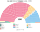

# 近期大選重算

> **這檔是什麼**：近期大選得票**怎麼**套進本夾選制（方法、假設、對照）。席次一覽與圖見 [`估計結果.md`](估計結果.md) §1、[`席次圖.md`](席次圖.md)。

2024、2019、2017 套新制

**方法**：[`生態模型.py`](生態模型.py)。第一偏好是 650 個選區的實際得票（[`資料/`](資料/)）；偏好排序是假設（[`12`](12-預期政治生態.md) §2）。另有「調回誠實偏好」版（`--sincere`）。**只用當時民意**，不用其後民調。

## 1 一覽

| | 實際（FPTP 650） | **新制全院 400** | **首長** | **組閣陣營** |
|---|---|---|---|---|
| 2024-07 | 工黨 411、保守 121、自民 72、SNP 9、Reform 5 … | 工黨 230、保守 82、自民 37、Reform 23、綠黨 11 … | **工黨** | 工黨單獨（230） |
| 2019-12 | 保守 365、工黨 202、SNP 48、自民 11 … | 保守 196、工黨 144、自民 35、SNP 8 … | **保守黨**（對 UUP 200:200，平手規則） | 保守 196＋UUP 4＋DUP 2＝202 |
| 2024 誠實偏好 | — | 工黨 231、保守 78、自民 34、Reform 27、綠黨 13 … | 工黨 | 工黨單獨 |
| 2019 誠實偏好 | — | 保守 162、工黨 157、**自民 56** … | **自民黨** | 自民＋工黨＋綠黨＋聯盟＝218 |
| 2017-06 | 保守 317、工黨 262、SNP 35、自民 12、DUP 10 … | 保守 184、工黨 182、自民 17 … | **自民黨**（對工黨 202:198） | 自民 17＋工黨 182＋UUP 1＋SDLP 3＝203 |
| 2017 誠實偏好 | — | 工黨 192、保守 148、自民 40 … | 工黨 | 工黨＋自民 232 |
| **2019-05 歐洲議會名單票** | （歐洲議會 2019：脫歐黨 29、自民 16、工黨 10、綠黨 7、保守 4 …／英國 73 席） | **Reform 126**、自民 96、工黨 88、保守 37、綠黨 26 … | **工黨** | 工黨 88＋綠黨 26＋自民 96＝210 |

## 2 2024-07
| 政黨 | 得票% | 實際 | 單一 240 | 複數 160 | **新制** |
|---|--:|--:|--:|--:|--:|
| 工黨 | 33.8 | 411 | 175 | 55 | **230** |
| 保守黨 | 23.7 | 121 | 42 | 40 | **82** |
| 自民黨 | 12.2 | 72 | 16 | 21 | **37** |
| Reform | 14.3 | 5 | 0 | 23 | **23** |
| 綠黨 | 6.7 | 4 | 0 | 11 | **11** |
| SDLP | 0.3 | 0 | 4 | 1 | **5** |
| SNP | 2.5 | 9 | 0 | 4 | **4** |
| 聯盟 | 0.4 | 0 | 1 | 1 | **2** |
| DUP | 0.6 | 5 | 1 | 1 | **2** |
| UUP | 0.3 | 0 | 1 | 1 | **2** |
| 威爾斯黨 | 0.7 | 4 | 0 | 1 | **1** |
| 新芬 | 0.7 | 7 | 0 | 1 | **1** |

| 區（單一） | 結果 |
|---|---|
| 東南（36） | 工黨 20、保守 8、自民 8 |
| 倫敦（27） | 工黨 24、保守 2、自民 1 |
| 西北（25） | 工黨 25 |
| 東英格蘭（23） | 保守 12、工黨 11 |
| 西南（23） | 工黨 16、自民 5、保守 2 |
| 西密德蘭（20） | 工黨 13、保守 7 |
| 蘇格蘭（20） | 工黨 18、自民 2 |
| 約克郡（19） | 工黨 16、保守 3 |
| 東密德蘭（18） | 工黨 10、保守 8 |
| 威爾斯（12） | 工黨 12 |
| 東北（10） | 工黨 10 |
| 北愛（7） | SDLP 4、聯盟 1、DUP 1、UUP 1 |

- 決選三人：保守／工黨／Reform 122 區、保守／自民／工黨 51 區、保守／綠黨／工黨 18 區。
- 當選者第一偏好中位數 37%。

## 3 2019-12
| 政黨 | 得票% | 實際 | 單一 240 | 複數 160 | **新制** |
|---|--:|--:|--:|--:|--:|
| 保守黨 | 43.6 | 365 | 125 | 71 | **196** |
| 工黨 | 32.1 | 202 | 91 | 53 | **144** |
| 自民黨 | 11.5 | 11 | 15 | 20 | **35** |
| SNP | 3.9 | 48 | 2 | 6 | **8** |
| SDLP | 0.4 | 2 | 3 | 1 | **4** |
| UUP | 0.3 | 0 | 3 | 1 | **4** |
| DUP | 0.8 | 8 | 1 | 1 | **2** |
| 綠黨 | 2.7 | 1 | 0 | 2 | **2** |
| Reform | 2.0 | 0 | 0 | 2 | **2** |
| 聯盟 | 0.4 | 1 | 0 | 1 | **1** |
| 威爾斯黨 | 0.5 | 4 | 0 | 1 | **1** |
| 新芬 | 0.6 | 7 | 0 | 1 | **1** |

| 區（單一） | 結果 |
|---|---|
| 東南（36） | 保守 30、自民 3、工黨 3 |
| 倫敦（27） | 工黨 19、保守 5、自民 3 |
| 西北（25） | 工黨 16、保守 8、自民 1 |
| 東英格蘭（23） | 保守 19、自民 2、工黨 2 |
| 西南（23） | 保守 17、工黨 4、自民 2 |
| 西密德蘭（20） | 保守 14、工黨 6 |
| 蘇格蘭（20） | **工黨 14、自民 4、SNP 2**（SNP 得 45% 但是聯合派選民一致把它排後） |
| 約克郡（19） | 保守 11、工黨 8 |
| 威爾斯（12） | 工黨 11、保守 1 |

- 保守黨 196，**差 5 席過半**；首長投票保守黨對 UUP 200:200，平手規則（排第一者多）讓保守黨就任。
- 現實是保守黨 80 席多數、脫歐協議一個月內通過。新制下要拉北愛聯合派，**而北愛聯合派正是反對那份協議（北愛海關邊界）的一方**。

## 4 2017-06

| 政黨 | 單一 240 | 複數 160 | **新制** |
|---|--:|--:|--:|
| 保守 | 112 | 72 | **184** |
| 工黨 | 115 | 67 | **182** |
| 自民 | 6 | 11 | **17** |
| SNP | 0 | 5 | **5** |
| DUP | 3 | 2 | **5** |
| SDLP | 2 | 1 | **3** |
| SF | 1 | 1 | **2** |
| UUP | 1 | 0 | **1** |
| PC | 0 | 1 | **1** |

- **兩大黨幾乎打平**：工黨單一 115、保守 112。2017 年兩黨合計 82%，240 區裡有 169 區的當選者第一偏好就過半；自民黨雖在 165 區進了前三名，多數區兩大黨之一已過半，**中位黨幾乎放大不了**（自民單一只有 6）。
- **SNP 單一 0**：蘇格蘭 20 區工黨 19、自民 1——SNP 在蘇格蘭的三人決選裡，聯合派選民（保守、自民）一致把工黨排在 SNP 前。SNP 的 5 席全在名單層。
- **首長是自民黨**（全院 17 席）：保守 184、工黨 182 都不過 201，兩大黨議員都把自民黨排第二；自民對工黨 202:198、對保守 210:190。組閣陣營自民＋工黨＋UUP＋SDLP 203。現實中梅伊靠 DUP 10 席的信任與供給協議執政。
- 誠實偏好版（前 2 名讓出 10%）：工黨 192、保守 148、自民 40，首長工黨。

## 4a 2019-05 歐洲議會名單票（政黨票當第一偏好）

英國國會選舉只有單一選區票，裡面有大量策略投票（小黨支持者轉投兩大黨）。**英國唯一的全國比例代表政黨票是歐洲議會選舉**：2019-05 大不列顛 11 區、封閉名單、頓特法。把它當第一偏好，是「如果選民投的是政黨票」的對照版。

- 資料：維基「Results of the 2019 European Parliament election in the United Kingdom by Westminster constituency」把計票區得票估計到 632 個國會選區（2010–19 年界線，和 2019 國會選舉同一套）；北愛爾蘭（表中沒有）沿用 2019 國會選舉得票。[`_build_ep2019.py`](_build_ep2019.py) → [`資料/ep-2019.csv`](資料/ep-2019.csv)。英國選舉委員會網站對自動存取回 403，未繞過。
- 政黨對應：脫歐黨→Reform（同一黨，2021 年改名）；Change UK、UKIP、其他→其他。
- **限制**：歐洲議會選舉不是國會選舉。投票率只有約 37%，議題幾乎只有脫歐，兩大黨都大幅流失；它代表「政黨票」，但不代表國會選舉的選民結構。

| 政黨 | 歐洲議會得票% | 單一 240 | 複數 160 | **新制** |
|---|--:|--:|--:|--:|
| Reform（脫歐黨） | 30.0 | 72 | 54 | **126** |
| 自民 | 19.4 | 63 | 33 | **96** |
| 工黨 | 13.6 | 65 | 23 | **88** |
| 保守 | 8.8 | 20 | 17 | **37** |
| 綠黨 | 11.3 | 7 | 19 | **26** |
| SNP | 3.4 | 6 | 5 | **11** |
| SDLP | 0.7 | 3 | 1 | **4** |
| UUP | 0.5 | 3 | 1 | **4** |
| DUP | 1.4 | 1 | 2 | **3** |
| 威爾斯黨 | 0.9 | 0 | 2 | **2** |
| 新芬 | 1.1 | 0 | 2 | **2** |
| 聯盟 | 0.8 | 0 | 1 | **1** |

（得票% 為全英，含北愛的國會選舉得票；歐洲議會大不列顛官方：脫歐黨 31.6%、自民 20.3%、工黨 14.1%、綠黨 12.1%、保守 9.1%。）

- **Reform 最大但當不了首長**：30% 第一偏好拿單一 72、全院 126，但在議員之間的排名投票輸給工黨（對 Reform 230:170）。
- **自民黨被放大最多**：19% 拿單一 63——它在幾乎每區都進前三名（「自民／工黨／Reform」82 區、「綠黨／自民／Reform」77 區），三人對決裡常是中位。
- **首長工黨**，組閣工黨＋綠黨＋自民＝210（過半 201）。和 2019-12 國會選舉的「保守黨首長」完全不同：第一偏好換成政黨票，結果整個翻轉，說明英國的重算**對第一偏好用哪一種票非常敏感**。

## 5 敏感度

見 [`12`](12-預期政治生態.md) §6。

## 6 限制

- 2024 年缺 Chorley（議長選區）與 North Norfolk（表格解析失敗）。
- 「其他」（無黨籍、小黨）不參與排序。
- 威爾斯黨在名單區與西密德蘭合併，名單席次少。
- 誠實偏好是粗略調整。

## 來源

- 逐選區得票：Wikipedia「Results of the 2024／2019 United Kingdom general election」（引選舉委員會、北愛選舉辦公室），2026-10-28 擷取。
- 選區中心座標：ONS Open Geography Portal（Westminster Parliamentary Constituencies July 2024、Dec 2021 Boundaries）。
- 實際席次：同上條目。
