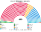
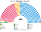
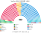

# 估計結果

> **這檔是什麼**：民意套本夾選制的席次**表**（如組閣聯盟／多數派政府）——§1 近期大選、§2 民調（若有）、§3 長期。圖庫見 [`席次圖.md`](席次圖.md)；大選算法細節見本夾重算檔。朝野互動見「預期政治生態」。

選制摘要：全院 **400＝單一 240（top-3 孔多賽）＋複數 160（彈性名單、15 區聖拉古、無法定門檻）**。詳 [`01`](01-國會與選制.md)。

## 1 近期大選

用當時實際得票套本夾。細節與方法見 [`14-近期大選重算.md`](14-近期大選重算.md)（[`生態模型.py`](生態模型.py)）。

| | 實際（FPTP 650） | **本夾全院 400** | 首長 |
|---|---|---|---|
| 2024-07 | 工黨 411、保守 121、自民 72、SNP 9、Reform 5 … | 工黨 **230**、保守 82、自民 37、Reform 23、綠黨 11 … | **工黨**（單獨 230） |
| 2019-12 | 保守 365、工黨 202、SNP 48、自民 11 … | 保守 **196**、工黨 144、自民 35、SNP 8 … | **保守黨**（對 UUP 200:200，平手規則） |

### 2024-07 單一／複數

| 政黨 | 單一 240 | 複數 160 | **全院** |
|---|--:|--:|--:|
| 工黨 | 175 | 55 | **230** |
| 保守黨 | 42 | 40 | **82** |
| 自民黨 | 16 | 21 | **37** |
| Reform | 0 | 23 | **23** |
| 綠黨 | 0 | 11 | **11** |
| SDLP | 4 | 1 | **5** |
| SNP | 0 | 4 | **4** |
| 聯盟 | 1 | 1 | **2** |
| DUP | 1 | 1 | **2** |
| UUP | 1 | 1 | **2** |
| 威爾斯黨 | 0 | 1 | **1** |
| 新芬 | 0 | 1 | **1** |

**組閣聯盟／多數派政府**：首長 **工黨**；工黨全院單獨過半；改選制／修憲要複數 ≥96（工黨複數不足則須拉自民等）。

### 2019-12 單一／複數

| 政黨 | 單一 240 | 複數 160 | **全院** |
|---|--:|--:|--:|
| 保守黨 | 125 | 71 | **196** |
| 工黨 | 91 | 53 | **144** |
| 自民黨 | 15 | 20 | **35** |
| SNP | 2 | 6 | **8** |
| SDLP | 3 | 1 | **4** |
| UUP | 3 | 1 | **4** |
| DUP | 1 | 1 | **2** |
| 綠黨 | 0 | 2 | **2** |
| Reform | 0 | 2 | **2** |
| 聯盟 | 0 | 1 | **1** |
| 威爾斯黨 | 0 | 1 | **1** |
| 新芬 | 0 | 1 | **1** |

**組閣聯盟／多數派政府**：首長 **保守黨**（平手規則）；保守 196 差 5 過半（≥201），組閣需北愛聯合派；誠實偏好版首長可翻自民（見重算）。

2024 年工黨全院 230、複數 55——單獨過半，改選制／修憲（複數 96）要拉自民或保守。2019 年保守黨 196，差 5 席過半；組閣需北愛聯合派。誠實偏好版見 [`14`](14-近期大選重算.md)（2019 首長可翻為自民黨）。

## 2 民調

公開全國投票意向（維基「Opinion polling for the next United Kingdom general election」）。大不列顛（GB）民調；北愛政黨未分列時保留 2024 地理得票。方法：以 **2024-07 逐選區** 為地理基底，按民調得票率縮放後跑本夾——**單一 240** top-3 孔多賽、**複數 160** 聖拉古（不是全國比例拆單一）。RB＝Restore Britain（地理以 Reform 為種）。

### YouGov／The Times·Sky News（2026-10-25..26，n＝2271，GB）

首長 **工黨**。

| 政黨 | 得票推估% | 單一 240 | 複數 160 | 本夾全院 |
|---|--:|--:|--:|--:|
| 工黨 | 27% | 101 | 42 | **143** |
| 保守黨 | 22% | 118 | 36 | **154** |
| Reform | 20% | 1 | 32 | **33** |
| 自民黨 | 11% | 11 | 20 | **31** |
| 綠黨 | 10% | 2 | 17 | **19** |
| SNP | 2% | 0 | 3 | **3** |
| 威爾斯黨 | 1% | 0 | 1 | **1** |
| Restore Britain | 4% | 0 | 4 | **4** |
| 其他 | 2% | 0 | 0 | **0** |
| SDLP | — | 4 | 1 | **5** |
| DUP | — | 1 | 1 | **2** |
| Alliance | — | 1 | 1 | **2** |
| UUP | — | 1 | 1 | **2** |
| SF | — | 0 | 1 | **1** |

### BMG／The i Paper（2026-10-28..29，n＝1529，GB）

首長 **保守黨**。

| 政黨 | 得票推估% | 單一 240 | 複數 160 | 本夾全院 |
|---|--:|--:|--:|--:|
| 工黨 | 31% | 97 | 52 | **149** |
| 保守黨 | 21% | 130 | 34 | **164** |
| Reform | 22% | 0 | 33 | **33** |
| 自民黨 | 8% | 4 | 10 | **14** |
| 綠黨 | 8% | 1 | 14 | **15** |
| SNP | 2% | 0 | 3 | **3** |
| 威爾斯黨 | 1% | 0 | 1 | **1** |
| Restore Britain | 5% | 1 | 9 | **10** |
| 其他 | 2% | 0 | 0 | **0** |
| SDLP | — | 4 | 0 | **4** |
| DUP | — | 1 | 1 | **2** |
| Alliance | — | 1 | 1 | **2** |
| UUP | — | 1 | 1 | **2** |
| SF | — | 0 | 1 | **1** |

## 3 長期運行假設下

生態模型示意 **推估第 3 屆**（＝2024 得票套本夾；假設見 [`12-預期政治生態.md`](12-預期政治生態.md)；數字由 [`生態模型.py`](生態模型.py) 算出）。

| 政黨 | 單一 240 | 複數 160 | 全院 400 |
|---|--:|--:|--:|
| 工黨 | 175 | 55 | **230** |
| 保守黨 | 42 | 40 | **82** |
| 自民黨 | 16 | 21 | **37** |
| Reform | 0 | 23 | **23** |
| 綠黨 | 0 | 11 | **11** |
| SDLP | 4 | 1 | **5** |
| SNP | 0 | 4 | **4** |
| 北愛其他（聯盟、DUP、UUP、新芬等） | 3 | 4 | **7** |
| 威爾斯黨 | 0 | 1 | **1** |
| **計** | **240** | **160** | **400** |

首長：工黨。Reform、綠黨席次幾乎全在複數層；SNP 單一 0（聯合派選民一致排後）。
朝野互動與候選人行為見 [`12-預期政治生態.md`](12-預期政治生態.md)。
