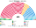
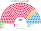
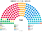
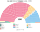
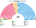

# 席次圖

> **這檔是什麼**：仿維基席次**圖庫**（長期示意；有則附大選重算／現行圖）。席次**數字表**與民調見 [`估計結果.md`](估計結果.md)；大選算法細節見本夾 `*大選重算*`／`*近期大選*` 檔。朝野互動見「預期政治生態」。

數字來自 [`生態模型.py`](生態模型.py)；產生器：席次圖產生器。座位依**經濟軸**由左到右排列，北愛政黨依聯合軸排在兩端附近。

## 2024-07 得票套新制（＝推估第 3 屆）

### 全院 400

### 單一席次 240

### 複數席次 160

| 政黨 | 單一 240 | 複數 160 | **全院** |
|---|--:|--:|--:|
| 工黨 | 175 | 55 | **230** |
| 保守黨 | 42 | 40 | **82** |
| 自民黨 | 16 | 21 | **37** |
| Reform | 0 | 23 | **23** |
| 綠黨 | 0 | 11 | **11** |
| SDLP | 4 | 1 | **5** |
| SNP | 0 | 4 | **4** |
| 聯盟 | 1 | 1 | **2** |
| DUP | 1 | 1 | **2** |
| UUP | 1 | 1 | **2** |
| 威爾斯黨 | 0 | 1 | **1** |
| 新芬 | 0 | 1 | **1** |

3/5 **96**。

## 現行制度 2024-07 實際結果

## 2019-12 得票套新制

| 政黨 | 單一 240 | 複數 160 | **全院** |
|---|--:|--:|--:|
| 保守黨 | 125 | 71 | **196** |
| 工黨 | 91 | 53 | **144** |
| 自民黨 | 15 | 20 | **35** |
| SNP | 2 | 6 | **8** |
| SDLP | 3 | 1 | **4** |
| UUP | 3 | 1 | **4** |
| DUP | 1 | 1 | **2** |
| 綠黨 | 0 | 2 | **2** |
| Reform | 0 | 2 | **2** |
| 聯盟 | 0 | 1 | **1** |
| 威爾斯黨 | 0 | 1 | **1** |
| 新芬 | 0 | 1 | **1** |

3/5 **96**。
