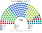

# 預期政治生態

> **席次估計**（近期大選重算、民調套本夾、長期運行假設下的席次表）見 [`估計結果.md`](估計結果.md)。本檔專注誘因、朝野互動與候選人行為；席次數字以估計結果與席次圖為準。

`0-基本/總體.md`：長期預期政治生態，要有論據，可大膽假設。
`0-基本/要求.md` **硬性**：不得把提示詞要求直接當預期生態；不合期望就回頭改設計。

路徑：**誘因 → 得票 → 選制 → 席次 → 朝野互動 → 檢視**。席次由 [`生態模型.py`](生態模型.py) 算出。

## 1 誘因

| 層 | 誘因 | 預期行為 |
|---|---|---|
| 單一席次（top-3 孔多賽） | 第三名支持者的第二偏好決定勝負 | 中間偏右的 VVD、CDA 與中間偏左的 D66 互相爭取第二偏好；**PVV、GL-PvdA 這類兩端政黨要拿到中間選民的第二偏好** |
| 複數席次（M 9–14） | 有效門檻 6.7–10% | 小黨合併或結盟（GL-PvdA 已是先例）；全國 1–3% 的黨只剩集中區域的機會 |
| 組閣 30 日 | 不需聯盟協議就能就任 | 協議變短、變成政策清單 |
| 建設性更新、無解散 | 退出聯盟不會倒閣 | 「拆政府逼選舉」這張牌消失 |

## 2 假設

### 2.1 偏好空間

二維：**經濟**（左 −1 … 右 +1）、**文化**（開放、親歐 −1 … 保守、限移民 +1）。

| 政黨 | 經濟 | 文化 | 政黨 | 經濟 | 文化 |
|---|:--:|:--:|---|:--:|:--:|
| GL-PvdA | −0.8 | −0.7 | NSC | 0.0 | 0.3 |
| SP | −0.9 | 0.1 | CDA | 0.2 | 0.2 |
| PvdD | −0.6 | −0.6 | VVD | 0.7 | 0.1 |
| DENK | −0.6 | −0.3 | BBB | 0.3 | 0.6 |
| Volt | −0.2 | −0.9 | SGP | 0.4 | 0.8 |
| D66 | 0.0 | −0.7 | JA21 | 0.7 | 0.7 |
| CU | −0.1 | 0.3 | PVV | −0.1 | 1.0 |
| 50PLUS | −0.3 | 0.3 | FvD | 0.5 | 1.0 |

選民三型：重經濟 30%、重文化 40%、均衡 30%。

### 2.2 地理

Kiesraad **逐投票所**結果彙整成「市鎮 × 4 位數郵遞區」約 3,200 個單位；省內依郵遞區號切選區（荷蘭的郵遞區號在地理上連續編排）。

### 2.3 屆次

**推估第 3 屆＝2025 的地理與得票**：2023 年的 NSC 浪潮已在 2025 年消退，2025 的版圖是較常態的荷蘭（四個中型黨各 12–17%）。不另外假設新黨。

## 3 席次（推估：2025 得票）

| 政黨 | 單一 90 | 複數 60 | **全院 150** | 現行 2025 |
|---|--:|--:|--:|--:|
| VVD | 40 | 9 | **49** | 22 |
| D66 | 23 | 11 | **34** | 26 |
| CDA | 25 | 8 | **33** | 18 |
| PVV | 1 | 10 | **11** | 26 |
| GL-PvdA | 0 | 9 | **9** | 20 |
| JA21 | 0 | 5 | **5** | 9 |
| FvD | 0 | 4 | **4** | 7 |
| DENK | 1 | 1 | **2** | 3 |
| SGP | 0 | 2 | **2** | 3 |
| BBB | 0 | 1 | **1** | 4 |

門檻：過半 76、3/5 90、2/3 100；複數 3/5 36、2/3 40。

- **單一席次三分天下**：VVD 40、CDA 25、D66 23。最常見的決選三人是 D66／PVV／VVD（40 區）。
- **PVV 單一只有 1 席**（海爾倫）：它的第一偏好在很多區領先或第二，但在三人對決裡幾乎不是任何人的第二偏好。
- **當選者第一偏好中位數 16%**；沒有一區過半。
- **首長：CDA**，對每個對手至少 96:54（對 VVD）。
- **組閣陣營**：CDA＋VVD 82 席，**兩黨即過半**。

## 4 朝野互動與候選人行為

| 面向 | 預期 |
|---|---|
| 組閣 | 30 日內、兩黨（CDA＋VVD）即過半；不再有 3–4 黨的長協議 |
| 立法 | 中間偏右多數；D66 是另一個可替換的夥伴（CDA＋D66 67，不夠；CDA＋D66＋GL-PvdA 76） |
| 規則 | CDA＋VVD 複數 17（要 36）：**改規則要拉 D66、PVV 或 GL-PvdA** |
| 兩端政黨 | PVV、GL-PvdA 的代表幾乎全在名單層；要回到單一席次，得讓中間選民至少不討厭它 |
| 候選人 | 單一席次的 VVD、CDA、D66 候選人互搶第二偏好；移民議題的極端言論被懲罰 |

## 5 檢視：哪裡不合

本夾對自己的期望：**組閣快、不倒閣、碎裂下降、改規則要跨陣營。**四項都對得上。不合的是代價：

### 5.1 不合一：兩端政黨在國會大幅縮小

| | 現行 2025 | 新制 |
|---|--:|--:|
| PVV | 26 | 11 |
| GL-PvdA | 20 | 9 |
| VVD＋CDA＋D66 | 66 | **116** |

荷蘭選民有約三成投給 PVV、GL-PvdA；新制下兩黨合計 20 席（13%）。**這是 top-3 孔多賽在荷蘭的直接結果**：兩端政黨幾乎不是任何人的第二偏好。

**檢視後的判斷**：不改選制（那是 `1-優化/行政立法/共用.md` 要的向心），但補兩件事：

| 原本 | 改成 | 檔 |
|---|---|---|
| 公投只有國會發動 | **人民 2% 連署的矯正型公投**：兩端政黨的選民能把國會剛通過的法律交付投票 | [`06`](06-人民修改法規範.md) |
| 改規則只看全院 | **複數席次 3/5（36）**：中間三黨（VVD、D66、CDA）在名單層只有 28／60，改規則至少要拉 8 席的 PVV、GL-PvdA 或小黨 | [`05`](05-憲法與修憲.md) |

### 5.2 不合二：首長是第三大黨

CDA 全院 33 席，比 VVD（49）、D66（34）少，卻是孔多賽贏家：VVD 的議員把 CDA 排在 D66 前，D66 的議員把 CDA 排在 VVD 前。**這是本夾的意圖**（首長是中位能接受的人）；代價是首長的黨不是最大黨，立法要靠 VVD。

## 6 敏感度

| 情境 | 單一 90 | 首長 |
|---|---|---|
| 2025（基準） | VVD 40、CDA 25、D66 23 | CDA |
| 選民全部重經濟 | **D66 62**、CDA 25 | **D66** |
| 選民全部重文化 | VVD 46、CDA 25、D66 18 | CDA |
| 切點平移半區 | VVD 33、D66 30、CDA 26 | CDA |
| PVV −6 點 | CDA 44、D66 23、VVD 20 | CDA |
| PVV +6 點 | VVD 38、CDA 24、D66 22、PVV 6 | CDA |
| 兩輪多數決（前 2 名對決） | D66 42、VVD 28、CDA 14、PVV 4 | CDA |

★ 首長在幾乎每一個情境都是 CDA；只有在「選民只看經濟軸」時變成 D66。單一席次的分配對選民類型很敏感（VVD 40 ↔ D66 62），**哪個中間黨拿最多單一席次是假設決定的，但「三個中間黨拿走幾乎全部」不是**。
