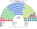
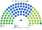
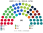
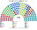
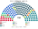

# 席次圖

> **這檔是什麼**：仿維基席次**圖庫**（長期示意；有則附大選重算／現行圖）。席次**數字表**與民調見 [`估計結果.md`](估計結果.md)；大選算法細節見本夾 `*大選重算*`／`*近期大選*` 檔。朝野互動見「預期政治生態」。

數字來自 [`生態模型.py`](生態模型.py)；產生器：席次圖產生器。座位依**文化軸**由左（開放、親歐）到右（保守、限移民）排列。

## 2025-10 得票套新制（＝推估第 3 屆）

### 全院 150

### 單一席次 90

### 複數席次 60

| 政黨 | 單一 90 | 複數 60 | **全院** |
|---|--:|--:|--:|
| VVD | 40 | 9 | **49** |
| D66 | 23 | 11 | **34** |
| CDA | 25 | 8 | **33** |
| PVV | 1 | 10 | **11** |
| GL-PvdA | 0 | 9 | **9** |
| JA21 | 0 | 5 | **5** |
| FvD | 0 | 4 | **4** |
| DENK | 1 | 1 | **2** |
| SGP | 0 | 2 | **2** |
| BBB | 0 | 1 | **1** |

首長 CDA；組閣陣營 CDA＋VVD 82。複數 3/5 **36**——中間三黨 28。

## 現行制度 2025-10 實際結果

## 2023-11 得票套新制

| 政黨 | 單一 90 | 複數 60 | **全院** |
|---|--:|--:|--:|
| NSC | 46 | 9 | **55** |
| VVD | 23 | 9 | **32** |
| PVV | 13 | 16 | **29** |
| GL-PvdA | 3 | 12 | **15** |
| D66 | 2 | 5 | **7** |
| BBB | 0 | 3 | **3** |
| DENK | 2 | 1 | **3** |
| SGP | 1 | 2 | **3** |
| CDA | 0 | 2 | **2** |
| SP | 0 | 1 | **1** |

## 顏色

GL-PvdA 紅、SP 深紅、PvdD 綠、DENK 青綠、Volt 紫、D66 淺綠、CU 天藍、50PLUS 紫紅、NSC 深藍綠、CDA 綠黃、VVD 藍、BBB 黃綠、SGP 橙、JA21 深藍、PVV 深青、FvD 暗紅。
