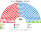

# 預期政治生態

> **席次估計**（近期大選重算、民調套本夾、長期運行假設下的席次表）見 [`估計結果.md`](估計結果.md)。本檔專注誘因、朝野互動與候選人行為；席次數字以估計結果與席次圖為準。

`0-基本/總體.md`：長期預期生態，要有論據，可大膽假設。`0-基本/要求.md` **硬性**：不得把提示詞當預期生態。席次由 [`生態模型.py`](生態模型.py) 算出。

## 1 誘因

| 層 | 誘因 | 預期行為 |
|---|---|---|
| top-3 孔多賽 | 第三名支持者的第二偏好決定勝負 | PP 對 PSOE 的對決由 VOX 與 SUMAR 的選民決定；**兩大黨之外沒有中位黨能贏單一席次** |
| 地方民族主義選區 | 決選三人常是「PSOE＋兩個地方黨」 | 地方黨的選民把 PSOE 排在對手地方黨前 → **PSOE 拿下巴斯克、加泰隆尼亞多數單一席次** |
| 複數 140、無法定門檻 | 第三黨與地方黨的代表在名單層 | VOX、SUMAR 各 18 席左右，全在名單層 |
| 全院選首長、30 日預設值 | 不再有自動重選 | 「拖到重選」不再是談判籌碼 |

## 2 假設

**第一偏好**：眾議院選舉的政黨票（逐市鎮）。

**偏好空間**：三軸。

| 政黨 | 經濟 | 領土 | 社會 |
|---|:--:|:--:|:--:|
| PSOE | −0.4 | 0.0 | −0.5 |
| PP | 0.5 | 0.6 | 0.4 |
| VOX | 0.6 | 1.0 | 1.0 |
| SUMAR（2019：Podemos 系＋Más País） | −0.8 | −0.3 | −0.9 |
| Cs（2019） | 0.4 | 0.7 | −0.2 |
| ERC | −0.5 | −1.0 | −0.6 |
| JUNTS | 0.3 | −1.0 | 0.0 |
| PNV | 0.2 | −0.8 | 0.0 |
| EH Bildu | −0.8 | −1.0 | −0.7 |
| BNG | −0.7 | −0.9 | −0.6 |
| CC（加那利聯盟） | 0.2 | −0.5 | 0.0 |
| UPN | 0.5 | 0.8 | 0.5 |
| CUP | −1.0 | −1.0 | −1.0 |
| 地方（PRC、Teruel Existe 等） | 0.0 | −0.3 | 0.1 |

**領土軸**是西班牙的第二條分界：地方民族主義政黨的選民不論經濟立場，都把 PSOE 排在 PP 前（JUNTS、PNV 是中間偏右，仍如此）。這和 2023 年 PNV、JUNTS 投票支持桑切斯授權一致。

## 3 席次（2023 得票，推估第 3 屆）

| 政黨 | 單一 210 | 複數 140 | **全院 350** | 現行 2023 |
|---|--:|--:|--:|--:|
| PP | 122 | 46 | **168** | 137 |
| PSOE | 87 | 47 | **134** | 121 |
| SUMAR | 0 | 18 | **18** | 31 |
| VOX | 0 | 18 | **18** | 33 |
| ERC | 1 | 3 | **4** | 7 |
| BILDU | 0 | 2 | **2** | 6 |
| JUNTS | 0 | 2 | **2** | 7 |
| PNV | 0 | 2 | **2** | 5 |
| BNG | 0 | 1 | **1** | 1 |
| CC | 0 | 1 | **1** | 1 |

門檻：過半 176、3/5 210、2/3 234；複數 3/5 84。

- **PP 單一 122**：馬德里 24／29、卡斯提亞-萊昂＋坎塔布里亞＋埃斯特雷馬杜拉 19／19、卡斯提亞-拉曼查＋亞拉岡 15／15、安達魯西亞 29／38、瓦倫西亞＋穆爾西亞 21／28。
- **PSOE 單一 87**：加泰隆尼亞＋巴利亞利 34／38、巴斯克＋納瓦拉＋拉里奧哈 13／15、加那利 10／10、加利西亞＋阿斯圖里亞斯 9／18。在加泰隆尼亞與巴斯克，決選三人是「PSOE＋兩個地方黨」，兩邊的地方黨選民都把 PSOE 排第二。
- **VOX、SUMAR 單一 0**：它們進得了前三名，但不是任何人的第二偏好之上。
- **首長：PP**（對 PSOE 186:164）。**組閣陣營：PP＋VOX 186**。

## 4 朝野互動

| 面向 | 預期 |
|---|---|
| 政府 | PP 首長、VOX 是唯一夠用的夥伴（VOX 18 席，比現行的 33 席弱得多） |
| 規則 | PP＋VOX 複數 64（要 84）：**改選制、改自治條例、改財政分配不行** |
| 地方黨 | 全院合計 11 席（現行 26）：**授權投票的關鍵少數地位大幅縮小** |
| 加泰隆尼亞與巴斯克 | 單一席次多數是 PSOE；地方黨的代表移到名單層 |

## 5 檢視：哪裡不合

### 5.1 不合一：地方民族主義政黨大幅縮小

現行 26 席（ERC、JUNTS、Bildu、PNV、BNG、CC、UPN），本夾 11 席。原因：現行的省級頓特法讓地方黨在自己的省裡是大黨；本夾的單一席次被 PSOE 以「第二偏好」拿走，名單層又以 13 區分配（加泰隆尼亞與巴利亞利合併、巴斯克與納瓦拉、拉里奧哈合併）。

**判斷**：保留，但寫清楚代價。`1-優化/總體.md`「適合該國的治理」的一面是**不讓少數地方黨在授權投票時以財政分配交換**（病 8），另一面是地方黨在國會的聲音變小。本夾把後者的補償放在三處：(1) 財政分配公式要兩種 3/5，地方黨不在政府也能擋；(2) 自治區議會不變；(3) 領土地位有程序（[`08`](08-自治區與領土.md)）。

### 5.2 不合二：第三黨沒有單一席次

VOX 12.5%、SUMAR 12.4%，單一 0 席。和英國 Reform、SNP 同型：**不是任何人的第二偏好**的黨，在 top-3 下贏不了單一席次。它們的代表全在名單層（各 18）。

**判斷**：保留。這是 top-3 孔多賽的設計目的：擋掉只有基本盤、沒有跨陣營吸引力的候選人。

## 6 敏感度

| 情境 | 2023 單一 | 2023 首長 | 2019 首長 |
|---|---|---|---|
| 基準 | PP 122、PSOE 87、ERC 1 | **PP**（＋VOX 186） | **PSOE** |
| 選民全部重經濟 | PP 127、PSOE 77、CC 5、ERC 1 | PP（＋VOX 191） | PSOE |
| 選民全部重領土 | PP 122、PSOE 83、PNV 4、ERC 1 | PP | PSOE |
| 選民全部重社會 | PP 122、PSOE 82、CC 5、ERC 1 | PP | PSOE |
| 切點平移半區 | PP 123、PSOE 87 | PP | PSOE |
| PP −3 點 | **PSOE 115**、PP 94 | **PSOE**（＋SUMAR 181） | — |
| PSOE +3 點 | **PSOE 117**、PP 93 | **PSOE**（＋SUMAR 185） | — |
| PP +3 點 | PP 140、PSOE 70 | PP 單獨 192 | — |
| 兩輪多數決（前 2 名對決） | PP 122、PSOE 85、BILDU 3 | PP | PSOE |

★ 偏好假設的變化不改變首長；**得票擺動 3 點就改變**。2023 年 PP 領先 PSOE 1.4 點，在本夾下就是 PP 執政；這比現行制度更接近「誰的票多誰組閣」——現行制度下 PP 是第一大黨卻組不成政府。

★ 兩輪多數決那一行和基準幾乎一樣：西班牙的單一席次本來就是兩大黨對決，top-3 的作用主要在加泰隆尼亞與巴斯克（決選三人有兩個地方黨時）。
