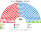
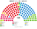
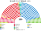
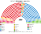

# 席次圖

> **這檔是什麼**：仿維基席次**圖庫**（長期示意；有則附大選重算／現行圖）。席次**數字表**與民調見 [`估計結果.md`](估計結果.md)；大選算法細節見本夾 `*大選重算*`／`*近期大選*` 檔。朝野互動見「預期政治生態」。

數字來自 [`生態模型.py`](生態模型.py)；產生器：席次圖產生器。座位依**經濟軸**由左到右排列。

## 2023-07 得票套新制（＝推估第 3 屆）

### 全院 350

### 單一席次 210

### 複數席次 140

| 政黨 | 單一 210 | 複數 140 | **全院** |
|---|--:|--:|--:|
| PP | 122 | 46 | **168** |
| PSOE | 87 | 47 | **134** |
| SUMAR | 0 | 18 | **18** |
| VOX | 0 | 18 | **18** |
| ERC | 1 | 3 | **4** |
| BILDU | 0 | 2 | **2** |
| JUNTS | 0 | 2 | **2** |
| PNV | 0 | 2 | **2** |
| BNG | 0 | 1 | **1** |
| CC | 0 | 1 | **1** |

首長 PP；組閣 PP＋VOX 186。

3/5 **84**。

## 現行制度 2023-07 實際結果

| 政黨 | 單一 210 | 複數 140 | **全院** |
|---|--:|--:|--:|
| PP | 122 | 46 | **168** |
| PSOE | 87 | 47 | **134** |
| SUMAR | 0 | 18 | **18** |
| VOX | 0 | 18 | **18** |
| ERC | 1 | 3 | **4** |
| BILDU | 0 | 2 | **2** |
| JUNTS | 0 | 2 | **2** |
| PNV | 0 | 2 | **2** |
| BNG | 0 | 1 | **1** |
| CC | 0 | 1 | **1** |

## 2019-11 得票套新制

| 政黨 | 單一 210 | 複數 140 | **全院** |
|---|--:|--:|--:|
| PSOE | 101 | 39 | **140** |
| PP | 97 | 30 | **127** |
| SUMAR | 0 | 22 | **22** |
| VOX | 0 | 22 | **22** |
| ERC | 9 | 5 | **14** |
| Cs | 0 | 11 | **11** |
| PNV | 1 | 2 | **3** |
| BILDU | 0 | 2 | **2** |
| CUP | 0 | 2 | **2** |
| JUNTS | 0 | 2 | **2** |
| 地方 | 2 | 0 | **2** |
| BNG | 0 | 1 | **1** |
| CC | 0 | 1 | **1** |
| UPN | 0 | 1 | **1** |

3/5 **84**。
