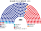
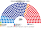
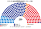

# 近期大選重算

> **這檔是什麼**：近期大選得票**怎麼**套進本夾選制（方法、假設、對照）。席次一覽與圖見 [`估計結果.md`](估計結果.md) §1、[`席次圖.md`](席次圖.md)。

用**當時實際的得票**，把 2024 年國會、2025 年與 2022 年總統選舉套進本夾的制度。數字由 [`近期大選推估.py`](近期大選推估.py) 算出。

與 [`15`](15-預期政治生態.md) 不同：15 的第一偏好是長期假設，這裡是開票紀錄；**第二偏好沿用 15 §2.3 的轉移結構**（進步側政黨選民互轉 82%–88%、改革新黨選民 60% 把國民力量排在民主黨前、國民力量選民 90% 把改革新黨排在民主黨前、民主黨選民 55% 把改革新黨排在國民力量前）。

## 1 國會 2024-04

### 1.1 實際（現行 300＝區域 254＋比例 46）

| 政黨 | 區域得票 | 比例得票 | 席次 |
|---|--:|--:|--:|
| 民主黨（比例為更民主聯合） | 50.5% | 26.7% | 169（另盟友 進步黨 3、新進步聯合 2、無黨籍 2） |
| 國民力量（比例為國民未來） | 45.1% | 36.7% | 108 |
| 祖國革新黨 | —（未推人） | 24.3% | 12 |
| 改革新黨 | 0.7% | 3.6% | 3 |
| 新未來 | 0.7% | 1.7% | 1 |

### 1.2 本夾（250＝單一 150＋複數 100）

| 政黨 | 單一 150 | 複數 100 | **全院 250** |
|---|--:|--:|--:|
| **民主黨** | 92 | 28 | **120** |
| 國民力量 | 49 | 38 | **87** |
| 祖國革新黨 | 8 | 25 | **33** |
| 改革新黨 | 1 | 8 | **9** |
| 綠色正義黨 | 0 | 1 | **1** |

**單一 150 的做法（政黨誠實第一偏好還原）。**
1. **為什麼不能直接套 254 區候選人票**：2024 年現行區域選制為單一選區相對多數（FPTP），比例代表拿下 **24.25%（687 萬票）** 的第三大黨「祖國革新黨」為了不分走民主黨選票，在 254 個區域選區**推了 0 人**；第四大黨「改革新黨」在 83% 選區未推人。在本夾 **top-3 孔多賽**下，同陣營兩黨同時參選不會因分票保送對手，各黨必然獨立推人。
2. **逐邑面洞拆回實際政黨**：取中央選管委 2,847 個邑面洞開票結果，**保留每一邑面洞在地的「進步側 vs 保守側」得票比例**，陣營內部再依該市道比例代表名單得票比拆回實際政黨（進步側拆為 `民主黨`、`祖國革新黨`、`綠色正義黨`、`新未來`；保守側拆為 `國民力量`、`改革新黨`、`自由統一黨`；若該邑面洞已有改革新黨或新未來實際區域候選人高票如華城乙、世宗甲，取其實際票與名單估算之較高者；都市「洞」給予祖國革新黨與改革新黨 1.2 倍城鄉修正，最後正規化鎖回市道總比率）。
3. **等人口切 150 區**：各市道依選舉人數分到新區數（最大餘數），市道內依現行選區與官方邑面洞順序按選舉人數切成等大新區，跨界邑面洞按比例拆分，跑第一輪取前 3 名、第二輪孔多賽對決。

| 市道 | 民主黨 | 國民力量 | 祖國革新黨 | 市道 | 民主黨 | 國民力量 | 祖國革新黨 |
|---|--:|--:|--:|---|--:|--:|--:|
| 首爾（28） | 23 | 5 | 0 | 江原（5） | 1 | 4 | 0 |
| 京畿（39） | 37 | 2 | 0 | 忠北（5） | 4 | 1 | 0 |
| 仁川（9） | 8 | 1 | 0 | 忠南（6） | 5 | 1 | 0 |
| 大田（4） | 4 | 0 | 0 | 世宗（1） | 1 | 0 | 0 |
| 光州（4） | 0 | 0 | **4** | 全北（5） | 3 | 0 | **2** |
| 全南（5） | 3 | 0 | **2** | 濟州（2） | 2 | 0 | 0 |
| 釜山（10） | 0 | 10 | 0 | 慶南（9） | 1 | 8 | 0 |
| 大邱（7） | 0 | 7 | 0 | 慶北（8） | 0 | 8 | 0 |
| 蔚山（3） | 1 | 2 | 0 | **計（150）** | **93** | **49** | **8** |

- **孔多賽 vs 第一輪最高票**（同樣 150 區）：因為進步側選票分在民主黨與祖國革新黨之間，**國民力量在 136 區居第一輪最高票**（祖國革新黨 11 區、民主黨 3 區）——若用相對多數一輪決，國民力量會橫掃 136 席！但在本夾 **top-3 孔多賽**下，民主黨與祖國革新黨雙雙進前 3、第二輪選民互轉，結果 **90 區翻盤**，最終民主黨贏 93 區、國民力量 49 區、祖國革新黨在湖南贏 **8 區**（光州 4、全北 2、全南 2）。這直接展示了 top-3 孔多賽「同陣營不必選前讓區也不會保送對手」的核心機制。
- **對照組（若進步陣營仍如現實合推單一候選人，`--sweep`）**：單一 150 為民主黨 103、國民力量 47（與政黨獨立參選下的「民主黨 93＋祖國革新黨 8＝101、國民力量 49」僅在蔚山與忠北邊際差 2 席）。
- **華城乙（改革新黨現任選區）與 `top-4`**：華城新區合併了鄰近選區後，改革新黨排第一輪第 4 名（排在民主黨、國民力量、祖國革新黨之後），`top-3` 時未進決選；若改為 `top-4`（見 `notes/top4測試/南韓/`），改革新黨進決選並憑跨陣營第二偏好贏下華城 1 席（民主黨 93→92、改革新黨 0→1）。
- **鐵票區 116／150**：當選人所屬陣營的第一偏好合計過半。

**複數 100 的做法。** 本夾 8 區（M 同 [`01`](01-議會組成與選制.md) §2.1）；首都圈四區由首爾、仁川、京畿、江原的市道比例得票按人口混合。黑爾額數＋最大餘數、無門檻。更民主聯合的票算民主黨、國民未來的票算國民力量。

| 複數區（M） | 國民力量 | 民主黨 | 祖國革新黨 | 改革新黨 | 其他 |
|---|--:|--:|--:|--:|---|
| 首爾北＋京畿東北（14） | 5 | 4 | 3 | 1 | 綠色正義黨 1 |
| 首爾南＋京畿南（13） | 5 | 4 | 3 | 1 | |
| 仁川＋京畿西（13） | 5 | 4 | 3 | 1 | |
| 京畿東南＋江原（13） | 5 | 4 | 3 | 1 | |
| 忠清（11） | 4 | 3 | 3 | 1 | |
| 湖南＋濟州（11） | 1 | 4 | **5** | 1 | |
| 大邱慶北＋蔚山（12） | 7 | 2 | 2 | 1 | |
| 釜山慶南（13） | 6 | 3 | 3 | 1 | |
| **計** | **38** | **28** | **25** | **8** | 1 |

改革新黨 3.6% 拿 8 席：每區都以最大餘數拿 1 席（[`01`](01-議會組成與選制.md) §2.3 說過黑爾＋最大餘數對 4% 上下的黨很寬）。

### 1.3 門檻

| 門檻 | 誰過 |
|---|---|
| 全院過半 126（法律、預提的任內調整、未覆蓋部分） | **無一黨單獨過半**；民主黨（121）＋祖國革新黨（33）＝**154** 過 |
| 單一過半 76（參考） | **民主黨 93 單獨** |
| 複數過半 51 | 無一黨；民主黨（28）＋祖國革新黨（25）＝53 |
| 修憲：全院 ≥150 且複數 ≥60 | 民主黨＋祖國革新黨＋綠正 全院 155 過，但複數 54 不過——**要國民力量** |

與現行比：民主黨本身從 169／300（56%，一黨過半）降到 121／250（48.4%，須與祖國革新黨協商），祖國革新黨從 12／300（4%）升到 33／250（13.2%），國民力量從 36.0% 微調至 34.8%（87／250）。

## 2 2025-06 民意套國會（代理）

2025 年沒有國會選舉。把 2024 年的逐邑面洞政黨偏好按各市道 2025 年總統得票（左翼：民主黨＋民主勞動黨；保守：國民力量；改革新黨 8.3%）縮放調整，名單票同步按陣營縮放到 2025 年總統得票。

| 政黨 | 單一 150 | 複數 100 | **全院 250** |
|---|--:|--:|--:|
| **民主黨** | 90 | 27 | **117** |
| 國民力量 | 50 | 39 | **89** |
| 祖國革新黨 | 10 | 24 | **34** |
| 改革新黨 | 0 | 8 | **8** |
| 自由統一黨 | 0 | 2 | **2** |

- 全北祖國革新黨由 2 席增至 4 席（民主黨 1 席），使祖國革新黨單一達 **10 席**；蔚山 3 區全歸國民力量；江原民主黨 1→2；忠南國民力量 1→2。
- 鐵票區 109／150。
- 門檻與 2024 相同：**民主黨（117）未單獨過半**，加祖國革新黨（34）＝**151** 過全院過半；修憲複數 51＜60，仍要國民力量。

### 2.1 樞紐仍是改革新黨的選民

在兩陣營＋改革新黨對照基準下（`近期大選推估.py --sweep`），只動「改革新黨選民把國民力量排在民主黨前」：

| 該比例 | 2024 兩陣營基準（民主／國民力量） | 2025 代理基準（民主／國民力量） |
|:--:|:--:|:--:|
| 40% | 103／47 | 106／44 |
| 50% | 103／47 | 103／47 |
| **60%** | **103／47** | **100／50** |
| 70% | 103／47 | 96／54 |
| 80% | 103／47 | 91／59 |
| 90% | 103／47 | 82／68 |

2025 年改革新黨升至 8.3%，其選民第二偏好從 40% 移到 90% 會讓單一席次移動達 24 席。

## 3 總統

民意層＝國會名單票（政黨層級），不用現實總統得票（受棄保、退選影響）、不用個別候選人；參選方層＝每黨可推人，相鄰政黨在新制誘因下可共同提名；前 3 名孔多賽（[方法](../../../notes/算法/選舉結果計算方式.md)）。選民排序沿用 §2 的政黨層級假設（`kr_orders`）。程式：[`近期大選推估.py`](近期大選推估.py) `president_list`。

### 3.1 主版

| 總統選舉 | 民意層 | 前三 | 勝者 |
|---|---|---|---|
| 2025-06 | 2024 名單票 | 國民力量 36.7%、民主黨 26.7%、祖國革新黨 24.2% | **民主黨**：對國民力量 57.7%、對祖國革新黨 58.0% |
| 2022-03 | 2020 名單票（各黨借用 2024 最接近政黨的排序） | 國民力量 33.8%、民主黨 33.4%、正義黨 9.7% | **民主黨**：對國民力量 58.7% |

- 2025：結果與現實相同。名單票下第三名是祖國革新黨（不是現實的改革新黨），它的選民幾乎都把民主黨排第二。
- 2022：**與現實不同**。現實是國民力量以 0.73 個百分點勝出，而且是在國民之黨退選、支持國民力量之後；2020 名單票下進步側（民主黨、正義黨、開放民主黨、民生黨）合計過半，民主黨對國民力量 58.7%。2020 名單票對應：未來韓國黨→國民力量、共民市民黨→民主黨、國民之黨→改革新黨的排序、開放民主黨→祖國革新黨的排序、民生黨→新未來的排序。

### 3.2 對照：現實總統得票

#### 2025-06

| 政黨 | 第一輪 | 本夾兩兩對決 |
|---|--:|---|
| **民主黨** | 49.42% | 對國民力量 **53.8%**、對改革新黨 54.5% |
| 國民力量 | 41.15% | 對改革新黨 63.4% |
| 改革新黨 | 8.34% | — |
| 民主勞動黨 | 0.98% | （第一輪淘汰） |

民主黨是孔多賽贏家，沒有循環。改革新黨選民即使 100% 把國民力量排前，國民力量也只到約 49.5%。

#### 2022-03

| 政黨 | 第一輪 |
|---|--:|
| 國民力量 | 48.56% |
| 民主黨 | 47.83% |
| 正義黨 | 2.37% |
| 其他 | 1.24% |

決選者是國民力量、民主黨、正義黨；正義黨贏不了任何一方，勝負只看民主黨對國民力量。**民主黨要贏，正義黨的選民要有 63.3% 以上把民主黨排在國民力量前**（其他小黨選民按一半一半）：

| 正義黨選民把民主黨排前 | 民主黨 : 國民力量 |
|:--:|:--:|
| 50% | 49.68 : 50.32 |
| 60% | 49.92 : 50.08 |
| 65% | 50.04 : 49.96 |
| 80% | 50.40 : 49.60 |

正義黨選民多半偏左，但 2022 年有一部分是對兩大黨都不滿的票，沒有資料能把這個比例定在 63% 的哪一邊。這一場的實際結果是 0.73 個百分點，本夾的第二偏好假設不足以翻轉或確認它。

**退選政黨放回**（[算法規劃](../../../notes/算法/單一選區與總統重算算法.md) §6，政黨層級）：國民之黨 2022-03-03 退出總統選舉、支持國民力量（投票前 6 天）。這是相對多數制下「避免分票」的退選；本夾第二輪完整排序，第三名不是分票者，退選沒有好處，所以放回。

- 支持度用政黨層級：最近一次全國名單票，2020 國會比例代表 **6.8%**。放回後第一輪前 3 名是**國民力量、民主黨、國民之黨**，正義黨掉到第四。
- 國民之黨的票從國民力量、民主黨扣回；這批選民就是那些人，所以他們的第二偏好和扣回比例相同。**「民主黨對國民力量」因此和現實完全一樣**（上表不變），不論扣回比例是 50:50、70:30 還是全部來自國民力量。
- 新問題只有一個：**國民之黨會不會是孔多賽贏家**（中間政黨的典型情況）。要贏，兩大黨選民都要大量把它排第二：

| 國民力量選民把國民之黨排在民主黨前 | 國民之黨成為孔多賽贏家，民主黨選民需要把它排在國民力量前 |
|:--:|:--:|
| 80% | 不可能 |
| 90% | 不可能 |
| 100% | ≥89% |

  以本夾 2025 年對中間偏右第三黨（改革新黨）的假設（民主黨選民 55%、國民力量選民 90%），國民之黨對國民力量 35%、對民主黨 47%，兩場都輸。**結論：放回國民之黨不改變 2022 年的判斷**——仍是民主黨、國民力量二選一，看正義黨選民的第二偏好。

程式：[`近期大選推估.py`](近期大選推估.py) `president_2022_pe`。

## 4 合起來看：同日選舉下的 2024–25

本夾三場同日選。用 2025 年的民意：

| | 結果 |
|---|---|
| 總統 | 民主黨（對國民力量 53.8%） |
| 單一 150 | 民主黨 90、國民力量 50、祖國革新黨 10 |
| 全院 250 | 民主黨 117、國民力量 89、祖國革新黨 34、改革新黨 8、自由統一黨 2 → **民主黨須與祖國革新黨合作（151 席）過法律與預提議會鑰匙** |
| 修憲 | 要國民力量（複數 51＜60 過不了） |
| 預提 | 總統（民主黨）的任期供給案由選民授權；任內調整由總統＋進步兩黨過半即可 |

與現實（民主黨總統＋民主黨一黨單獨過半）相比，本夾下民主黨全院占 46.8%（117／250），**不再一黨壟斷立法權，必須與祖國革新黨協商法律，且修憲必須跨陣營找國民力量**。

## 5 模型的限制

- **陣營內政黨拆分是市道比例代表名單＋城鄉修正**：2024 年祖國革新黨未提區域候選人，沒有逐邑面洞的實際區域開票，因此在保留各邑面洞進步 vs 保守比例的前提下，以市道比例代表得票比還原；湖南部分選區民主黨與祖國革新黨差距極小，微調城鄉權重會移動數席。
- **合併方式**：照條目順序切，不是實際劃界；市道內反向切，兩陣營對決總數不變（103／47）。
- **首爾南北兩半在名單上得票相同**：江南三區偏保守，實際劃區後兩區之間可能差 1 席，全國總數大致不變。
- **2025 是代理**：把市道總統得票擺動套回逐邑面洞政黨基準。
- 2020 年國會沒有重算。

## 6 資料來源

| 數字 | 出處 |
|---|---|
| 2024 年逐邑面洞（投票區）逐候選人得票、選舉人數 | 中央選舉管理委員會，公共資料入口網 data.go.kr 15025527「국회의원선거 개표결과_20240410」（[`_build_emd.py`](_build_emd.py) → [`資料/emd-2024.csv`](資料/emd-2024.csv)）；逐選區加總與舊版 ko.wikipedia 17 個市道條目的 254 區資料一致 |
| 2024 年逐選區當選人、次高票（用來更正 ko 兩處誤植）、各市道比例得票率、全國結果 | en.wikipedia：2024 South Korean legislative election |
| 2024 年各市道投票者數 | ko.wikipedia：대한민국 제22대 국회의원 선거 |
| 2025 年總統各市道得票 | en.wikipedia：2025 South Korean presidential election |
| 2022 年總統各市道得票、國民之黨退選 | en.wikipedia：2022 South Korean presidential election |
