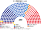

# 席次圖

`0-基本/總體.md` 要求：給仿維基百科的議會席次圖（如：單一席次、複數席次圖；有政黨／派系議員的圓點顏色為所屬政黨／派系的代表色）。本夾兩個組成都有，所以三張：全院、單一、複數。

數字來自 [`15`](15-預期政治生態.md) 第 3 屆，由 [`生態模型.py`](生態模型.py) 算出。產生器：席次圖產生器。

## 全院 250（加總）

民主黨 141（改革派 76、勞動派 65）、國民力量 82（傳統派 51、改革派 31）、祖國革新黨 8、改革新黨 8、進步黨 8、正義黨 3。過半 **126**、3/5 **150**、2/3 **167**。

民主黨單獨過法律門檻。民主黨陣營（加祖國革新黨、進步黨）全院 157，過 3/5——但修憲另要複數席次過 60，這一張看不出來，要看複數那一張。

## 單一席次 150

單一席次是向心誘因的來源。任內調整的議會那一把與未覆蓋部分由全院 ≥126 表決（[`03`](03-行政權預算.md)）。

民主黨 103（改革派 57、勞動派 46）、國民力量 47（傳統派 37、改革派 10）。

國民力量的傳統派 37 席就是嶺南的全部單一席次。150 區裡有 102 區當選人陣營的第一偏好就過半（[`15`](15-預期政治生態.md) §2.5）。

## 複數席次 100

民主黨 38（改革派 19、勞動派 19）、國民力量 35（改革派 21、傳統派 14）、祖國革新黨 8、改革新黨 8、進步黨 8、正義黨 3。過半 **51**、3/5 **60**、2/3 **67**，無一黨過半。修憲要在這一張也過門檻（[`05`](05-法律與修憲.md) §2.2a）：民主黨陣營 54，要跨陣營。

四個小黨的 27 席全在這一張。

## 顏色

兩大黨按派系分色（母黨色的變體）。座位由左至右依政治光譜排列。
