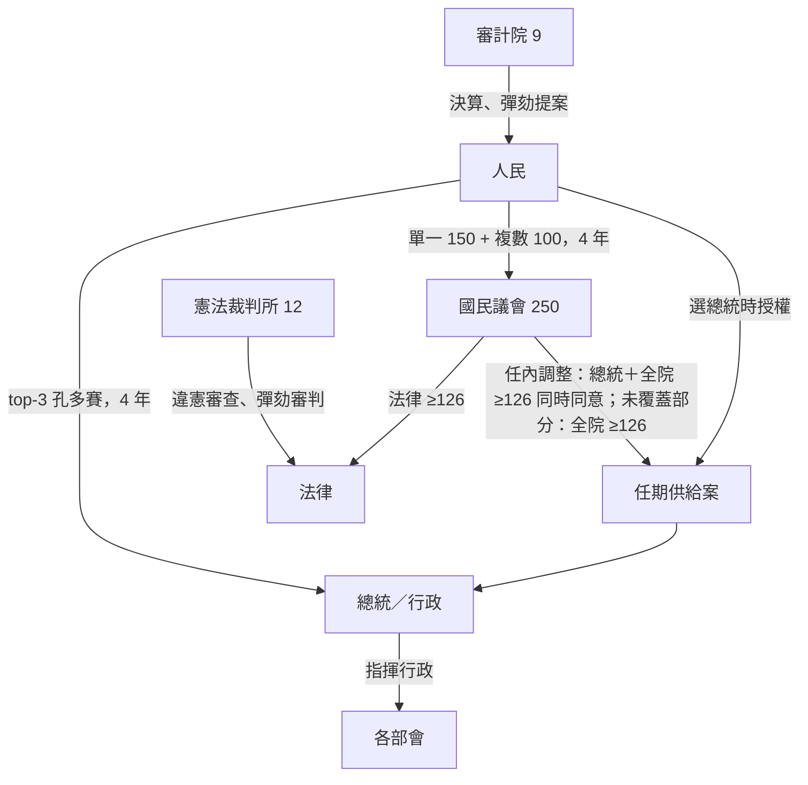
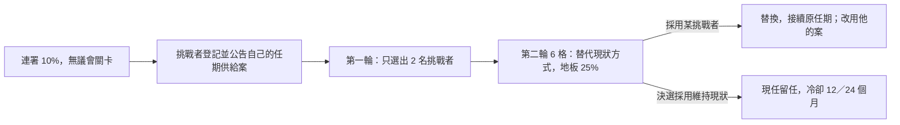
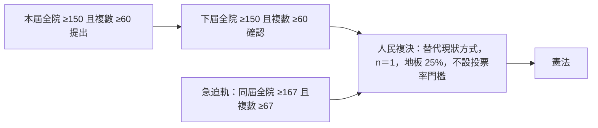
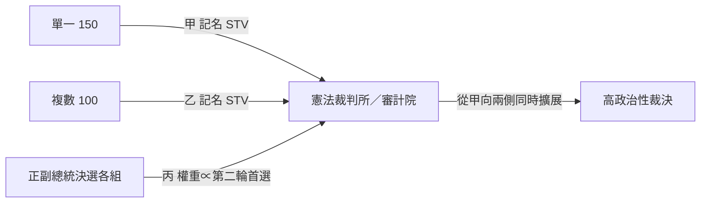
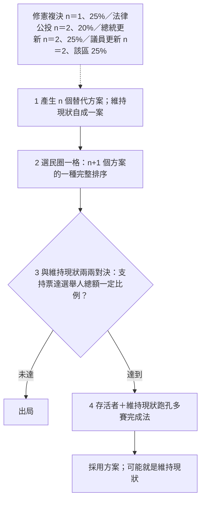
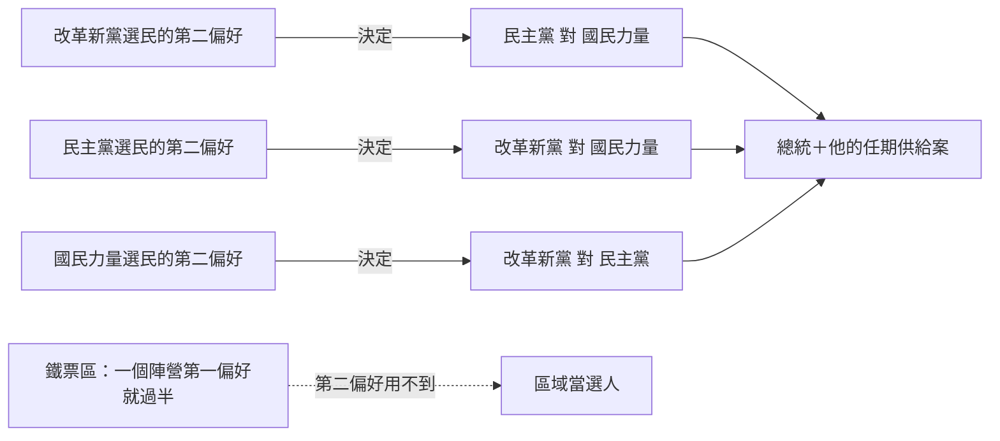

# 憲政架構圖

`0-基本/總體.md` 要求：給多張憲政設計架構圖，方便讀者理解。圖上的數字與詳細檔同一組。

## 1 全景：四權與人民

## 2 更新：先淘汰再決選

## 3 修憲複決：一定票數 25%

## 4 其他權：甲乙丙，互不否決

## 5 替代現狀方式：人民端四處共用

## 6 總統那一場：誰是樞紐

模型下，只有第一場在翻動結果（[`15`](15-預期政治生態.md) §2.4）。
