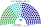
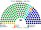
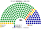
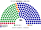
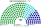
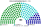
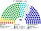

# 估計結果

> 近期大選與民調的民意套進本夾後的總統、議會席次與朝野互動：§0 總統、§1 近期大選（議會）、§2 民調、§3 長期推估、§4 朝野互動。席次圖見 [`席次圖.md`](席次圖.md)；議會的算法見 [`../一院議會制/17-近期大選重算.md`](../一院議會制/17-近期大選重算.md)，計算方式總說明見 。第一偏好一律用不分區政黨票。

選制摘要：全院 **180＝單一 100（top-3 孔多賽）＋複數 80（彈性名單、7 區聖拉古、無門檻）**。詳 [`01`](01-議會組成與選制.md)。議會選制與 [`../一院議會制/`](../一院議會制/) 相同；總統另選，本檔席次表為**議會**。

## 計算方式

| 層 | 本夾的做法 |
|---|---|
| 民意層（第一偏好） | 同一院議會制（逐村里不分區政黨票）；總統用同一份政黨票的全國加總 |
| 參選方層 | 每個政黨都可推人；場外小黨互併（低票讓低票）、場內黨為相鄰場外黨退讓或共推（高票讓低票；受讓方至少有讓方一半的票）、場內黨單純退選（避免當攪局者）——都要雙方偏好整合後的勝者；正式結盟照現實 |
| 制度層：單一席次 | 單一 100 top-3 孔多賽；總統全國一區 top-3 孔多賽：第一輪取前 k 名，第二輪全體選民照完整排序兩兩對決，循環用 Ranked Pairs；選民的排序由各黨的政策位置推得 |
| 制度層：複數席次 | 7 區聖拉古、無門檻 |
| 首長、組閣 | （總統制，無首長選舉） |
| 民調 | 以最近一次大選的地理分布，依民調的全國比例縮放各黨得票，再跑同一套計算 |

細節與敏感度：[`../一院議會制/17-近期大選重算.md`](../一院議會制/17-近期大選重算.md)；程式：[`../一院總統制-測試/總統推估.py`](../一院總統制-測試/總統推估.py)；共同算法：[`選舉結果計算方式`](../../../notes/算法/選舉結果計算方式.md)。

## 0 總統（直選，全國一區 top-3 孔多賽）

民意層用當年**不分區政黨票**，不用總統第一輪的實際得票：現行相對多數一輪下，小黨選民棄保、政黨禮讓，總統票不是真實第一偏好。參選方層：每個政黨都能推一組正副總統，前 3 名進決選；2012–2024 的前 3 名都是大黨，小黨共同提名改變不了決選名單。不用個別候選人。算法：[`../一院總統制-測試/總統推估.py`](../一院總統制-測試/總統推估.py)（與議會單一選區同一套排序假設）。

| 民意 | 第一偏好（前三） | 兩兩對決 | **總統** |
|---|---|---|---|
| 2024-01 | 民進黨 36.2、國民黨 34.6、民眾黨 22.1 | 民進黨勝國民黨 51.9；民眾黨勝民進黨 53.0；國民黨勝民眾黨 54.0 | **國民黨**（循環；最弱的一環「民進黨勝國民黨」不採認） |
| 2020-01 | 民進黨 34.0、國民黨 33.4、民眾黨 11.2 | 民進黨勝國民黨 55.7、勝民眾黨 54.0 | **民進黨** |
| 2016-01 | 民進黨 44.1、國民黨 26.9、親民黨 6.5 | 民進黨勝國民黨 58.5、勝親民黨 59.6 | **民進黨** |
| 2012-01 | 國民黨 44.5、民進黨 34.6、台聯 9.0 | 國民黨勝民進黨 52.2、勝台聯 54.7 | **國民黨** |
| 美麗島 2026-09 | 民進黨 47.6、國民黨 29.2、民眾黨 23.2 | 民進黨勝國民黨 58.0、勝民眾黨 52.0 | **民進黨** |
| 戴立安 2026-10 | 民進黨 47.5、國民黨 27.0、民眾黨 25.5 | 民進黨勝國民黨 58.9、勝民眾黨 51.5 | **民進黨** |

**2024 是三方循環**，誰當選取決於第二偏好（`python 總統推估.py --sweep`）：

| 假設改變 | 2024 總統 |
|---|---|
| 民進黨選民把民眾黨排在國民黨前的比例 30–50% | 國民黨 |
| 同上 60–70% | **民眾黨** |
| 民眾黨選民把國民黨排在民進黨前的比例 35–45% | **民進黨** |
| 同上 55–75% | 國民黨 |

2012–2020 三屆在所有假設下都不變。現實的 2024 年民進黨以 40.1% 相對多數當選；在本夾的規則下，它要先在一對一裡贏過另外兩黨，而 2024 的民意沒有給任何一黨這樣的位置。

## 1 近期大選

用當時實際得票套本夾議會選制。細節與方法見 [`../一院議會制/17-近期大選重算.md`](../一院議會制/17-近期大選重算.md)（同資料夾 [`../一院議會制/近期大選推估.py`](../一院議會制/近期大選推估.py)）。

| | 實際（113） | **本夾全院 180** |
|---|---|---|
| 2024-01（政黨票） | 國民黨 52、民進黨 51、民眾黨 8、無黨籍 2 | 國民黨 **85**、民進黨 60、民眾黨 35 |
| 2020-01（政黨票） | 民進黨 61、國民黨 38、民眾黨 5、時代力量 3 … | 民進黨 **108**、國民黨 51、民眾黨 10、時代力量 7、親民黨 3、台灣基進 1 |
| 2016-01（政黨票） | 民進黨 68、國民黨 35、時代力量 5、親民黨 3 … | 民進黨 **123**、國民黨 40、時代力量 7、親民黨 6、新黨 4 |
| 2012-01（政黨票） | 國民黨 64、民進黨 40、親民黨 3、台聯 3 … | 國民黨 **99**、民進黨 68、台聯 8、親民黨 5 |

### 2024-01 單一／複數

| 政黨 | 單一 100 | 複數 80 | **全院** |
|---|--:|--:|--:|
| 中國國民黨 | 55 | 30 | **85** |
| 民主進步黨 | 35 | 31 | **66** |
| 台灣民眾黨 | 10 | 19 | **29** |

**組閣聯盟／多數派政府**：總統制——預算由全院議決；國民黨全院 **85**＜91，須拉民眾黨（＋29＝114）或在野合作。

國民黨全院 85，差 6 過半（≥91）；行政權預算由**全院**議決（本夾不用預提）。

### 2020-01

**組閣聯盟／多數派政府**：民進黨全院 **108** 單獨過半（≥91）。

民進黨 **108**、國民黨 51、民眾黨 10、時代力量 7、親民黨 3、台灣基進 1。民進黨單獨過半。

### 2016-01

民進黨全院 **123** 單獨過半。中位第三黨在資料裡是親民黨（當年尚無民眾黨）。

### 2012-01

國民黨全院 **99** 單獨過半。中位第三黨是親民黨。

## 2 民調

公開政黨**喜好度／好感度**（非立委政黨票）。**不是**全國比例拆單一。

方法：以 **2024-01 村里政黨票** 為地理基底，按喜好／好感度當全國權重縮放三黨得票後跑本夾——**單一 100** top-3 孔多賽、**複數 80** 聖拉古（與 §1 同一套重算；本節小黨欄歸零）。

### 美麗島電子報／趨勢（2026-09-29..10-02，n＝1201；喜好度）

議會單獨過半 **民進黨**（≥91）。

| 政黨 | 喜好度 | 單一 100 | 複數 80 | 本夾全院 |
|---|--:|--:|--:|--:|
| 民主進步黨 | 43.1% | 69 | 38 | **107** |
| 中國國民黨 | 26.5% | 17 | 24 | **41** |
| 台灣民眾黨 | 21.0% | 14 | 18 | **32** |

### 戴立安／畢肯（2026-10-20..22，n＝1075；好感度）

議會單獨過半 **民進黨**（≥91）。

| 政黨 | 好感度 | 單一 100 | 複數 80 | 本夾全院 |
|---|--:|--:|--:|--:|
| 民主進步黨 | 49.0% | 54 | 38 | **92** |
| 台灣民眾黨 | 26.3% | 35 | 21 | **56** |
| 中國國民黨 | 27.9% | 11 | 21 | **32** |

## 3 長期運行假設下

下表為政黨加總；[`席次圖.svg`](席次圖.svg) 圖例依**派系**分色，與 [`席次圖.md`](席次圖.md) 括號內服務／政策席次一致。

生態模型示意 **第 3 屆**（假設見 [`15-預期政治生態.md`](15-預期政治生態.md)）。

| 政黨／派系 | 單一 100 | 複數 80 | 全院 |
|---|--:|--:|--:|
| 民主進步黨 | 40 | 27 | **67** |
| 中國國民黨 | 33 | 22 | **55** |
| 台灣民眾黨 | 8 | 12 | **20** |
| 無黨籍／地方 | 12 | 4 | **16** |
| 時代力量 | 4 | 6 | **10** |
| 台灣基進 | 2 | 5 | **7** |
| 綠黨與環境團體聯盟 | 1 | 4 | **5** |
| **計** | **100** | **80** | **180** |

兩大黨全院相加 122。過半 91、基本法 108。
朝野互動與候選人行為見 [`15-預期政治生態.md`](15-預期政治生態.md)。

## 4 朝野互動（各次估計）

預算規則：預算全院 ≥91；不過時法定義務照撥、其餘沿用上年度，不會停擺。

| 民意 | 總統 | 議會全院 180 | 互動 |
|---|---|---|---|
| 2024-01 | 國民黨 | 國民黨 85、民進黨 60、民眾黨 35 | 分立邊緣：總統的黨差 6 席過半，法律與預算要民眾黨；民眾黨在單一選區只有 10 席，它的籌碼在院內。民進黨在野最大黨，不能倒閣，只能等人民發動總統更新或下次選舉 |
| 2020-01 | 民進黨 | 民進黨 108 | 一致政府；全院也到基本法的 108，但複數 30 不到 48，基本法仍要在野黨 |
| 2016-01 | 民進黨 | 民進黨 123 | 一致政府；同上，複數 39 |
| 2012-01 | 國民黨 | 國民黨 99 | 一致政府；複數 37，基本法要民進黨 |
| 美麗島 2026-09 | 民進黨 | 民進黨 107 | 一致政府 |
| 戴立安 2026-10 | 民進黨 | 民進黨 92 | 一致政府，只多 1 席；民眾黨單一 35 席，是區域上能和兩大黨競爭的第三黨 |

誘因、候選人行為與檢視見 [`15-預期政治生態.md`](15-預期政治生態.md)。
