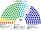
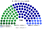
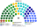

# 席次圖

`0-基本/總體.md` 要求：給仿維基百科的議會席次圖（如：單一席次、複數席次圖；有政黨／派系議員的圓點顏色為所屬政黨／派系的代表色）。本夾兩個組成都有，所以三張：全院、單一、複數。

數字來自 [`15`](15-預期政治生態.md) 第 3 屆，由 [`生態模型.py`](生態模型.py) 算出。產生器：席次圖產生器。

## 全院 180（加總）

國民黨 86（服務 60、政策 26）、民進黨 67（服務 42、政策 25）、民眾黨 17、時代力量 6、綠黨與環境團體聯盟 2、台灣基進 2。過半 **91**、3/5 **108**。兩大黨相加 **153**。

同一屆的總統也是國民黨候選人（[`15`](15-預期政治生態.md) §2.4）。

## 單一席次 100

單一席次是向心誘因的來源；行政權預算由全院 ≥91 表決（[`03`](03-行政權預算.md)）。

國民黨 62（服務 50、政策 12）、民進黨 38（服務 30、政策 8）。

預算看全院：國民黨總統要加民眾黨（103）。若只由這一張表決，分裂政府時在野的單一多數會單獨握有預算（[`15`](15-預期政治生態.md) §5.2）。

## 複數席次 80

民進黨 29（政策 17、服務 12）、國民黨 24（政策 14、服務 10）、民眾黨 17、時代力量 6、綠黨與環境團體聯盟 2、台灣基進 2。過半 **41**、3/5 **48**、2/3 **54**，無一黨過半。基本法與修憲要在這一張也過門檻（[`05`](05-法律與法規位階.md) §2.3）：兩大黨合計 53。

民眾黨的 17 席全在這一張。

## 顏色

兩大黨按派系分色（母黨色的變體），不是整黨塗成一色。座位由左至右依政治光譜排列。
