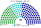
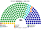
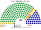
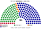
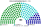
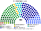

# 估計結果

> 近期大選與民調的民意套進本夾選制後的席次、組閣與朝野互動：§1 近期大選、§2 民調、§3 長期推估。席次圖見 [`席次圖.md`](席次圖.md)；大選的算法見 [`17`](17-近期大選重算.md)，計算方式總說明見 ；誘因與候選人行為見 [`15`](15-預期政治生態.md)。

選制摘要：全院 **180＝單一 100（top-3 孔多賽）＋複數 80（彈性名單、7 區聖拉古、無門檻）**。詳 [`01`](01-議會組成與選制.md)。

## 計算方式

| 層 | 本夾的做法 |
|---|---|
| 民意層（第一偏好） | 中選會逐村里**不分區政黨票**（2012–2024）；小黨依各區名單票拆回；民調以 2024 村里地理縮放 |
| 參選方層 | 每個政黨都可推人；場外小黨互併（低票讓低票）、場內黨為相鄰場外黨退讓或共推（高票讓低票；受讓方至少有讓方一半的票）、場內黨單純退選（避免當攪局者）——都要雙方偏好整合後的勝者；正式結盟照現實 |
| 制度層：單一席次 | 單一 100 依人口切區，top-3 孔多賽：第一輪取前 k 名，第二輪全體選民照完整排序兩兩對決，循環用 Ranked Pairs；選民的排序由各黨的政策位置推得 |
| 制度層：複數席次 | 7 區、每區 8–14 席，聖拉古、無門檻 |
| 首長、組閣 | 全院 180 記名排名；組閣由首長往外依偏好加黨到 ≥91 |
| 民調 | 以最近一次大選的地理分布，依民調的全國比例縮放各黨得票，再跑同一套計算 |

細節與敏感度：[`17-近期大選重算.md`](17-近期大選重算.md)；程式：[`近期大選推估.py`](近期大選推估.py)；共同算法：[`選舉結果計算方式`](../../../notes/算法/選舉結果計算方式.md)。

## 1 近期大選

第一偏好用當時的不分區政黨票（不受區域選舉的棄保、禮讓影響），不用區域立委或總統的實際得票。各黨在新制下都有動機在每一區參選，區域上不沿用現行的禮讓。細節見 [`17-近期大選重算.md`](17-近期大選重算.md)（[`近期大選推估.py`](近期大選推估.py)）。2012／2016 尚無民眾黨：居中的第三黨是**親民黨**；小黨依各區實際名單票拆回各真實政黨。

| | 實際（113） | **本夾全院 180** | 首長 |
|---|---|---|---|
| 2024-01（政黨票） | 國民黨 52、民進黨 51、民眾黨 8、無黨籍 2 | 國民黨 **85**、民進黨 60、民眾黨 35 | **民眾黨**（民眾黨＋國民黨 120） |
| 2020-01（政黨票） | 民進黨 61、國民黨 38、民眾黨 5、時代力量 3 … | 民進黨 **108**、國民黨 51、民眾黨 10、時代力量 7、親民黨 3、台灣基進 1 | **民進黨**（單獨 108） |
| 2016-01（政黨票） | 民進黨 68、國民黨 35、時代力量 5、親民黨 3 … | 民進黨 **123**、國民黨 40、時代力量 7、親民黨 6、新黨 4 | **民進黨**（單獨 123） |
| 2012-01（政黨票） | 國民黨 64、民進黨 40、親民黨 3、台聯 3 … | 國民黨 **99**、民進黨 68、台聯 8、親民黨 5 | **國民黨**（單獨 99） |

### 2024-01 單一／複數

| 政黨 | 單一 100 | 複數 80 | **全院** |
|---|--:|--:|--:|
| 國民黨 | 55 | 30 | **85** |
| 民進黨 | 29 | 31 | **60** |
| 民眾黨 | 16 | 19 | **35** |

**組閣聯盟／多數派政府**：首長 **民眾黨**（兩大黨皆將其排第二）；執政多數國民黨＋民眾黨＝**120**（過半 91）；國民黨單獨 85 差 6。

### 2020-01 單一／複數

| 政黨 | 單一 100 | 複數 80 | **全院** |
|---|--:|--:|--:|
| 民進黨 | 78 | 30 | **108** |
| 國民黨 | 22 | 29 | **51** |
| 民眾黨 | 0 | 10 | **10** |
| 時代力量 | 0 | 7 | **7** |
| 親民黨 | 0 | 3 | **3** |
| 台灣基進 | 0 | 1 | **1** |

**組閣聯盟／多數派政府**：首長 **民進黨**；民進黨 **108** 單獨過半。

### 2016-01 單一／複數

| 政黨 | 單一 100 | 複數 80 | **全院** |
|---|--:|--:|--:|
| 民進黨 | 84 | 39 | **123** |
| 國民黨 | 16 | 24 | **40** |
| 時代力量 | 0 | 7 | **7** |
| 親民黨 | 0 | 6 | **6** |
| 新黨 | 0 | 4 | **4** |

**組閣聯盟／多數派政府**：首長 **民進黨**；民進黨 **123** 單獨過半（亦過 3/5 的 108）。

### 2012-01 單一／複數

| 政黨 | 單一 100 | 複數 80 | **全院** |
|---|--:|--:|--:|
| 國民黨 | 62 | 37 | **99** |
| 民進黨 | 38 | 30 | **68** |
| 台聯 | 0 | 8 | **8** |
| 親民黨 | 0 | 5 | **5** |

**組閣聯盟／多數派政府**：首長 **國民黨**；國民黨 **99** 單獨過半。

2024 年國民黨全院 85，差 6 席過半；首長由全院記名排名選出，兩大黨議員都把民眾黨排第二，首長出自民眾黨。2020／2016 民進黨、2012 國民黨皆全院單獨過 91。

## 2 民調

可得的 2026 年公開民調只有政黨**喜好度／好感度**（各黨分開問，加總不是 100%），沒有立委政黨票的投票意向。本節把三黨的喜好度正規化成占比當全國第一偏好，以 **2024-01 村里政黨票**為地理基底縮放後跑本夾——**單一 100** top-3 孔多賽、**複數 80** 聖拉古（與 §1 同一套重算；小黨歸零）。喜好度不是投票意向，本節只當方向參考。

### 美麗島電子報／趨勢（2026-09-29..10-02，n＝1201；喜好度）

首長 **民進黨**；民進黨全院 107 單獨過半，不需聯盟。

| 政黨 | 喜好度 | 單一 100 | 複數 80 | 本夾全院 |
|---|--:|--:|--:|--:|
| 民主進步黨 | 43.1% | 69 | 38 | **107** |
| 中國國民黨 | 26.5% | 17 | 24 | **41** |
| 台灣民眾黨 | 21.0% | 14 | 18 | **32** |

### 戴立安／畢肯（2026-10-20..22，n＝1075；好感度）

首長 **民進黨**；民進黨全院 92 單獨過半（多 1 席），任何一位議員倒戈都會讓建設性更新變得可行。

| 政黨 | 好感度 | 單一 100 | 複數 80 | 本夾全院 |
|---|--:|--:|--:|--:|
| 民主進步黨 | 49.0% | 54 | 38 | **92** |
| 台灣民眾黨 | 26.3% | 35 | 21 | **56** |
| 中國國民黨 | 27.9% | 11 | 21 | **32** |

## 3 長期運行假設下

下表為政黨加總；[`席次圖.svg`](席次圖.svg) 圖例依**派系**分色，與 [`席次圖.md`](席次圖.md) 括號內服務／政策席次一致。

生態模型示意 **第 3 屆**（假設見 [`15-預期政治生態.md`](15-預期政治生態.md)；數字由 [`生態模型.py`](生態模型.py) 算出）。

| 政黨 | 單一 100 | 複數 80 | 全院 |
|---|--:|--:|--:|
| 中國國民黨 | 61 | 24 | **85** |
| 民主進步黨 | 38 | 28 | **66** |
| 台灣民眾黨 | 1 | 17 | **18** |
| 時代力量 | 0 | 6 | **6** |
| 綠黨與環境團體聯盟 | 0 | 3 | **3** |
| 台灣基進 | 0 | 2 | **2** |
| **計** | **100** | **80** | **180** |

| | 第 3 屆 | 第 5 屆 | 第 8 屆 |
|---|--:|--:|--:|
| 單一 國民黨／民進黨／民眾黨 | 61／38／1 | 55／45／0 | 38／62／0 |
| 全院最大黨 | 國民黨 85 | 國民黨 81 | 民進黨 89 |

## 4 朝野互動（各次估計）

| 民意 | 政府 | 在野 | 互動 |
|---|---|---|---|
| 2024-01 | 民眾黨首長＋國民黨（120） | 民進黨 60 | 國民黨單一最多卻不握首長：它要讓民眾黨留在政府裡，就得讓偏綠選民不至於把民眾黨排最後；民進黨在野的路是爭取民眾黨選民的第二偏好 |
| 2020-01、2016-01 | 民進黨單獨（108、123） | 國民黨 51、40 | 民進黨單獨過半，全院也達基本法的 108，但複數席次只有 30、39，不到 48：基本法與修憲仍須在野黨。單一選區的大勝不能單獨改規則 |
| 2012-01 | 國民黨單獨 99 | 民進黨 68 | 國民黨過半 8 席，法律單獨過；複數 37，基本法要民進黨 |
| 美麗島 2026-09 | 民進黨單獨 107 | 國民黨 41、民眾黨 32 | 在野兩黨合計 73，提不出建設性更新；基本法仍要拉一個在野黨 |
| 戴立安 2026-10 | 民進黨單獨 92 | 民眾黨 56、國民黨 32 | 執政多數只多 1 席：民眾黨在單一選區拿 35 席，是兩大黨之外第一個能在區域上競爭的第三黨；在野兩黨若推出共同準人選，只要拉到 3 位執政議員就能換人 |

誘因、候選人行為與長期推估見 [`15-預期政治生態.md`](15-預期政治生態.md)。
