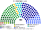
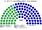
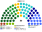

# 席次圖

`0-基本/總體.md` 要求：給仿維基百科的議會席次圖（如：單一席次、複數席次圖；有政黨／派系議員的圓點顏色為所屬政黨／派系的代表色）。本夾兩個組成都有，所以三張：全院、單一、複數。

數字來自 [`15`](15-預期政治生態.md) 第 3 屆，由 [`生態模型.py`](生態模型.py) 算出。產生器：席次圖產生器。

## 全院 180（加總）

國民黨 85（服務 59、政策 26）、民進黨 66（服務 41、政策 25）、民眾黨 18、時代力量 6、綠黨與環境團體聯盟 3、台灣基進 2。過半 **91**、3/5 **108**。兩大黨相加 **151**。全院圖看不出「政府在單一 100」，所以要看下一張。

## 單一席次 100

單一席次是向心誘因的來源；政府由全院產生（[`02`](02-行政首長.md)）。

國民黨 61（服務 49、政策 12）、民進黨 38（服務 30、政策 8）、民眾黨 1。國民黨在這一張過半，但組閣看全院：國民黨 85 要加民眾黨 18。

國民黨的第一偏好（34%）比民進黨（38%）少，單一席次卻多 23 席：理由在 [`15`](15-預期政治生態.md) §2.4——民眾黨選民在「民進對國民」那一場略偏國民黨，而民進黨選民在「國民對民眾」那一場沒有偏向民眾黨。

## 複數席次 80

民進黨 28（政策 17、服務 11）、國民黨 24（政策 14、服務 10）、民眾黨 17、時代力量 6、綠黨與環境團體聯盟 3、台灣基進 2。過半 **41**、3/5 **48**、2/3 **54**，無一黨過半。基本法與修憲要在這一張也過門檻（[`05`](05-法律與法規位階.md) §2.3）：兩大黨合計 52。

民眾黨 18 席有 17 席在這一張：它的選民決定單一席次的勝負，它自己的席次幾乎全在名單上。

## 顏色

兩大黨按派系分色（母黨色的變體），不是整黨塗成一色。座位由左至右依政治光譜排列。
