# 憲政架構圖

`0-基本/總體.md` 要求：給多張憲政設計架構圖，方便讀者理解。圖上的數字與詳細檔同一組。

## 1 全景：五權與人民

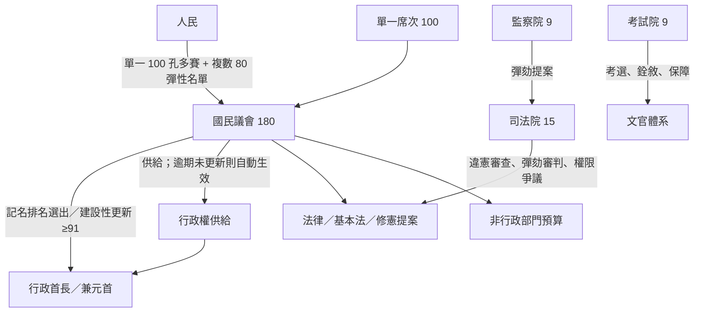

## 2 為什麼不長得像現行制度

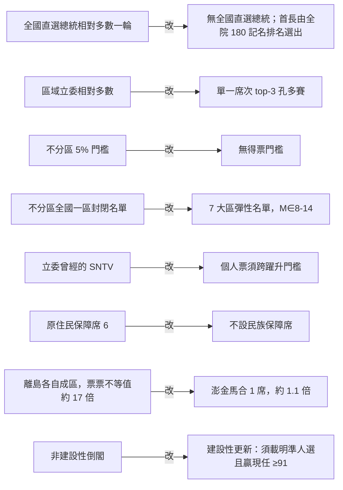

## 3 行政與議會：拆得掉，但必須組得出

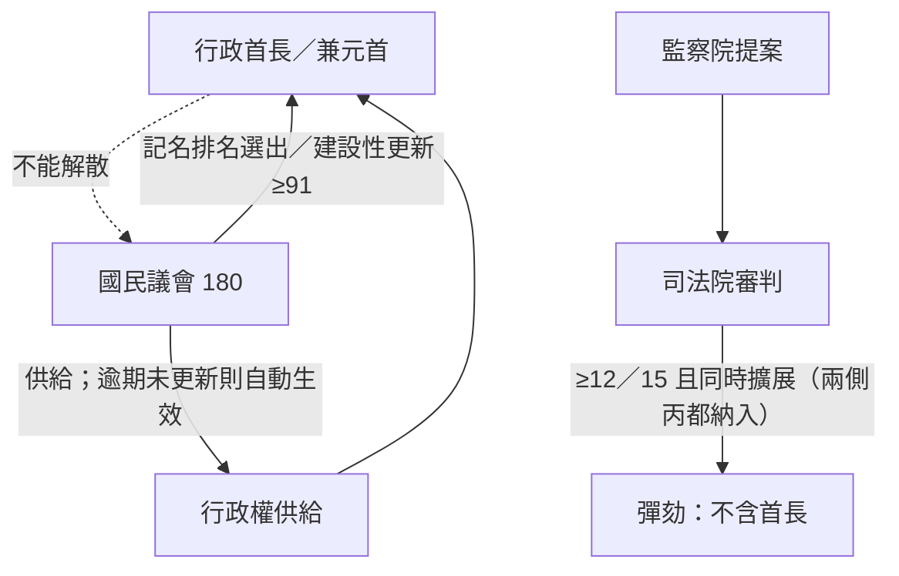

## 4 供給問題怎麼解（建設性＋自動生效）

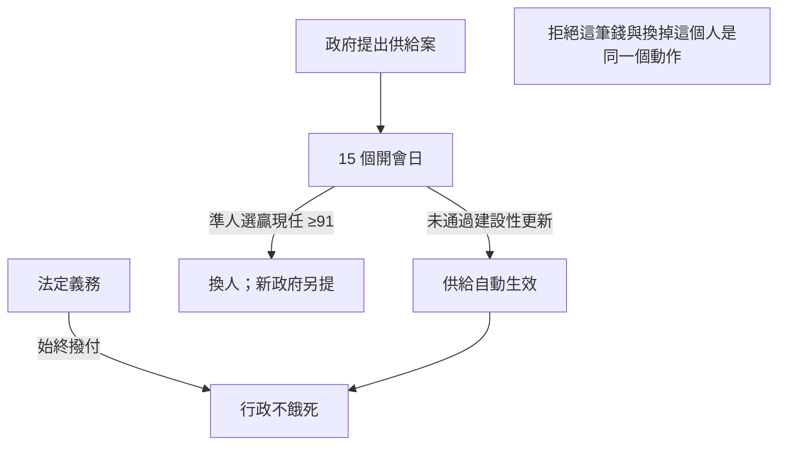

## 5 供給、法律與改規則的兩種多數

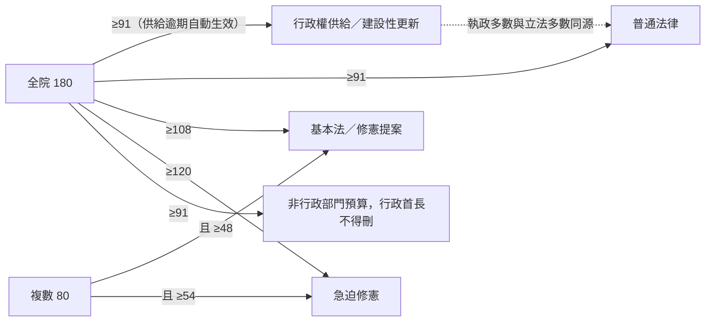

## 6 修憲：從「實質改不了」到「多數就能過」

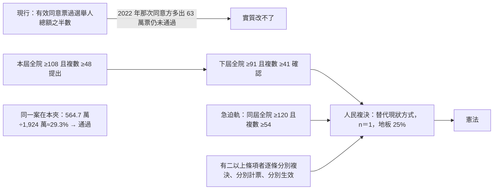

## 7 三院人事：甲乙丙代理人，杯葛者浪費投票權

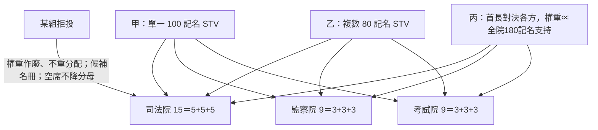

乙組留下。溫床在議會法案，不是禁止複數席次議員當選舉權人。不設須專選的院長。

## 8 高政治性：從甲向兩側同時擴展

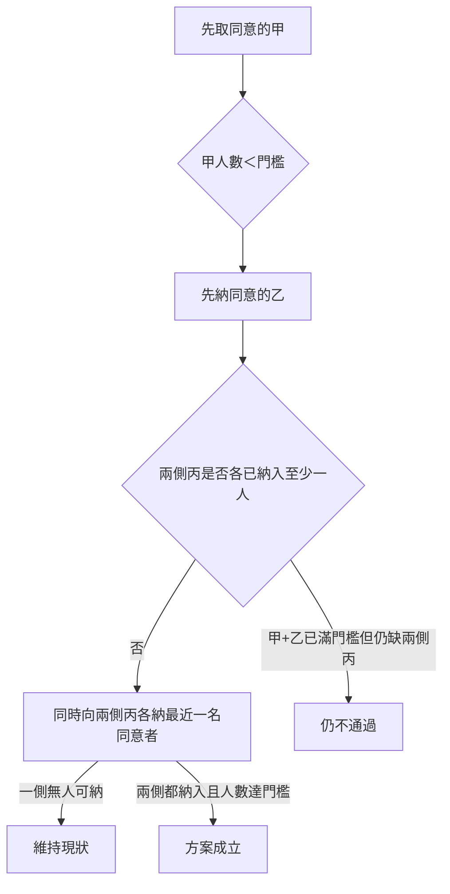

抽籤工作組只分案，不當通過門檻。

## 9 緊急狀態：預設是結束，而且不碰選舉與更新

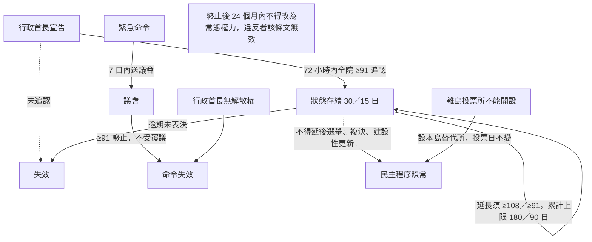

## 10 更新：首長走建設性，議員走替代現狀

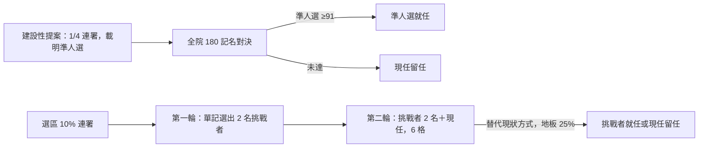

## 11 替代現狀方式：人民端三處共用

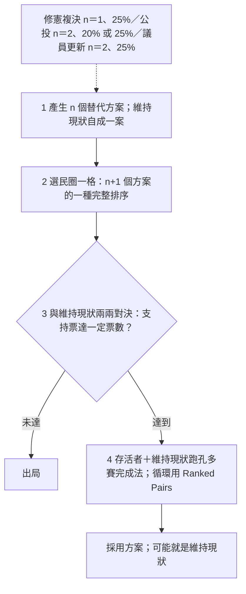

淘汰排在投票系統**之前**：放在後面，民意基礎不足的方案會把足夠的方案一起拖下水（[`06`](06-修憲與人民修改法規範.md) §2.2）。

## 12 單一席次的第二輪：誰握著哪一場

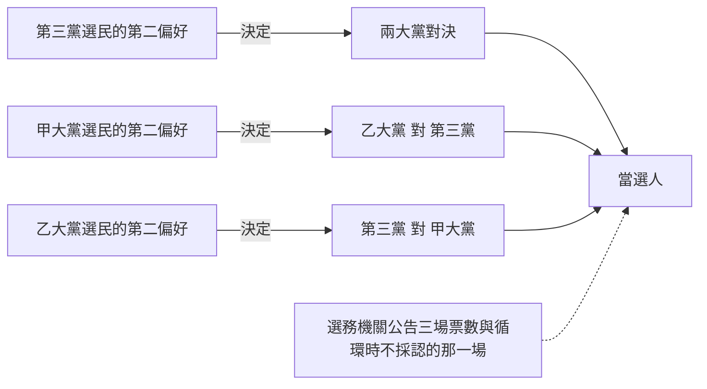

每一場對決都由**不在場上那一方的選民**決定。這是本夾讓批鬥對手陣營有價格的機制（[`15`](15-預期政治生態.md) §9）。
