# 近期大選重算

> 席次表見 [`估計結果.md`](估計結果.md)；全部圖與單一／複數表見 [`席次圖.md`](席次圖.md)。本檔講**怎麼**套，以及和舊結構（方案 A）的並排。

## 1 資料與方法

| 項目 | 做法 |
|---|---|
| 得票 | 中選會選舉資料庫逐村里結果（`../一院議會制/資料/村里-YYYY.csv`、`名單-YYYY.csv`）；2012、2016 的中位第三黨＝親民黨；小黨依各區實際名單得票拆回各真實政黨參選 |
| 第一偏好 | 不分區政黨票 |
| 第二偏好（★假設） | 民進黨選民 50% 把中位第三黨排在國民黨前；國民黨選民 85%；中位第三黨選民 55% 把國民黨排在民進黨前（`生態模型.Q_DEFAULT`，完整多黨排序見 `政黨單位.tw_orders`） |
| 國民院單一 120 | 7 區配額（臺北 13、新北 20、桃竹 17、中彰 21、雲嘉南 17、高屏 18、其餘縣市 13）＋澎金馬 1；區內依縣市碼→現行選區→鄉鎮→村里連續切；多黨 top-3 孔多賽、循環 Ranked Pairs |
| 國民院複數 30 | 全國政黨票聖拉古、無門檻 |
| 參議院 75 | 6 區政黨票聖拉古、無門檻（臺北基宜 11、新北 13、桃竹苗 12、中彰投 15、雲嘉南 10、高屏花東澎金馬 14）；「其餘縣市與離島」的名單票依村里政黨票拆回縣市 |
| 首長 | 國民院全院 150 記名排名（`生態模型.MP_RANK`），≥76；排名表未列的小黨（2016 信心希望聯盟 1 席）不參與首長投票，已驗證不影響結果 |

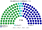

## 2 主算結果總覽

| 選舉 | 實際立法院 | **國民院 150** | **參議院 75** | 首長、組閣與規則 |
|---|---|---|---|---|
| 2024 政黨票 | 國民黨 52、民進黨 51、民眾黨 8、無黨籍 2（113） | **國民黨 74、民進黨 55、民眾黨 20、時代力量 1**（單一 國民黨 63、民進黨 44、民眾黨 13；複數 國民黨 11、民進黨 11、民眾黨 7、時代力量 1） | 民進黨 29、國民黨 28、民眾黨 18 | **民眾黨**；民眾黨＋國民黨＝104；參議院 46；普通法律兩院皆過；基本法不可 |
| 2020 政黨票 | 民進黨 61、國民黨 38、民眾黨 5、時代力量 3、台灣基進 1、無黨籍 5 | **民進黨 109、國民黨 31、民眾黨 5、時代力量 2 …**（單一 民進黨 98、國民黨 21、民眾黨 1；複數 民進黨 11、國民黨 10、民眾黨 4、時代力量 2 …） | 民進黨 29、國民黨 26、民眾黨 10、時代力量 6、台灣基進 2 … | **民進黨**；民進黨＝109；參議院 29；普通法律參議院擱置、國民院 ≥76 重新表決；基本法不可 |
| 2016 政黨票 | 民進黨 68、國民黨 35、時代力量 5、親民黨 3、無盟 1、無黨籍 1 | **民進黨 118、國民黨 24、時代力量 2、親民黨 2 …**（單一 民進黨 104、國民黨 16；複數 民進黨 14、國民黨 8、時代力量 2、親民黨 2 …） | 民進黨 36、國民黨 22、時代力量 6、親民黨 6、新黨 5 | **民進黨**；民進黨＝118；參議院 36；普通法律參議院擱置、國民院 ≥76 重新表決；基本法不可 |
| 2012 政黨票 | 國民黨 64、民進黨 40、台聯 3、親民黨 3、無盟 2、無黨籍 1 | **國民黨 87、民進黨 57、台聯 3、親民黨 2 …**（單一 國民黨 73、民進黨 47；複數 國民黨 14、民進黨 10、台聯 3、親民黨 2 …） | 國民黨 35、民進黨 28、台聯 7、親民黨 5 | **國民黨**；國民黨＝87；參議院 35；普通法律參議院擱置、國民院 ≥76 重新表決；基本法不可 |

## 3 各屆

### 3.1 2024

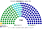

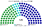

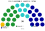

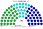

| 政黨 | 國民院單一 120 | 國民院複數 30 | **國民院 150** | **參議院 75** |
|---|--:|--:|--:|--:|
| 國民黨 | 63 | 11 | **74** | **28** |
| 民進黨 | 34 | 11 | **55** | **29** |
| 民眾黨 | 23 | 7 | **20** | **18** |
| 時代力量 | 0 | 1 | **1** | **0** |
| **合計** | **120** | **30** | **150** | **75** |

- 首長 **民眾黨**（國民黨 74 差 2 席過半，兩大黨皆把民眾黨排第二）；組閣 **民眾黨＋國民黨＝104**；組閣陣營在參議院 46／75 → 普通法律兩院皆過。
- 基本法（國民院 ≥90 且參議院 ≥50）：民進黨＋國民黨 129／57（可）；民進黨＋民眾黨 75／47（不可）；國民黨＋民眾黨 94／46（不可）。

### 3.2 2020

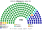

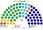

| 政黨 | 國民院單一 120 | 國民院複數 30 | **國民院 150** | **參議院 75** |
|---|--:|--:|--:|--:|
| 民進黨 | 98 | 11 | **109** | **29** |
| 國民黨 | 21 | 10 | **31** | **26** |
| 民眾黨 | 1 | 4 | **5** | **10** |
| 時代力量 | 0 | 2 | **2** | **6** |
| 台灣基進 | 0 | 1 | **1** | **2** |
| 親民黨 | 0 | 1 | **1** | **2** |
| 綠黨 | 0 | 1 | **1** | **0** |
| **合計** | **120** | **30** | **150** | **75** |

- 首長 **民進黨**；組閣 **民進黨＝109**；組閣陣營在參議院 29／75 → 普通法律參議院擱置、國民院 ≥76 重新表決。
- 基本法（國民院 ≥90 且參議院 ≥50）：民進黨＋國民黨 140／55（可）；民進黨＋民眾黨 114／39（不可）；民進黨＋親民黨 110／31（不可）；國民黨＋民眾黨 36／36（不可）；國民黨＋親民黨 32／28（不可）；民眾黨＋親民黨 6／12（不可）。

### 3.3 2016

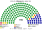

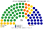

| 政黨 | 國民院單一 120 | 國民院複數 30 | **國民院 150** | **參議院 75** |
|---|--:|--:|--:|--:|
| 民進黨 | 104 | 14 | **118** | **36** |
| 國民黨 | 16 | 8 | **24** | **22** |
| 時代力量 | 0 | 2 | **2** | **6** |
| 親民黨 | 0 | 2 | **2** | **6** |
| 新黨 | 0 | 1 | **1** | **5** |
| 綠黨社會民主黨聯盟 | 0 | 1 | **1** | **0** |
| 信心希望聯盟 | 0 | 1 | **1** | **0** |
| 台聯 | 0 | 1 | **1** | **0** |
| **合計** | **120** | **30** | **150** | **75** |

- 首長 **民進黨**；組閣 **民進黨＝118**；組閣陣營在參議院 36／75 → 普通法律參議院擱置、國民院 ≥76 重新表決。
- 基本法（國民院 ≥90 且參議院 ≥50）：民進黨＋國民黨 142／58（可）；民進黨＋親民黨 120／42（不可）；國民黨＋親民黨 26／28（不可）。

### 3.4 2012

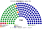

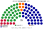

| 政黨 | 國民院單一 120 | 國民院複數 30 | **國民院 150** | **參議院 75** |
|---|--:|--:|--:|--:|
| 國民黨 | 73 | 14 | **87** | **35** |
| 民進黨 | 47 | 10 | **57** | **28** |
| 台聯 | 0 | 3 | **3** | **7** |
| 親民黨 | 0 | 2 | **2** | **5** |
| 綠黨 | 0 | 1 | **1** | **0** |
| **合計** | **120** | **30** | **150** | **75** |

- 首長 **國民黨**；組閣 **國民黨＝87**；組閣陣營在參議院 35／75 → 普通法律參議院擱置、國民院 ≥76 重新表決。
- 基本法（國民院 ≥90 且參議院 ≥50）：民進黨＋國民黨 144／63（可）；民進黨＋親民黨 59／33（不可）；國民黨＋親民黨 89／40（不可）。

## 4 要點

1. **國民院單一 120 的席次獎勵大，但 2024 三腳督下仍未單黨過半**：2024 國民黨 34.6% 政黨票拿國民院 74（差 2 席過半，首長出自中位的民眾黨，組閣民眾黨＋國民黨 94）；2016 民進黨 118、2020 民進黨 109、2012 國民黨 87 則單獨過半。
2. **比例參議院從未有單一政黨過半**（最大黨 28–36／75）：一黨在國民院單獨執政時，參議院能擱置普通法律、公開辯論，但不能卡死；2024 民眾黨＋國民黨兩黨聯合則在參議院亦有 46 席直接過半。
3. **基本法 2/3 守住規則**：四屆中任何單一陣營（含 2024 國民黨＋民眾黨 94／46）都改不了；只有民進黨＋國民黨同時同意才過。

## 5 方案 A（舊結構）並排

同一批票套舊結構（國民院 90＋60、參議院縣市單一 75；[`方案A對照.py`](方案A對照.py)）：

| 選舉 | 方案 A 國民院／參議院 | 方案 A 首長 | **方案 B 國民院／參議院** | 方案 B 首長 |
|---|---|---|---|---|
| 2024 政黨票 | 國民黨 72、民進黨 56、民眾黨 22／國民黨 41、民進黨 26、民眾黨 8 | 民眾黨（民眾黨＋國民黨 94） | 國民黨 74、民進黨 55、民眾黨 20 …／民進黨 29、國民黨 28、民眾黨 18 | 民眾黨（民眾黨＋國民黨 94） |
| 2020 政黨票 | 民進黨 94、國民黨 40 …／民進黨 59、國民黨 16 | 民進黨 | 民進黨 109、國民黨 31、民眾黨 5 …／民進黨 29、國民黨 26、民眾黨 10 … | 民進黨 |
| 2016 政黨票 | 民進黨 110、國民黨 29 …／民進黨 66、國民黨 9 | 民進黨 | 民進黨 118、國民黨 24、時代力量 2 …／民進黨 36、國民黨 22、時代力量 6 … | 民進黨 |
| 2012 政黨票 | 國民黨 82、民進黨 59 …／國民黨 47、民進黨 28 | 國民黨 | 國民黨 87、民進黨 57、台聯 3 …／國民黨 35、民進黨 28、台聯 7 … | 國民黨 |

**差別**：A 的兩院都是孔多賽單一選區，參議院幾乎是國民院的同色縮小版（2016 民進黨 66／75）；B 的參議院按比例，2016 民進黨只有 36。A 的規則鎖在國民院複數 60 的 3/5；B 鎖在比例參議院的 2/3。

## 6 第二偏好敏感度（`python 近期大選推估.py --sweep`）

只動最不確定的 `q民進`（民進黨選民把中位第三黨排在國民黨前的比例；基準 50%）。各格為國民院首長：

| q民進 | 2024 政黨票 | 2020 | 2016 政黨票 | 2012 政黨票 |
|:--:|---|---|---|---|
| 20% | 國民黨 | 民進黨 | 民進黨 | 國民黨 |
| 35% | 國民黨 | 民進黨 | 民進黨 | 國民黨 |
| **50%** | **民眾黨** | 民進黨 | 民進黨 | 國民黨 |
| 65% | 民眾黨 | 民進黨 | 民進黨 | 國民黨 |
| 80% | 民眾黨 | 民進黨 | 民進黨 | 國民黨 |

2012、2016、2020 不隨 q 變；2024 在 q≥50% 時首長為民眾黨，q≤35% 時國民黨單獨過半。

## 7 民調與長期

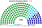

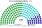

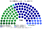

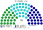

數字見 [`估計結果.md`](估計結果.md) §2、§3。
