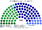
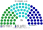

# 席次圖

`0-基本/總體.md` 要求：給仿維基百科的議會席次圖（如：單一席次、複數席次圖；有政黨、派系或意識形態議員的圓點顏色為所屬政黨／派系的代表色）。本夾兩院各一個組成，所以兩張。

數字來自 [`15`](15-預期政治生態.md) 第 3 屆，由 [`生態模型.py`](生態模型.py) 算出。產生器：席次圖產生器。

## 國民院 100（單一選區）

國民院是單一選區的院；與參議院在**聯席會議**一起選出並更新行政首長、給供給（[`02`](02-行政首長.md)、[`03`](03-行政權預算與供給.md)）。

國民黨 61（地方服務派 49、國會政策派 12）、民進黨 38（地方服務派 30、國會政策派 8）、台灣民眾黨 1。過半 **51**、3/5 **60**、2/3 **67**。

國民黨在這一院過半、過 3/5——但組閣看聯席（國民黨 85＋民眾黨 18＝103），規則要參議院也過 3/5，看下一張。

## 參議院 80（7 大區彈性名單）

參議院是**第二道同意**：普通法案、基本法、修憲都要它。

民進黨 28（國會政策派 17、地方服務派 11）、國民黨 24（國會政策派 14、地方服務派 10）、台灣民眾黨 17、時代力量 6、綠黨與環境團體聯盟 3、台灣基進 2。過半 **41**、3/5 **48**、2/3 **54**。

政府黨國民黨 24＋民眾黨 17＝**41**，剛好過半。基本法的 48 只有兩大黨一起（52）。

## 顏色

各黨代表色；兩大黨按派系分色（母黨色的變體）。座位由左至右依政治光譜排列。
