# 憲政架構圖

`0-基本/總體.md`：給多張憲政設計架構圖，方便讀者理解。

## 1 全景：五權、兩院與人民

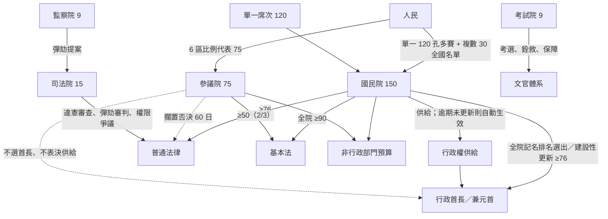

## 2 兩院分工：政府院與規則院

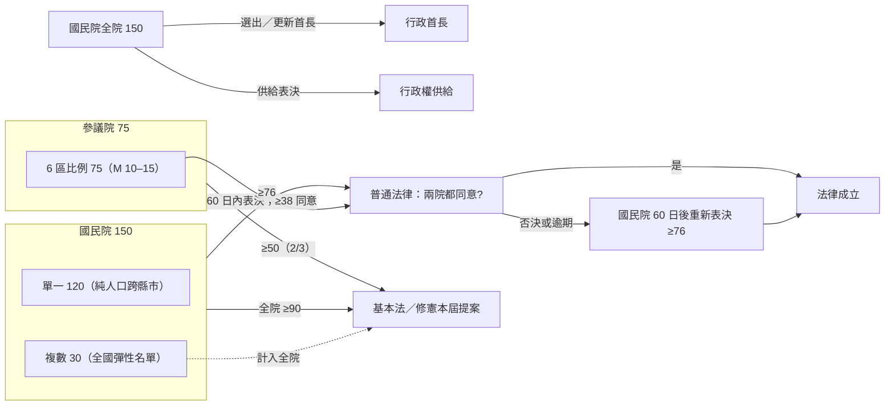

## 3 為什麼不長得像現行制度

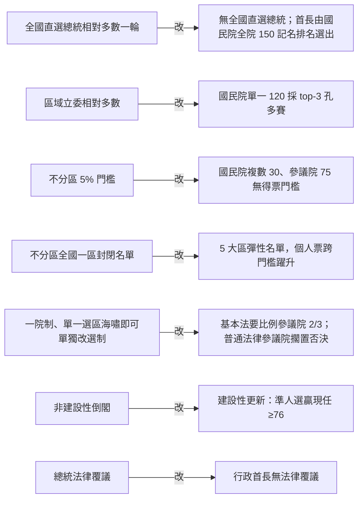

## 4 行政與國民院：拆得掉，但必須組得出

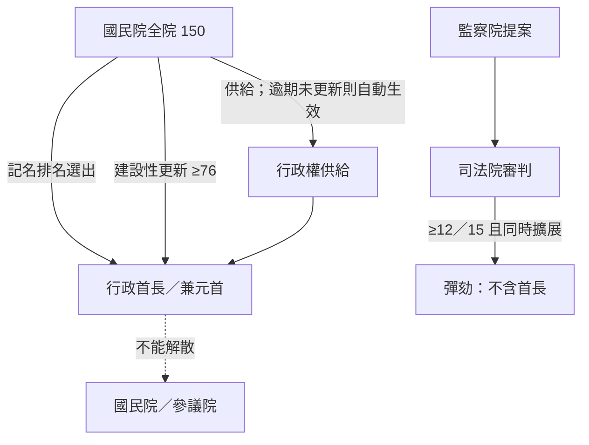

## 5 供給問題怎麼解（建設性＋自動生效）

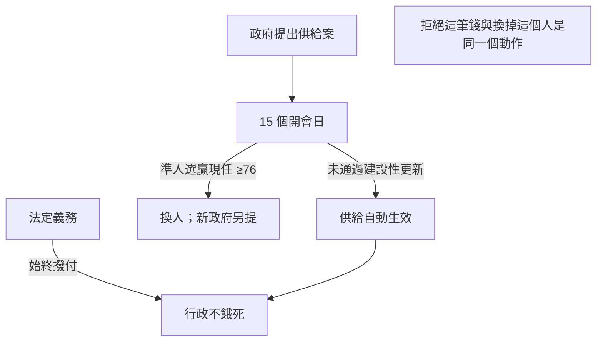

## 6 錢只看國民院，普通法律參議院擱置，基本法要參議院 2/3

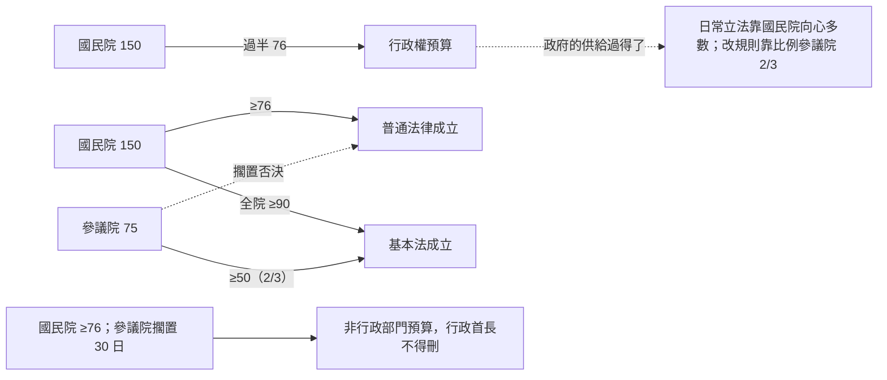

## 7 修憲：兩院 2/3 跨屆＋人民替代現狀

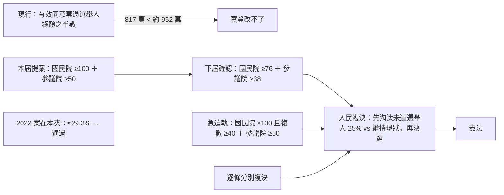

## 8 三院人事：甲（國民院單一）、乙（參議院）、丙（首長對決）

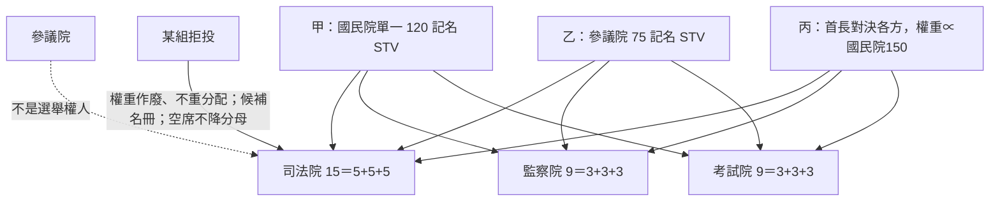

## 9 高政治性：從甲向兩側同時擴展

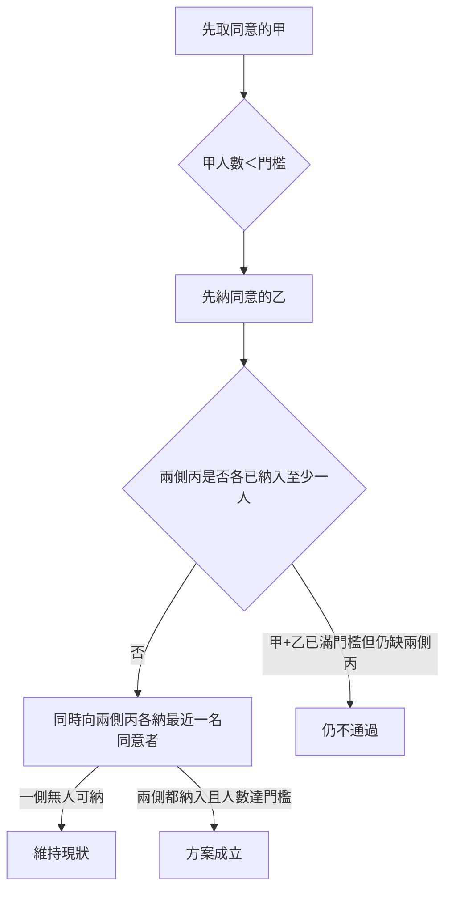

## 10 緊急狀態：預設是結束，而且不碰選舉與更新

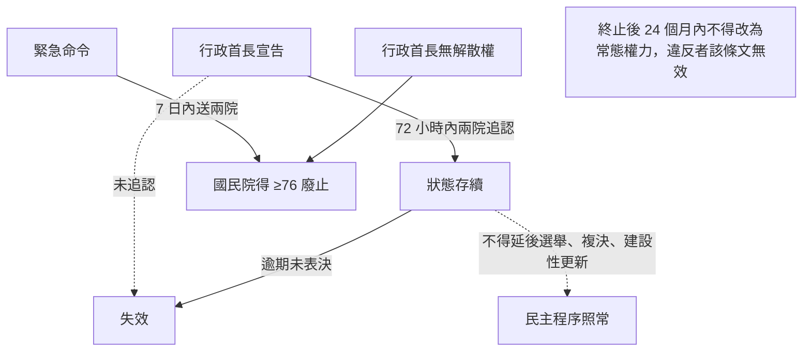

## 11 更新：建設性換人

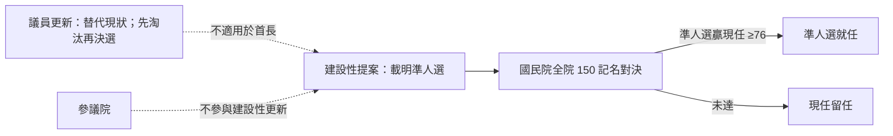
