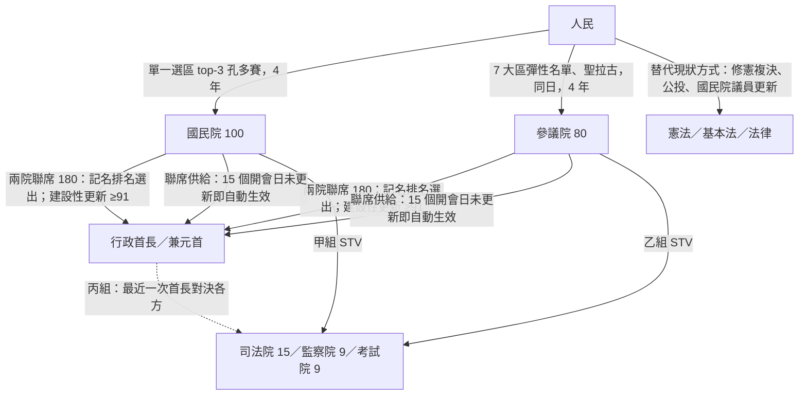
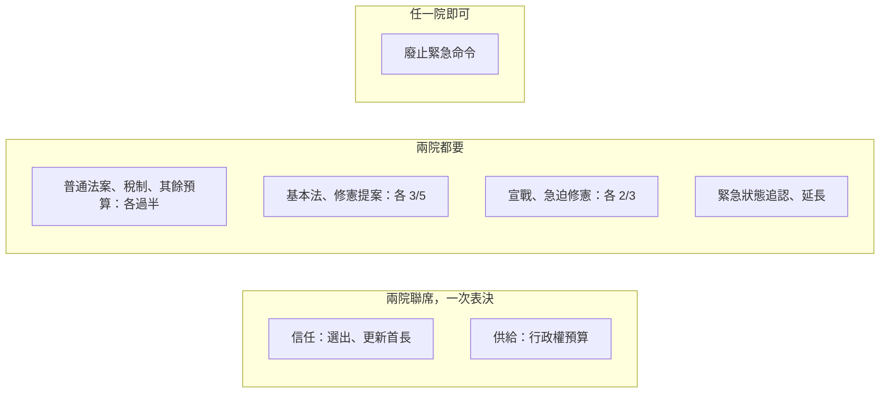
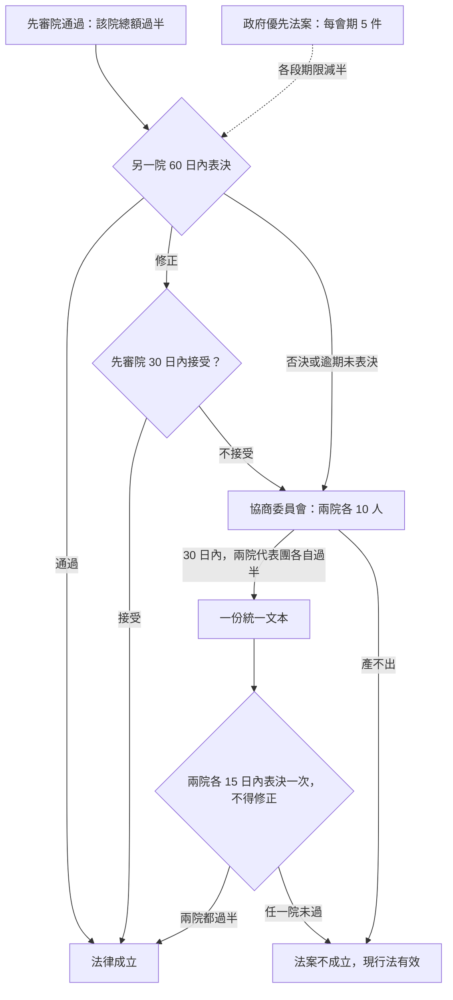
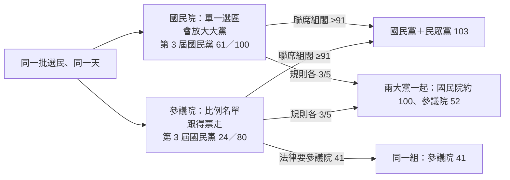
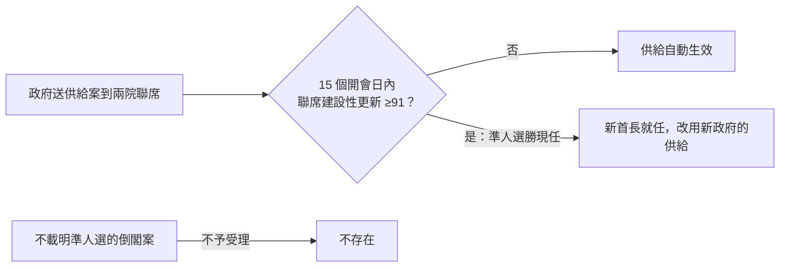
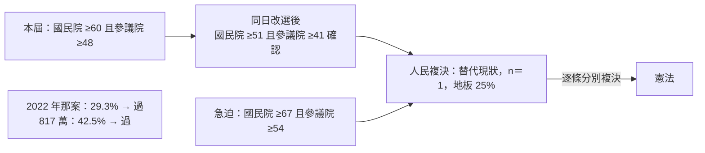
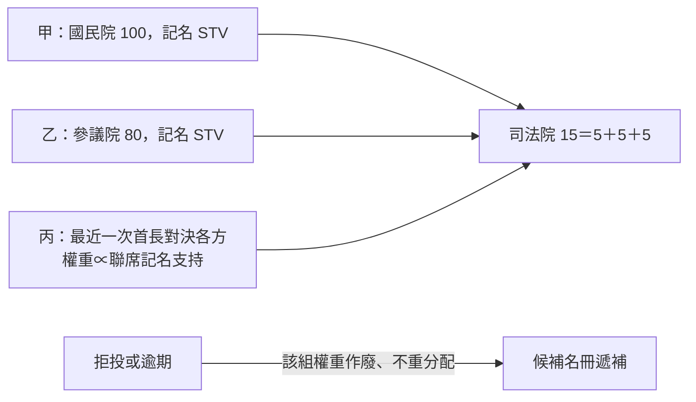
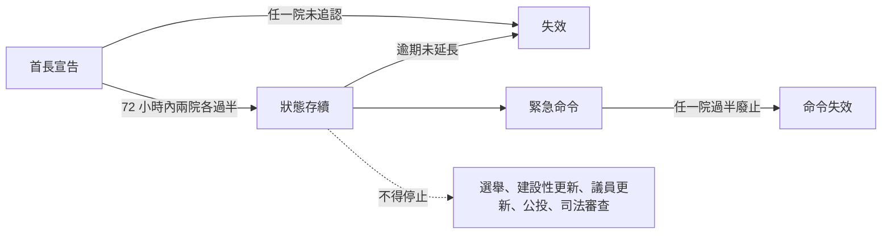

# 憲政架構圖

數字與正文同一組：國民院 100（過半 51、3/5 60、2/3 67）；參議院 80（過半 41、3/5 48、2/3 54）；兩院聯席 180（過半 91）。

## 1 全景：人民、兩院、五權

## 2 聯席管政府與錢，兩院各自管規則

## 3 普通法案：雙重同意與收斂

沒有延宕期滿視為通過、沒有覆寫、沒有「不表決視為同意」。最長約 4.5 個月。

## 4 為什麼兩院長得不一樣

## 5 建設性更新與供給

## 6 修憲

## 7 三院人事：甲乙丙

## 8 緊急狀態

