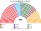
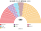
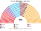
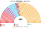
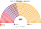
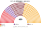

# 近期大選重算

> **這檔是什麼**：近期大選得票**怎麼**套進本夾選制（方法、假設、對照）。席次一覽與圖見 [`估計結果.md`](估計結果.md) §1、[`席次圖.md`](席次圖.md)。

2023、2018 套新制（另以 2024 地方選舉代理）

**方法**：[`生態模型.py`](生態模型.py)。第一偏好是最高選舉委員會開放資料的**逐縣**得票（[`資料/`](資料/)，約 970 縣；國外與海關票不含）；偏好排序是假設（[`12`](12-預期政治生態.md) §2）。只用當時民意。

## 1 一覽

| | 實際（600） | 實際政府 | **新制全院 450** | **首長** | **組閣陣營** |
|---|---|---|---|---|---|
| 2024-03（地方代理） | — | — | **CHP 159**、AKP 98、新福利 70、MHP 38、İYİ 34、DEM 29 … | 新福利（循環） | 新福利＋…＋AKP＋MHP＋İYİ 246 |
| 2023-05 | AKP 268、CHP 169、綠左 61、MHP 50、İYİ 43 … | AKP 候選人（人民聯盟） | AKP 171、CHP 99、İYİ 79、MHP 59、DEM 38 | **MHP** | MHP＋AKP 230 |
| 2023-05（總統票，家園黨放回） | 同上 | 同上 | AKP 206、CHP 152、勝利黨 32 … | **AKP** | AKP＋MHP 226 |
| 2018-06 | AKP 295、CHP 146、HDP 67、MHP 49、İYİ 43 | AKP 候選人（人民聯盟） | **AKP 237**、CHP 93、İYİ 52、DEM 42、MHP 26 | **AKP** | AKP 單獨 |
| 2015-11 | AKP 317、CHP 134、HDP 59、MHP 40 | 達武特奧盧（AKP 單獨） | AKP 255、MHP 66、CHP 88、DEM 41 | **AKP** | AKP 單獨 255 |
| 2015-06 | AKP 258、CHP 132、MHP 80、HDP 80 | 組閣失敗 → 2015-11 重選 | AKP 192、MHP 112、CHP 97、DEM 49 | **MHP** | MHP 112＋AKP 192＝304 |

## 2 2024-03 地方選舉代理

用市議會的政黨票當「最近民意」。**限制**：DEM 在西部大城沒有推出或支持 CHP；地方選舉的投票行為與全國不同。

| 政黨 | 得票% | 單一 270 | 複數 180 | **新制** |
|---|--:|--:|--:|--:|
| CHP | 35.5 | 91 | 68 | **159** |
| AKP | 32.4 | 32 | 66 | **98** |
| YRP | 7.0 | 61 | 13 | **74** |
| MHP | 5.9 | 27 | 11 | **38** |
| İYİ | 4.6 | 26 | 8 | **34** |
| DEM | 5.6 | 17 | 12 | **29** |
| Zafer | 2.6 | 12 | 1 | **13** |
| BBP | 1.2 | 2 | 1 | **3** |
| SP | 1.3 | 2 | 0 | **2** |

- **CHP 全院 159**，單一 91：伊斯坦堡 27／50、伊茲密爾 13／15、愛琴海內陸 12、安卡拉 11、西馬爾馬拉 10。
- **新福利單一 61**：「AKP／CHP／新福利」的 74 區裡它是兩邊的第二偏好；東南西 13／14、伊斯坦堡三 7、東馬爾馬拉 7。
- 首長：循環（CHP＞新福利＞AKP＞CHP），Ranked Pairs 第一名新福利黨，對 CHP 215:235，**沒過 226**（[`12`](12-預期政治生態.md) §5.2）。

## 3 2023-05

| 政黨 | 得票% | 實際 | 單一 270 | 複數 180 | **新制** |
|---|--:|--:|--:|--:|--:|
| AKP | 35.5 | 268 | 102 | 69 | **171** |
| CHP | 25.5 | 169 | 48 | 51 | **99** |
| İYİ | 9.8 | 43 | 61 | 18 | **79** |
| MHP | 9.9 | 50 | 39 | 20 | **59** |
| DEM | 8.8 | 61 | 19 | 19 | **38** |
| YRP | 2.8 | 5 | 0 | 2 | **2** |
| TİP | 1.7 | 4 | 0 | 1 | **1** |
| BBP | — | — | 1 | 0 | 1 |

| 區（單一） | 結果 |
|---|---|
| 伊斯坦堡一（16） | CHP 9、İYİ 4、AKP 3 |
| 伊斯坦堡二（18）、三（16） | AKP 8＋8、İYİ 7＋5、CHP 3＋3 |
| 西馬爾馬拉＋布爾薩（23） | İYİ 11、AKP 8、CHP 4 |
| 東馬爾馬拉（17） | AKP 12、MHP 3、İYİ 2 |
| 伊茲密爾（15） | CHP 10、İYİ 5 |
| 愛琴海內陸（22） | İYİ 13、AKP 7、CHP 2 |
| 安卡拉（19） | AKP 9、CHP 4、İYİ 4、MHP 2 |
| 中安納托利亞（21） | MHP 14、AKP 7 |
| 西地中海（17） | CHP 10、İYİ 5、MHP 2 |
| 東地中海（17） | CHP 6、MHP 6、AKP 4、İYİ 1 |
| 西黑海（16） | AKP 10、MHP 6 |
| 東黑海與東北（15） | AKP 9、MHP 3、DEM 2、CHP 1 |
| 中東部（12） | AKP 5、DEM 5、MHP 1、İYİ 1 |
| 東南西（14） | AKP 13、MHP 1 |
| 東南東（12） | DEM 12 |

- 決選三人：AKP／CHP／İYİ 109 區、AKP／CHP／MHP 83 區、AKP／CHP／DEM 61 區。**沒有循環**。
- 114 區的當選者不是第一偏好最多者；當選者第一偏好中位數 38%。

### 3.1 總統第一輪當第一偏好

總統票只有四個陣營：人民聯盟（AKP）49.2%、國家聯盟（CHP）45.1%、祖先聯盟（勝利黨）5.3%、家園黨 0.4%。**把國家聯盟與 DEM 的票都算給 CHP**：CHP 拿下東南東 12／12。

**退選政黨放回**（[算法規劃](../../../notes/算法/單一選區與總統重算算法.md) §6，政黨層級）：家園黨 2023-05-11 退出總統選舉（名字仍在票上），這是兩輪決選下「避免分票」的退選；新制第二輪完整排序，退選沒有好處。放回到同日議會選舉的家園黨得票（各縣比例，全國 0.9%），補上的票從 CHP 扣回（44.5%）。結果：CHP 單一 103 → 101、勝利黨 30 → 32，家園黨沒進任何一區的前三。首長 AKP，對 CHP 只有 228:222。這一版只說明「兩大陣營」框架本身的形狀，第一偏好太粗，不當主結果。

## 4 2018-06

| 政黨 | 得票% | 實際 | 單一 270 | 複數 180 | **新制** |
|---|--:|--:|--:|--:|--:|
| AKP | 42.5 | 295 | 160 | 77 | **237** |
| CHP | 22.9 | 146 | 50 | 43 | **93** |
| İYİ | 10.1 | 43 | 35 | 17 | **52** |
| DEM | 11.5 | 67 | 19 | 23 | **42** |
| MHP | 11.0 | 49 | 6 | 20 | **26** |

- **AKP 單一 160**：那年 AKP 得票 42.5%，中安納托利亞 20／21、黑海全拿、伊斯坦堡二三 23／34。
- **AKP 237 > 226**：單獨執政，但複數 77 < 108、全院 < 270：**改不了規則**。
- MHP 只有單一 6：AKP 太強，MHP 少有進前三名又能贏的區。

## 5 2015-11

| 政黨 | 單一 270 | 複數 180 | **新制** |
|---|--:|--:|--:|
| AKP | 166 | 89 | **255** |
| MHP | 44 | 22 | **66** |
| CHP | 40 | 48 | **88** |
| DEM | 20 | 21 | **41** |

- **AKP 單一 166、全院 255，單獨過 226**：AKP 得票 49.3%，中安納托利亞 21／21、東南西 14／14。MHP 單一 44（愛琴海內陸 11、西地中海 9），CHP 只剩伊茲密爾的 13 席。AKP 全院 255 過 226 但不到 270，**改不了規則**。

## 6 2015-06

| 政黨 | 單一 270 | 複數 180 | **新制** |
|---|--:|--:|--:|
| AKP | 114 | 78 | **192** |
| MHP | 84 | 28 | **112** |
| CHP | 50 | 47 | **97** |
| DEM | 22 | 27 | **49** |

- **MHP 單一 84、全院 112**：「AKP／CHP／MHP」的 198 區裡，MHP 是兩邊選民的共同第二偏好。**首長是 MHP**（對 AKP 258:192），與 AKP 組閣 304。現實中這一年 AKP 失去過半、組閣 45 日內失敗，總統宣布提前改選；本夾無解散，30 日內 MHP＋AKP 政府成立。

## 7 敏感度

見 [`12`](12-預期政治生態.md) §6。

## 8 限制

- 第一偏好用政黨票；候選人個人因素沒有反映。
- 國外票（2023 年約 180 萬有效票）不在逐縣資料內，沒有算進名單層。
- 新選區沿縣中心座標的 Hilbert 序切；選舉人超過半席的縣（155 個）等分成數塊，假設縣內組成相同。
- 縣中心座標取自 Wikidata，5 個以人工補上。

## 來源

- 最高選舉委員會開放資料平台 acikveri.ysk.gov.tr：2023-05-14 議會與總統第一輪、2018-06-24 議會、2024-03-31 市議會選舉的逐縣結果。
- 實際席次：同上公告。
