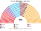
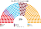
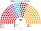
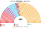
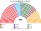
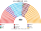
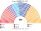

# 估計結果

> 近期大選與民調的民意套進本夾後的席次、首長、組閣與朝野互動。圖庫見 [`席次圖.md`](席次圖.md)。

選制摘要：全院 **450＝單一 270（top-3 孔多賽）＋複數 180（彈性名單、16 區聖拉古、無法定門檻）**。詳 [`01`](01-國會與選制.md)。

## 計算方式

| 層 | 做法 |
|---|---|
| 民意層 | 最高選舉委員會（YSK）開放資料逐縣（ilçe，約 970 個）國會得票（國外與海關票不含）。現行是比例名單，棄保失真比總統選舉小；聯盟內政黨分開計 |
| 參選方層 | 每黨都可推人；地方性政黨只在本地參選；相鄰政黨在合起來能進前 3、且雙方都偏好合併後勝者時共同提名（席次圖產生器）；DEM 等庫德政黨在東南部有地方實力 |
| 單一 270 | 依省配額，沿縣中心座標的 Hilbert 序切成選舉人相近的選區，大縣等分成數塊（假設縣內組成相同）；前 3 名、全體選民完整排序兩兩對決，循環用 Ranked Pairs。選民排序由各黨在經濟、宗教、民族、政權四軸的位置推得 |
| 複數 180 | 各區聖拉古、無門檻 |
| 首長、組閣 | 全院 450 記名排名，孔多賽；組閣由首長往外依政策距離加黨到 ≥226 |
| 民調 | 全國投票意向，以 2023 縣地理縮放 |

程式：[`生態模型.py`](生態模型.py)、[`民調推估.py`](民調推估.py)；細節見 [`14`](14-近期大選重算.md)、共同算法 [`選舉結果計算方式`](../../../notes/算法/選舉結果計算方式.md)。

## 1 近期大選

用當時實際得票套本夾（另以 2024 地方選舉代理）。細節與方法見 [`14-近期大選重算.md`](14-近期大選重算.md)（[`生態模型.py`](生態模型.py)）。

| | 實際（600） | **本夾全院 450** | 首長 |
|---|---|---|---|
| 2023-05 | AKP 268、CHP 169、綠左 61、MHP 50、İYİ 43 … | AKP **171**、CHP 99、İYİ 79、MHP 59、DEM 38 | **MHP**（組閣 MHP＋AKP 230） |
| 2018-06 | AKP 295、CHP 146、HDP 67、MHP 49、İYİ 43 | AKP **237**、CHP 93、İYİ 52、DEM 42、MHP 26 | **AKP**（單獨過半） |
| 2015-11 | AKP 317、CHP 134、HDP 59、MHP 40 | AKP **255**、CHP 88、MHP 66、DEM 41 | **AKP**（單獨過半） |
| 2015-06 | AKP 258、CHP 132、MHP 80、HDP 80 | AKP **192**、MHP 112、CHP 97、DEM 49 | **MHP**（組閣 MHP＋AKP 304） |
| 2024-03（地方代理） | — | CHP **159**、AKP 98、新福利 70、MHP 38、İYİ 34、DEM 29 … | 新福利（循環；對 CHP 未過 226） |

### 2023-05 單一／複數

| 政黨 | 單一 270 | 複數 180 | **全院** |
|---|--:|--:|--:|
| AKP | 102 | 69 | **171** |
| CHP | 48 | 51 | **99** |
| İYİ | 61 | 18 | **79** |
| MHP | 39 | 20 | **59** |
| DEM | 19 | 19 | **38** |
| YRP | 0 | 2 | **2** |
| TİP | 0 | 1 | **1** |
| BBP | 1 | 0 | 1 |

**組閣聯盟／多數派政府**：首長 **MHP**；執政多數 MHP＋AKP＝**230**（過半 226）；改選制／修憲要全院 270 且複數 108——現達不到。

**預期政治生態**：**最大黨不當首長**：AKP 171 席，首長卻是 MHP（59 席），因為 MHP 在議員的兩兩對決中同時勝過 AKP 與 CHP：它夾在兩大陣營之間。政府只多 4 席，AKP 是大股東，隨時能與其他黨用建設性更新換人，實權仍在 AKP。İYİ 79 席是本夾的意外贏家：它在 AKP、CHP 的三人決選中是兩邊共同的第二偏好。

### 2018-06 單一／複數

| 政黨 | 單一 270 | 複數 180 | **全院** |
|---|--:|--:|--:|
| AKP | 160 | 77 | **237** |
| CHP | 50 | 43 | **93** |
| İYİ | 35 | 17 | **52** |
| DEM | 19 | 23 | **42** |
| MHP | 6 | 20 | **26** |

**組閣聯盟／多數派政府**：首長 **AKP**；AKP **237** 單獨過半；複數 77＜108，改規則要拉人。

**預期政治生態**：AKP 單獨執政，不必依賴 MHP；但改規則（含修憲）要拉 CHP 或 MHP 與 İYİ，總統制式的單方面改制在本夾做不到。

### 2024-03 地方代理 單一／複數

| 政黨 | 單一 270 | 複數 180 | **全院** |
|---|--:|--:|--:|
| CHP | 91 | 68 | **159** |
| AKP | 32 | 66 | **98** |
| YRP | 61 | 13 | **74** |
| MHP | 27 | 11 | **38** |
| İYİ | 26 | 8 | **34** |
| DEM | 17 | 12 | **29** |
| Zafer | 12 | 1 | **13** |
| BBP | 2 | 1 | **3** |
| SP | 2 | 0 | **2** |

**組閣聯盟／多數派政府**：首長示意 **新福利**（循環；對 CHP 未過 226）。

**預期政治生態**：以 2024 地方選舉的得票當民意，CHP 159 席是最大黨，但議員之間出現循環，Ranked Pairs 選出伊斯蘭主義的新福利黨（74 席）。這是不穩定的格局：任何兩大黨聯手都能用建設性更新換人，首長隨時可能易手。

2023 年 MHP＋AKP 全院 230、複數 89——立法過半，改選制／修憲（全院 270 且複數 108）不行。2018 年 AKP 237 單獨過半，複數 77 仍改不了規則。

## 2 民調

> 2026-11-04：本節數字改由 [`民調推估.py`](民調推估.py) 重算（輸入 [`資料/polls.csv`](資料/polls.csv)）。原數字沒有留下可重跑的程式；新黨沿用母黨的政策位置與地理（見程式開頭）。

公開全國投票意向（PolitPro 等彙整）。方法：以 **2023-05 逐縣** 為地理基底，按民調得票率縮放後跑本夾——**單一 270** top-3 孔多賽、**複數 180** 聖拉古（不是全國比例拆單一）。Yeni＝Yeni Parti（Özel；地理以 CHP 為種）；Anahtar 以 İYİ 為種。

### ASAL（2026-10-04..10，n＝2020）

首長 **Anahtar**（模型對決敏感）。

**預期政治生態**：AKP 153 席最大，但議員排序出現循環，首長落到只有 4 席的 Anahtar：它在各大黨之間都不是最後一名。**這是模型對排序假設很敏感的結果**；現實中議員很可能策略性地排序，讓 AKP 或 İYİ 這類大黨勝出。若 Anahtar 真的當選，它只能當兩大陣營的看守型首長。

| 政黨 | 得票推估% | 單一 270 | 複數 180 | 全院 450 |
|---|--:|--:|--:|--:|
| AKP | 31.6% | 91 | 62 | **153** |
| Yeni | 25.2% | 46 | 50 | **96** |
| İYİ | 7.1% | 78 | 13 | **91** |
| MHP | 8% | 35 | 15 | **50** |
| DEM | 8.8% | 20 | 19 | **39** |
| CHP | 5.1% | 0 | 11 | **11** |
| Anahtar | 3.2% | 0 | 4 | **4** |
| Zafer | 3.4% | 0 | 4 | **4** |
| YRP | 2.9% | 0 | 2 | **2** |
| 其他 | 4.7% | 0 | 0 | **0** |

### Kontak（2026-09-29..10-04，n＝1773）

首長 **Zafer**。

**預期政治生態**：民族主義的 Zafer（83 席，單一 67 席）當首長：它在議員的兩兩對決中勝過 AKP 與新黨（Yeni），是兩大陣營之間的折衷。政府要靠 AKP 或 Yeni 撐，Zafer 的移民、難民立場會成為政府主軸，與 DEM 的衝突升高。

| 政黨 | 得票推估% | 單一 270 | 複數 180 | 全院 450 |
|---|--:|--:|--:|--:|
| AKP | 28.5% | 90 | 55 | **145** |
| Yeni | 23.8% | 54 | 44 | **98** |
| Zafer | 7.7% | 67 | 16 | **83** |
| İYİ | 6.8% | 35 | 14 | **49** |
| DEM | 8.5% | 21 | 19 | **40** |
| CHP | 12.2% | 0 | 23 | **23** |
| MHP | 3.8% | 3 | 7 | **10** |
| YRP | 3.1% | 0 | 2 | **2** |
| BBP | — | 0 | 0 | **0** |
| TİP | 1.6% | 0 | 0 | **0** |
| 其他 | 4% | 0 | 0 | **0** |

## 3 長期運行假設下

生態模型示意 **推估第 3 屆**（＝2023 得票套本夾；假設見 [`12-預期政治生態.md`](12-預期政治生態.md)；數字由 [`生態模型.py`](生態模型.py) 算出）。

| 政黨 | 單一 270 | 複數 180 | 全院 450 |
|---|--:|--:|--:|
| AKP | 102 | 69 | **171** |
| CHP | 48 | 51 | **99** |
| İYİ | 61 | 18 | **79** |
| MHP | 39 | 20 | **59** |
| DEM | 19 | 19 | **38** |
| YRP | 0 | 2 | **2** |
| TİP | 0 | 1 | **1** |
| BBP | 1 | 0 | 1 |
| **計** | **270** | **180** | **450** |

首長：MHP；組閣陣營 MHP＋AKP 230。İYİ 單一 61——AKP／CHP／İYİ 決選區裡兩邊選民共同的第二偏好。
**預期政治生態**：同 2023 大選。誘因與候選人行為見 [`12-預期政治生態.md`](12-預期政治生態.md)。
