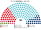
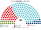

# 近期大選重算

> **這檔是什麼**：近期大選得票**怎麼**套進本夾選制（方法、假設、對照）。席次一覽與圖見 [`估計結果.md`](估計結果.md) §1、[`席次圖.md`](席次圖.md)。

2024、2019 套新制

**問題**：2024-09 與 2019-09 的選民照原本的偏好投票，在本夾的制度下會選出什麼樣的國會和政府？

**方法**：[`生態模型.py`](生態模型.py)。第一偏好是 BMI 終局 **Gemeinde／維也納區**得票（[`資料/nr-2024.csv`](資料/nr-2024.csv)、[`資料/nr-2019.csv`](資料/nr-2019.csv)；Briefwahl 按同政治區有效票比例併入）；偏好排序是假設（[`12`](12-預期政治生態.md) §2）。單一選區在邦內依 GKZ 序切，席次配額見 [`01`](01-國會與選制.md)。**不是**全國比例拆單一；**不模擬**政黨在新制下的重組（第 3 屆誘因假設見 [`估計結果`](估計結果.md) §3）。

## 1 一覽

| | 實際（183，三層 PR） | 實際組閣 | **新制全院 180** | **新制首長** | **組閣聯盟／多數派政府** |
|---|---|---|---|---|---|
| 2024-09 | FPÖ 31.1%、ÖVP 27.9%、SPÖ 22.4%、NEOS 9.8%、Grüne 8.7% | **155 天**；ÖVP＋SPÖ＋NEOS（排除 FPÖ） | ÖVP **57.2%**、SPÖ 21.1%、FPÖ 14.4%、NEOS 3.9%、Grüne 2.8%、KPÖ 0.6% | **ÖVP**（最弱 129） | **ÖVP＝103** |
| 2019-09 | ÖVP 38.8%、SPÖ 21.9%、FPÖ 16.9%、Grüne 14.2%、NEOS 8.2% | ÖVP＋Grüne（Kurz） | ÖVP **59.4%**、SPÖ 22.2%、Grüne 7.8%、FPÖ 7.2%、NEOS 3.3% | **ÖVP**（最弱 120） | **ÖVP＝107** |

## 2 2024-09

| 政黨 | 得票% | 實際 | 單一 108 | 複數 72 | **新制** |
|---|--:|--:|--:|--:|--:|
| FPÖ | 28.9 | 57 | 3 | 23 | **26** |
| ÖVP | 26.3 | 51 | 83 | 19 | **102** |
| SPÖ | 21.1 | 41 | 22 | 17 | **39** |
| NEOS | 9.1 | 18 | 0 | 7 | **7** |
| GRÜNE | 8.2 | 16 | 0 | 5 | **5** |
| KPÖ | 2.4 | 0 | 0 | 1 | **1** |
| BIER 等 | 4.0 | 0 | 0 | 0 | **0** |

| 邦（單一） | 結果 |
|---|---|
| Wien（24） | SPÖ 18、ÖVP 6 |
| Niederösterreich（20） | ÖVP 20 |
| Oberösterreich（18） | ÖVP 17、SPÖ 1 |
| Steiermark（15） | ÖVP 14、SPÖ 1 |
| Tirol（9） | ÖVP 8、SPÖ 1 |
| Salzburg（7） | ÖVP 7 |
| Kärnten（7） | ÖVP 4、FPÖ 3 |
| Vorarlberg（5） | ÖVP 5 |
| Burgenland（3） | ÖVP 3 |

- **組閣 155 天 → 30 日內**：ÖVP 是孔多賽贏家（對 FPÖ 154:26；最弱對 Grüne／NEOS／SPÖ 128:52）；ÖVP 單獨 102 過半，不必談三黨。
- **FPÖ 57 → 26**：全國第一偏好，單一只 3（皆在 Kärnten）。決選三人最常見是 **FPÖ／SPÖ／ÖVP**（92 區）；FPÖ 幾乎不是第二偏好。
- **53 區**「非第一偏好第一名當選」；當選者第一偏好中位數約 29%，沒有一區過半。
- **2 區循環**（Ranked Pairs）。

## 3 2019-09

| 政黨 | 得票% | 實際 | 單一 108 | 複數 72 | **新制** |
|---|--:|--:|--:|--:|--:|
| ÖVP | 37.5 | 71 | 78 | 28 | **106** |
| SPÖ | 21.2 | 40 | 24 | 16 | **40** |
| FPÖ | 16.2 | 31 | 0 | 13 | **13** |
| GRÜNE | 13.8 | 26 | 5 | 10 | **15** |
| NEOS | 8.1 | 15 | 1 | 5 | **6** |
| JETZT | 1.9 | 0 | 0 | 0 | **0** |
| KPÖ 等 | 1.3 | 0 | 0 | 0 | **0** |

| 邦（單一） | 結果 |
|---|---|
| Wien（24） | SPÖ 19、GRÜNE 5 |
| Niederösterreich（20） | ÖVP 20 |
| Oberösterreich（18） | ÖVP 15、SPÖ 3 |
| Steiermark（15） | ÖVP 14、SPÖ 1 |
| Tirol（9） | ÖVP 8、SPÖ 1 |
| Salzburg（7） | ÖVP 7 |
| Kärnten（7） | ÖVP 7 |
| Vorarlberg（5） | ÖVP 5 |
| Burgenland（3） | ÖVP 3 |

- **ÖVP 單獨 106 過半**：現實是 ÖVP＋Grüne；新制下聯盟協議不是就任條件。
- **FPÖ 31 → 13**：單一只 0——那年第一偏好已掉到 16%，三人決選裡更不是第二偏好。
- **Grüne 單一 4**（皆 Wien）：文化開放軸上能進決選並勝過部分 SPÖ／ÖVP 組合。
- 首長 ÖVP（最弱對 Grüne／NEOS／SPÖ 120:60）。

## 4 敏感度與穩健性（2024）

| 檢查 | 結果 |
|---|---|
| 選民全部重經濟 | 單一 FPÖ 78、SPÖ 19、ÖVP 9；首長 **FPÖ** |
| 選民全部重文化 | 單一 ÖVP 81、SPÖ 27；首長 ÖVP |
| 全部均衡 | 單一 ÖVP 81、SPÖ 26；首長 ÖVP |
| FPÖ −6 點 | 全院 ÖVP 102、SPÖ 46、FPÖ 17；首長 ÖVP |
| FPÖ ＋6 點 | 全院 ÖVP 95、FPÖ 38、SPÖ 33；首長 ÖVP |

★ **全部重經濟**時 FPÖ 變首長：說明 2024 基準結果高度依賴「文化軸權重」假設。改 [`12`](12-預期政治生態.md) §2.1 的選民型權重就會動搖誰當選首長——這是本夾必須標出的敏感點，不是拿來粉飾。

## 5 限制

- 偏好排序是假設的二維空間，不是真實排序票。
- 單一選區依 GKZ 序切，不是官方劃界；Wien 23 區要 24 席時對最大單位對半拆。
- Briefwahl 按同政治區（Bezirk 碼）有效票比例併入市鎮，不是逐所歸屬。
- 2019 與 2024 的市鎮集合略有增減（2118 vs 2115）；切區各自獨立。
- 不模擬新制下的政黨重組（那是 §3 長期，不是本檔）。

## 來源

- BMI，《Nationalratswahl 2024／2019》終局 Gemeindeergebnisse xlsx（[`資料/nr2024-bmi.xlsx`](資料/nr2024-bmi.xlsx)、[`資料/nr2019-bmi.xlsx`](資料/nr2019-bmi.xlsx)）。
- 實際席次與組閣：Bundeswahlbehörde 終局；2024–25 組閣 155 天為公開時程紀錄。
