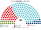

# 估計結果

> 席次**表**——§1 近期大選、§2 民調、§3 長期。圖庫見 [`席次圖.md`](席次圖.md)；算法見 [`14`](14-近期大選重算.md)、[`生態模型.py`](生態模型.py)。

選制摘要：全院 **180＝單一 108（top-3 孔多賽）＋複數 72（聖拉古、無全國門檻、九邦）**。詳 [`01`](01-國會與選制.md)。

## 計算方式

| 層 | 做法 |
|---|---|
| 民意層 | 內務部（BMI）終局逐市鎮（維也納逐區）國民議會得票，通信投票依同政治區比例併入。現行是比例制，棄保失真小，直接當第一偏好 |
| 參選方層 | 每黨都可推人；相鄰政黨在合起來能進前 3、且雙方都偏好合併後勝者時共同提名（席次圖產生器） |
| 單一 108 | 依邦配額，邦內依市鎮代碼順序切成票數相近的選區（不跨邦）；前 3 名、全體選民完整排序兩兩對決，循環用 Ranked Pairs。選民排序由各黨在經濟、文化兩軸的位置推得 |
| 複數 72 | 九邦聖拉古、無全國門檻 |
| 首長、組閣 | 全院 180 記名排名，孔多賽；組閣由首長往外依政策距離加黨到 ≥91 |
| 民調 | 全國得票率，以 2024 市鎮地理縮放 |

程式：[`生態模型.py`](生態模型.py)（`--poll` 民調、`--projection` 第 3 屆）；細節見 [`14`](14-近期大選重算.md)。

## 1 近期大選

BMI 市鎮得票套本夾（**不是**比例拆單一）。細節見 [`14`](14-近期大選重算.md)。**不是第 3 屆。**

| | 實際（183） | **本夾全院 180** | 首長 |
|---|---|---|---|
| 2024-09 | FPÖ 31.1%、ÖVP 27.9%、SPÖ 22.4%、NEOS 9.8%、Grüne 8.7%；組閣 155 天 | ÖVP **57.2%**、SPÖ 21.1%、FPÖ 14.4%、NEOS 3.9%、Grüne 2.8%、KPÖ 0.6% | **ÖVP** |
| 2019-09 | ÖVP 38.8%、SPÖ 21.9%、FPÖ 16.9%、Grüne 14.2%、NEOS 8.2% | ÖVP **59.4%**、SPÖ 22.2%、Grüne 7.8%、FPÖ 7.2%、NEOS 3.3% | **ÖVP** |

### 2024-09 單一／複數

| 政黨 | 單一 108 | 複數 72 | **全院** |
|---|--:|--:|--:|
| ÖVP | 83 | 19 | **102** |
| SPÖ | 22 | 17 | **39** |
| FPÖ | 3 | 23 | **26** |
| NEOS | 0 | 7 | **7** |
| GRÜNE | 0 | 5 | **5** |
| KPÖ | 0 | 1 | **1** |

**組閣聯盟／多數派政府**：首長 **ÖVP**；ÖVP 單獨 **102**（過半 91）。改規則要複數 ≥43（ÖVP 僅 19）。

**預期政治生態**：ÖVP 單獨執政，不必經過 155 天的三黨談判。FPÖ 得票第一卻只有 26 席（單一 3 席），是最大的「票多席少」反對黨，會把選制本身當成政治議題，並用矯正型公投（[`06`](06-人民修改法規範.md)）挑戰剛通過的法律。改規則要全院 ≥108 且複數 ≥43：ÖVP＋SPÖ 複數只有 36，還要加 NEOS（43）。

### 2019-09

| 政黨 | 單一 108 | 複數 72 | **全院** |
|---|--:|--:|--:|
| ÖVP | 78 | 28 | **106** |
| SPÖ | 24 | 16 | **40** |
| GRÜNE | 5 | 10 | **15** |
| FPÖ | 0 | 13 | **13** |
| NEOS | 1 | 5 | **6** |

**組閣聯盟／多數派政府**：首長 **ÖVP**；ÖVP 單獨 **106**（現實為 ÖVP＋Grüne）。

**預期政治生態**：ÖVP 單獨過半，Grüne 從現實的執政夥伴變成反對黨。ÖVP＋SPÖ 全院 146、複數 44，兩大黨聯手就夠改規則；這是本檔各情境中唯一兩大黨聯手就夠的一次。

## 2 民調

方法：以 **2024 市鎮地理** 為基底，按民調全國得票%縮放後跑本夾——**單一** top-3 孔多賽、**複數** 聖拉古（**不是**比例拆單一）。

### Unique Research / Heute（田野 2026-09-28..10-01，n＝810）

全國意向：FPÖ 38、ÖVP 20、SPÖ 15、Grüne 12、NEOS 10、KPÖ 4。

| 政黨 | 單一 108 | 複數 72 | **全院** |
|---|--:|--:|--:|
| FPÖ | 32 | 28 | **60** |
| ÖVP | 45 | 14 | **59** |
| SPÖ | 29 | 12 | **41** |
| GRÜNE | 1 | 9 | **10** |
| NEOS | 1 | 7 | **8** |
| KPÖ | 0 | 2 | **2** |

**首長：ÖVP**（最弱一場對決 119:61）。FPÖ 席次最多，但其他黨的議員多把 ÖVP 排在 FPÖ 前面。  
**組閣聯盟／多數派政府**（依政策距離由近到遠）：ÖVP＋FPÖ＝**119**。  
★ 模型**不編碼**「排除 FPÖ」；若 ÖVP 仍不與 FPÖ 合作，可走 ÖVP＋SPÖ＋NEOS＝108 或 ÖVP＋SPÖ＋Grüne＝110——這是政黨行為，不是規則。

**預期政治生態**：最大黨不當首長。FPÖ 60 席要換掉 ÖVP 首長，得與 SPÖ 共推一人（合計 101），兩黨在文化軸上相距太遠，不太可能。所以 ÖVP 握有選夥伴的主動權：與 FPÖ 共組是右派政府，與 SPÖ 共組則重演大聯合。不論哪一組，FPÖ 在複數層有 28 席，加上任一黨就能擋下組織法（複數 3/5 是 43）。

## 3 長期運行（推估第 3 屆）

生態模型示意 **推估第 3 屆**（假設見 [`12`](12-預期政治生態.md) §2.3；`python 生態模型.py --projection`）。

**與 §1 不同**：不是 2024 得票重跑。假設兩屆孔多賽後——（1）約 5 點「發現 FPÖ 決選常輸」的第一偏好從 FPÖ 移到 ÖVP；（2）FPÖ 為搶第二偏好，文化軸從 1.0 軟化到 0.55；（3）BIER 消散、KPÖ 略升。地理形狀仍用 2024。

目標全國得票%：ÖVP 28、FPÖ 24、SPÖ 21、NEOS 10、Grüne 9、KPÖ 3.5、BIER 0.5。

| 政黨 | 單一 108 | 複數 72 | **全院 180** |
|---|--:|--:|--:|
| ÖVP | 74 | 23 | **97** |
| SPÖ | 29 | 17 | **46** |
| FPÖ | 5 | 17 | **22** |
| NEOS | 0 | 8 | **8** |
| GRÜNE | 0 | 6 | **6** |
| KPÖ | 0 | 1 | **1** |

**組閣聯盟／多數派政府**：首長 **ÖVP**；ÖVP 單獨 **97**（過半 91）。相對 §1：SPÖ 單一回升（Wien 全拿）、FPÖ 在 Kärnten 等拿回部分單一，但仍非孔多賽首長。

**預期政治生態**：ÖVP 單獨 97 席，只多 6 席，黨內任何一派都有籌碼。複數只有 23 席，連同 SPÖ 或 FPÖ 都只有 40，改規則要三黨。誘因與候選人行為見 [`12`](12-預期政治生態.md)。
