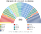

# 預期政治生態

> **席次估計**（近期大選重算、民調套本夾、長期運行假設下的席次表）見 [`估計結果.md`](估計結果.md)。本檔專注誘因、朝野互動與候選人行為；席次數字以估計結果與席次圖為準。

`0-基本/總體.md`：給長期運行下的預期政治生態，要有論據，可大膽假設。
`0-基本/要求.md` **硬性**：不得把提示詞要求直接當預期生態；不合期望就回頭改設計。

路徑：**誘因 → 得票 → 選制 → 席次 → 朝野互動 → 檢視**。席次由 [`生態模型.py`](生態模型.py) 算出（`python 生態模型.py --projection`）。

## 1 誘因

| 層 | 誘因 | 預期行為 |
|---|---|---|
| 單一席次（top-3 孔多賽） | 第三名支持者的第二偏好決定勝負 | **PT 的候選人 系與 PL 的候選人 系都要拿到對方選民的第二偏好**——兩邊都拿不到，於是贏的是中間 |
| 名單（彈性） | 個人票達 Droop 25% 才躍升 | 拉票王效應消失；黨的排序變重要 |
| 修正案廢除 | 要錢就得進政府 | 中間大團的地方機器失去燃料（§2.3 的推估假設） |
| 首長由國會選 | 中位議員是關鍵 | 全國大選不再是兩個人的對決 |
| 建設性更新 | 倒閣要扶一個具名的人上台 | 彈劾式的倒閣消失 |

## 2 假設

### 2.1 偏好空間

兩條軸：**陣營**（PT −1 … PL +1）、**政治風格**（綱領型 −1 … 恩庇、中間大團 +1）。

| 政黨 | 陣營 | 風格 | 政黨 | 陣營 | 風格 |
|---|:--:|:--:|---|:--:|:--:|
| PSOL（＋Rede） | −1.0 | −0.6 | PODE | 0.3 | 0.4 |
| PT（＋PCdoB、PV） | −0.9 | −0.2 | União | 0.3 | 0.7 |
| PDT | −0.5 | 0.0 | PP | 0.5 | 0.8 |
| PSB | −0.5 | 0.1 | União–PP（2026 聯盟） | 0.4 | 0.75 |
| PSDB（＋Cidadania） | 0.0 | −0.1 | REP（Republicanos） | 0.6 | 0.5 |
| MDB | −0.1 | 0.6 | PRD（＋Solidariedade） | 0.5 | 0.6 |
| PSD | 0.0 | 0.7 | MISSÃO | 0.6 | −0.6 |
| AVANTE | 0.0 | 0.6 | NOVO | 0.8 | −0.7 |
| | | | PL | 1.0 | 0.0 |

選民三型：重陣營 40%、重風格 25%、均衡 35%。中間大團＝PSD、MDB、União、PP、REP、PODE、AVANTE、PRD。

### 2.2 第一偏好

**眾議員選票**（政黨＋候選人票）。這是本模型最大的假設：巴西的眾議員選票是開放名單下的**個人票**，中間大團的地方名人吸走大量選票；PT 的候選人 2026 年第一輪拿 45%，PT 聯盟的眾議員票只有 15%。**眾議員票低估了兩大陣營、高估了中間大團**。§2.3 的推估修正這一點。

### 2.3 推估第 3 屆

2026 的地理；**議員修正案廢除後，中間大團的地方機器變弱**，PT 與 PL 各從中間大團按比例拿回 4 個百分點（PL 26.7%、PT 19.3%、União–PP 11.2%）。

## 3 席次（推估第 3 屆）

| 政黨 | 單一 300 | 複數 213 | **全院 513** |
|---|--:|--:|--:|
| PL | 28 | 62 | **90** |
| União–PP | 80 | 25 | **105** |
| PT | 17 | 44 | **61** |
| PSD | 47 | 16 | **63** |
| MDB | 35 | 13 | **48** |
| REP | 22 | 15 | **37** |
| PODE | 33 | 9 | **42** |
| PSB | 6 | 9 | **15** |
| PSDB | 18 | 4 | **22** |
| PSOL | 0 | 10 | **10** |
| NOVO | 7 | 4 | **11** |
| AVANTE | 4 | 1 | **5** |
| PRD | 3 | 1 | **4** |

左（PT、PSOL、PSB、PDT）88／中間大團 289／右（PL、NOVO、MISSÃO）118／PSDB 18。
門檻：過半 257、3/5 308、2/3 342；複數過半 107、3/5 128。

- **單一 300 裡中間大團 194 席**。最常見的決選三人是 PL／PT／União–PP（73 區）：União–PP 對 PL 有 PT 選民撐、對 PT 有 PL 選民撐。
- **PT 在東北一席單一都沒有**：東北的決選常是 PT／PSD／União–PP，PSD 或 União–PP 是孔多賽贏家。PT 的單一席次大多在里約、聖保羅、阿雷格里港的都會區。
- **當選者第一偏好的中位數約 20%**，最低 3.6%。
- **行政首長：PODE**（全院 29 席）。孔多賽贏家、無循環，最弱一場 260（過 257），第一輪就任。

## 4 朝野互動與候選人行為

| 面向 | 預期 |
|---|---|
| 首長 | **中位小黨的人**：模型三個情境都是中間大團的某一黨（PODE、União） |
| 立法 | 中間大團 274 席過半，普通法律由它主導；PL 或 PT 要影響法律，得和中間大團談 |
| 規則 | 中間大團複數只有 80（不到 128）：**改憲法要拉 PL 或 PT** |
| 換首長 | 在野要拿出一位具名的人，對決 ≥257；中間大團內部的換人比跨陣營容易 |
| 預算 | 自動生效；沒有修正案；中間大團的貨幣只剩部會（上限 24）與政治任命（公開） |
| 候選人 | 單一席次的 PL 候選人要拿 PT 選民的第二偏好，**極化言論被懲罰**；PT 候選人同理 |
| 兩大陣營 | 代表主要在**名單層**（PL 62、PT 44，合計半數名單席次）與大城市的單一席次 |

## 5 檢視：哪裡不合

本夾對自己的期望：**首長向心、議員不能拿預算換票、改規則要跨陣營、政府不因彈劾倒台。**後三項對得上；第一項對得上但代價很大。

### 5.1 不合一：中間大團拿到全院約三分之二

| 情境 | 中間大團 | 左 | 右 |
|---|--:|--:|--:|
| 2026 得票 | **339** | 68 | 98 |
| 2022 得票 | **355** | 67 | 60 |
| 推估第 3 屆 | 274 | 91 | 134 |

計劃的病 3 就是中間大團；新制把它從「被收買的一方」變成「執政的一方」。**向心選制在巴西選出的中位，正是恩庇型政黨。**

**檢視後的判斷**：本夾不改選制——孔多賽贏家是誰是選民的偏好，不是規則該決定的。改的是**中間大團執政時能拿什麼**：

| 原本 | 改成 | 檔 |
|---|---|---|
| 部會數不限 | **上限 24** | [`02`](02-政府組成與建設性更新.md) §2.5 |
| 政治任命不管 | **上限、逐一公開推薦政黨或議員** | 同上 |
| 聯盟協議不管 | **涉及部會、任命、預算者全文公開** | 同上 |
| 地方移轉不管 | **公式化，裁量 ≤10%** | [`03`](03-預算與供給.md) §2.4 |

### 5.2 不合二：兩大陣營在單一席次幾乎消失

2026 年 PT 的候選人 以 51.79% 當選總統；同一批選民在新制下讓 PT 拿到單一 **7** 席（全院 42）。PL 的情況好一些（單一 20、全院 72）。**選民最在意的那條線（PT 的候選人 或 PL 的候選人）在國會裡被壓扁成名單層的代表**。

本夾的判斷：這是 `1-優化/行政立法/共用.md` 要的（避免二極化、向心）；代價寫在這裡。

### 5.3 不合三：小黨的首長

三個情境的首長都是中間大團裡的一個中位小黨（2026 得票：PODE 51 席；推估：PODE 29 席）。小黨首長要靠中間大團的其他黨才能立法——**它是一個協調者，不是一個領袖**。供給自動生效讓它至少能執政。

### 5.4 對得上的

- **改規則要跨陣營**：三個情境沒有任何一群過複數 128。
- **沒有議員修正案**：中間大團要錢得進政府，進政府就得為政府負責。
- **首長在 30 日內產生**：三個情境都是。

## 6 敏感度

| 情境 | 單一 300 前三 | 中間大團／左／右 | 首長 |
|---|---|---|---|
| 2026 得票（基準） | União–PP 85、PSD 51、PODE 63 | 356／63／83 | PODE |
| 推估：PT、PL 各 +4 | União–PP 80、PL 28、PSD 47 | 274／91／134 | PODE |
| PT、PL 各 +8 | PL 70、União–PP 54、MDB 31 | 213／119／166 | PODE |
| PT、PL 各 +12 | PL 77、União–PP 32、PT 40 | 152／150／191 | PODE |
| 2026 PL −6 點 | União–PP 81、PSD 69、MDB 39 | — | PODE |
| 2026 PL +6 點 | União–PP 79、PL 47、PSD 49 | — | PRD |
| 選民全部重陣營 | União–PP 102、PSD 52、PL 15 | — | PODE |
| 選民全部重風格 | União–PP 59、PL 42、PSD 56 | — | PODE |

★ **首長在每一個情境都是中間大團的一個中位黨**，就算 PT、PL 各從中間大團拿 12 點、中間大團只剩 152 席。這是本夾在巴西最穩健的結果。

## 7 席次圖

[`席次圖.md`](席次圖.md)。
