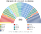
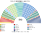
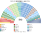

# 近期大選重算

> **這檔是什麼**：近期大選得票**怎麼**套進本夾選制（方法、假設、對照）。席次一覽與圖見 [`估計結果.md`](估計結果.md) §1、[`席次圖.md`](席次圖.md)。

2026、2022 套新制

**問題**：2026-10 與 2022-10 的選民照原本的偏好投票，在本夾的制度下會選出什麼樣的國會和政府？

**方法**：[`生態模型.py`](生態模型.py)。第一偏好是高等選舉法院（TSE）**逐市鎮×選舉區**的聯邦眾議員實際得票（[`資料/`](資料/)，約 6,000 個單位）；偏好排序是假設（[`12`](12-預期政治生態.md) §2）。選區固定用 2026 有效票切。參選方層用 `finals_for`（withdraw）：相鄰共同提名與高票讓低票，不把全國政黨重組成新黨。

## 1 一覽

| | 實際（513，開放名單） | **新制全院 513** | **新制首長** |
|---|---|---|---|
| 2026-10 | PL 121、PT 聯盟 88、União–PP 87、PSD 43、REP 41、MDB 36、PODE 27、其他 70 | União–PP 115、PL 60、PSD 69、MDB 53、PT 40、REP 41、PODE 75 … | **PODE**（孔多賽贏家，最弱 265） |
| 2022-10 | PL 99、PT 聯盟 80、União 59、PP 47、PSD 42、MDB 42、REP 41、其他 103 | União 106、PSD 73、PL 38、MDB 48、PP 33、PT 34 … | **União**（最弱一場 282） |

## 2 2026-10
| 政黨 | 得票% | 實際 | 單一 300 | 複數 213 | **新制** |
|---|--:|--:|--:|--:|--:|
| União–PP | 13.6 | 87 | 85 | 30 | **115** |
| PL | 22.7 | 121 | 8 | 52 | **60** |
| PSD | 8.3 | 43 | 51 | 18 | **69** |
| MDB | 6.9 | 36 | 37 | 16 | **53** |
| PT 聯盟 | 15.3 | 88 | 5 | 35 | **40** |
| REP | 7.0 | 41 | 24 | 17 | **41** |
| PODE | 5.2 | 27 | 63 | 12 | **75** |
| PSB | 4.4 | — | 0 | 10 | **10** |
| PSOL 聯盟 | 4.9 | — | 0 | 10 | **10** |
| NOVO | 2.6 | — | 1 | 4 | **5** |
| PSDB 聯盟 | 2.8 | — | 14 | 3 | **17** |
| PRD 聯盟 | 1.9 | — | 5 | 4 | **9** |
| AVANTE | 1.6 | — | 7 | 1 | **8** |
| MISSÃO | 1.1 | — | 0 | 1 | **1** |

左 63／中間大團 356／右 83／PSDB 11。

- **單一席次的決選三人最常見是 PL／PT／União–PP（59 區）**。三人裡 União–PP 是中位：PT 選民把它排在 PL 前，PL 選民把它排在 PT 前。
- **當選者第一偏好的中位數 18%，最低 6%**；300 區只有 4 區的當選者第一偏好過半。
- **PT 單一 7 席，都在大都會**。東北一席都沒有：那裡 PT 的眾議員票不夠高，決選常是 PT／PSD／União–PP。
- **首長**：PODE 是孔多賽贏家（無循環，最弱一場 265）。新制下 30 日屆滿由 PODE 的人就任。
- **規則**：中間大團全院 339（過 308），**複數只有 98（不到 128）**，改不了憲法。

### 2.1 各州單一席次

| 州 | 單一 | 州 | 單一 |
|---|---|---|---|
| SP 58 | PODE 14、REP 13、PL 9、PSD 9 … | BA 21 | PSD 12、PSDB 4、MDB 2、União–PP 2 … |
| MG 28 | União–PP 15、PL 7、PSD 2、REP 2 … | RJ 22 | União–PP 11、PSD 7、PSDB 2、PT 1 … |
| PR 16 | União–PP 10、NOVO 4、PSD 2 | RS 16 | União–PP 5、PSD 3、PT 2、REP 2 … |
| CE 14 | MDB 4、PRD 4、União–PP 3、PSD 3 | PE 14 | PODE 7、PSD 3、União–PP 3、PSB 1 |
| PA 13 | MDB 11、PODE 2 | SC 11 | PODE 2、REP 2、PSD 2、PL 2 … |

## 3 2022-10
| 政黨 | 得票% | 實際 | 單一 300 | 複數 213 | **新制** |
|---|--:|--:|--:|--:|--:|
| União | 9.3 | 59 | 84 | 22 | **106** |
| PSD | 7.6 | 42 | 56 | 17 | **73** |
| PL | 16.6 | 99 | 0 | 38 | **38** |
| MDB | 7.3 | 42 | 29 | 19 | **48** |
| PP | 8.0 | 47 | 13 | 20 | **33** |
| PT 聯盟 | 14.0 | 80 | 3 | 31 | **34** |
| REP | 7.0 | 41 | 15 | 16 | **31** |
| PRD 等 | 5.0 | — | 31 | 10 | **41** |
| PSDB 聯盟 | 4.5 | — | 28 | 9 | **37** |
| PODE | 3.3 | — | 25 | 7 | **32** |
| PSOL、AVANTE、PSB、PDT | — | — | 14 | 22 | 各 9 |
| NOVO | 1.2 | — | 0 | 2 | **2** |

首長：**União**（對每個對手至少 282:231）。

## 4 敏感度與穩健性

| 檢查 | 結果 |
|---|---|
| 切點平移半區（2026） | 單一：União–PP 82、PSD 53、PODE 43；首長 PODE |
| 改用兩輪多數決（前 2 名對決） | 2026：PL 單一 91、全院 143——**PL 回到第一大黨**；首長 PRD |
| 選民全部重陣營／重風格／均衡 | 首長全部是 PODE（2026）、União（2022） |

★ 兩輪多數決那一行說明 top-3 的作用：二選一的決選常是 **PL 對 PT**——中間大團排第三就進不了決選，它的選民在 PL 與 PT 之間多選 PL；三人決選讓中間大團進得去，而它一進去就是孔多賽贏家。

## 5 總統選舉（只為 [`00`](00-讀法與政體選擇.md) §3.2）

民意層＝國會名單票（政黨層級），不用現實總統第一輪（受棄保、退選影響）、不用個別候選人；參選方層＝每個參選方可推人，相鄰政黨在新制誘因下可共同提名；前 3 名、6 格排序、孔多賽。（方法：[`選舉結果計算方式`](../../../notes/算法/選舉結果計算方式.md)）民意層用同日眾議院名單票（2018 沒有逐區名單票資料，只有對照）。

| 年 | **主版：同日眾議院名單票** | 勝者 | 對照：現實第一輪（政黨層級） |
|---|---|---|---|
| 2022 | PT＋PSB 17.9%、**União＋PRD＋PODE 17.6%**、PL 16.6% | **União 代表的中間大團共同人選**（對 PL 79.4%、對 PT 72.2%） | PT（實際決選 PT 50.9%） |
| 2026 | PL 22.7%、**União–PP＋PRD 15.5%**、PT 15.3% | **União–PP 共同人選**（對 PL 71.7%、對 PT 72.1%） | AVANTE（模型；實際決選 PT 51.8%） |
| 2018 | （無名單票資料） | — | PL（實際決選 PL 55.1%） |

★ 眾議院票裡兩大陣營（PT、PL）各只有一成多到兩成；中間大團（União、PP、PSD、MDB 等）合起來比兩極都大。以政黨為單位、讓相鄰政黨在新制誘因下共同提名，**中間大團的共同人選在兩年都是孔多賽贏家**。現實的兩極化決選來自總統選舉本身的動員（候選人個人票），不是政黨票。

這張表不是預測，是說明：**總統制下 top-3 的結果取決於第一偏好用哪一種票、誰和誰整合**，這正是本夾選議會制的理由之一。

## 6 限制

- **第一偏好是眾議員票**，在開放名單下是個人票，高估中間大團、低估兩大陣營（[`12`](12-預期政治生態.md) §2.2）。
- 選區用有效票近似人口；大城市依選舉區編號排序，假設選舉區大致按地理編號。
- 市鎮座標取 IBGE 市鎮中心點；2025 年新設的 Boa Esperança do Norte 用約略座標。
- 2022 年的單位對到 2026 年的名單區，對不上的歸同州第一區（少數）。
- 實際席次只列主要政黨（其他併計）。

## 7 組閣陣營估計

首長由排名投票選出、**不需要聯盟協議**；普通法律要 ≥257。估法：從首長的黨出發，依偏好空間的距離（均衡型權重）**由近到遠**加入，直到 ≥257；另列「最小過半」組合中跨度最小的幾個。

| 情境 | 首長 | 由近到遠擴展到過半 | 其他最小過半 |
|---|---|---|---|
| 2026 得票 | PODE | PODE 51＋PRD 9＋União–PP 118＋REP 49＋AVANTE 5＋PSD 70＝**302** | PODE＋União–PP＋REP＋MDB（272） |
| 2022 得票 | União | União 92＋PODE 24＋PRD 53＋PP 41＋PSD 71＝**281** | União＋PSD＋PRD＋MDB（266） |
| 推估第 3 屆 | PODE | PODE 29＋PRD 4＋União–PP 100＋REP 42＋AVANTE 4＋PSD 65＋MDB 45＝**289** | PODE＋União–PP＋PL＋REP（278） |

- **組閣陣營＝中間大團自己**：União–PP、PSD、REP、MDB、PODE 這幾個黨就過半，**不需要 PL 也不需要 PT**。
- 首長的黨很小（29–51 席），**陣營的重心是 União–PP**（100–118 席）：首長是協調者，União–PP 是最大股東。
- 替代組合：**中間大團＋PL**（推估 265）。中間大團可以選擇向右拉 PL 進來，而不是向左拉 PT——**PT 在三個情境裡都不在任何跨度最小的過半組合中**。
- 改憲法仍要兩種 3/5：中間大團的複數席次 80–98，**改規則時才需要 PL 或 PT**。

## 來源

- TSE，`votacao_partido_munzona_2018／2022／2026`（cdn.tse.jus.br，逐市鎮×選舉區、逐黨得票）。
- 市鎮 TSE 碼 ↔ IBGE 碼：GitHub `betafcc/Municipios-Brasileiros-TSE`；IBGE 市鎮座標：GitHub `kelvins/municipios-brasileiros`。
- 實際席次：[Senado Notícias 2026-10-05](https://www12.senado.leg.br/noticias/materias/2026/10/05/camara-pl-obtem-a-maior-bancada-federacao-pt-pcdob-pv-e-a-segunda-forca)、[DIAP](https://www.diap.org.br/index.php/noticias/agencia-diap/93195-camara-pl-tem-eleicao-historica-com-eleicao-de-121-deputados-federais)；2022 年 [ElectionGuide](https://electionguide.org/elections/id/3762)。
- 總統決選：[TSE 2026-10](https://www.tse.jus.br/comunicacao/noticias/2026/Outubro/presidente-do-tse-anuncia-reeleicao-de-lula-e-faz-balanco-do-2o-turno-das-eleicoes-2026)；TSE 資料檔。
