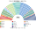
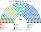
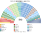
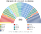

# 估計結果

> **這檔是什麼**：民意套本夾選制的席次**表**（如組閣聯盟／多數派政府）——§1 近期大選、§2 民調（若有）、§3 長期。圖庫見 [`席次圖.md`](席次圖.md)；大選算法細節見本夾重算檔。朝野互動見「預期政治生態」。

選制摘要：全院 **513＝單一 300（top-3 孔多賽）＋複數 213（聖拉古、無法定門檻）**。詳 [`01`](01-國會與選制.md)。

## 計算方式

| 層 | 做法 |
|---|---|
| 民意層 | TSE 逐市鎮×選舉區眾議員票，約 6,000 個單位 |
| 參選方層 | `finals_for`（withdraw）：相鄰共同提名、高票讓低票。不把全國政黨重組成新黨 |
| 單一 300 | 不跨州；top-3 孔多賽；選區用 2026 有效票切 |
| 複數 213 | 18 區聖拉古、無門檻、M∈[8,16] |
| 首長／組閣 | 全院孔多賽；≥257 |

細節見 [`14`](14-近期大選重算.md)、。

## 1 近期大選

用 TSE 逐市鎮得票套本夾。細節見 [`14-近期大選重算.md`](14-近期大選重算.md)。

| | 實際（開放名單） | **本夾全院 513** | 首長 |
|---|---|---|---|
| 2026-10 | PL 121、PT 聯盟 88、União–PP 87 … | União–PP **115**、PL 60、PSD 69、MDB 53、PT 40 … | PODE |
| 2022-10 | PL 99、PT 聯盟 80、União 59 … | União **106**、PSD 73、PL 38、MDB 48 … | União |

### 2026-10 單一／複數

| 政黨 | 單一 300 | 複數 213 | **全院** |
|---|--:|--:|--:|
| União–PP | 85 | 30 | **115** |
| PL | 8 | 52 | **60** |
| PSD | 51 | 18 | **69** |
| MDB | 37 | 16 | **53** |
| PT | 5 | 35 | **40** |
| REP | 24 | 17 | **41** |
| PODE | 63 | 12 | **75** |
| PSB | 0 | 10 | **10** |
| PSOL | 0 | 10 | **10** |
| NOVO | 1 | 4 | **5** |
| PSDB | 14 | 3 | **17** |
| PRD | 5 | 4 | **9** |
| AVANTE | 7 | 1 | **8** |
| MISSÃO | 0 | 1 | **1** |

**組閣聯盟／多數派政府**：首長 **PODE**；中間大團為樞紐；改憲法要複數 ≥128（中間大團約 80，須拉 PL 或 PT）。

### 2022-10 單一／複數

| 政黨 | 單一 300 | 複數 213 | **全院** |
|---|--:|--:|--:|
| União | 84 | 22 | **106** |
| PSD | 56 | 17 | **73** |
| PL | 0 | 38 | **38** |
| MDB | 29 | 19 | **48** |
| PP | 13 | 20 | **33** |
| PT | 3 | 31 | **34** |
| REP | 15 | 16 | **31** |
| PRD | 31 | 10 | **41** |
| PSDB | 28 | 9 | **37** |
| PODE | 25 | 7 | **32** |
| AVANTE | 12 | 3 | **15** |
| PSOL | 0 | 9 | **9** |
| PSB | 2 | 6 | **8** |
| PDT | 2 | 4 | **6** |
| NOVO | 0 | 2 | **2** |

**組閣聯盟／多數派政府**：首長 **União**；中間大團＋盟友組閣；細節見重算檔。

## 2 民調

**跳過。** 巴西 2026-10-04 剛大選，選後沒有眾議院投票意向民調。現有的只是「偏好政黨」調查（Datafolha 2025-12：PT 24%、PL 12%、**無偏好 46%**；Ipsos-Ipec 2026-03：PT 27%、PL 19%），只問得出兩大黨，無法分配到本夾 15 個黨，也沒有地理分布。最新民意用 §1 的 2026-10 逐市鎮得票（一個月前）代表。

原本這一節的「2026 得票套本夾」與 §1 重複，已刪除。

## 3 長期運行假設下

生態模型 **推估第 3 屆**（修正案廢除後誘因下的得票假設；[`12-預期政治生態.md`](12-預期政治生態.md) §3）。

| 政黨 | 單一 300 | 複數 213 | **全院 513** |
|---|--:|--:|--:|
| PL | 28 | 62 | **90** |
| União–PP | 80 | 25 | **105** |
| PT | 17 | 44 | **61** |
| PSD | 47 | 16 | **63** |
| MDB | 35 | 13 | **48** |
| REP | 22 | 15 | **37** |
| PODE | 33 | 9 | **42** |
| PSB | 6 | 9 | **15** |
| PSDB | 18 | 4 | **22** |
| PSOL | 0 | 10 | **10** |
| NOVO | 7 | 4 | **11** |
| AVANTE | 4 | 1 | **5** |
| PRD | 3 | 1 | **4** |

朝野互動與候選人行為見 [`12-預期政治生態.md`](12-預期政治生態.md)。

## 4 朝野互動（各次估計）

| 民意 | 政府 | 在野 | 互動 |
|---|---|---|---|
| 2026-10 | PODE 首長 | União–PP 115、PL 60、PT 40 … | 開放名單換成彈性名單後，大黨仍需多黨組閣；首長是議員之間的孔多賽贏家（居中小黨），議員不得增列預算科目，所以組閣不再靠分配預算修正案 |
| 2022-10 | União 首長 | PL、PT 等 | 同上 |

誘因、候選人行為與檢視見 [`12-預期政治生態.md`](12-預期政治生態.md) §4–§5。
