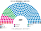
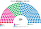
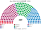
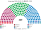
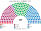
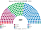

# 估計結果

> 席次**表**——§1 近期大選、§2 民調、§3 長期。圖庫見 [`席次圖.md`](席次圖.md)；算法見 [`14`](14-近期大選重算.md)、[`生態模型.py`](生態模型.py)、[`民調推估.py`](民調推估.py)。

選制：全院 **220＝單一 132（top-3 孔多賽）＋複數 88（12 區、聖拉古、無門檻、無紅利）**；首長全院排名投票選出（棄權不計）；供給、建設性更新 ≥111。詳 [`01`](01-國會與選制.md)。

**資料限制**：只有 59 個選區層級的得票率（內政部網站擋自動存取），見 [`14`](14-近期大選重算.md) §1。

## 計算方式

| 層 | 做法 |
|---|---|
| 民意層 | 59 個現行選區的名單得票率（維基百科選區表；內政部網站對自動存取回 403，依規定不繞過）。現行是比例名單，棄保失真小；地理只有選區層，比逐投票所粗 |
| 參選方層 | 每黨都可推人；地方性政黨只在本地參選；相鄰政黨在合起來能進前 3、且雙方都偏好合併後勝者時共同提名（席次圖產生器） |
| 單一 132 | 區內依選區順序按居民切成等大的新區，跨界的選區按比例拆分（同一選區拆出的新區得票率相同，會低估地方差異）；前 3 名、全體選民完整排序兩兩對決，循環用 Ranked Pairs。選民排序由各黨在經濟、文化兩軸的位置推得 |
| 複數 88 | 12 區聖拉古、無門檻；「其他」拆成 5 張小名單 |
| 首長、組閣 | 全院 220 記名排名，孔多賽；組閣由首長往外依政策距離加黨到 ≥111 |
| 民調 | 全國投票意向，以 2023-06 選區地理縮放 |

程式：[`生態模型.py`](生態模型.py)、[`民調推估.py`](民調推估.py)；細節見 [`14`](14-近期大選重算.md)、共同算法 [`選舉結果計算方式`](../../../notes/算法/選舉結果計算方式.md)。

## 1 近期大選

| | 實際（300） | **本夾全院 220** | 首長 | 組閣 |
|---|---|---|---|---|
| 2023-06 | ND 158（含紅利 50）、SYRIZA 47、PASOK 32、KKE 21 … | **ND 148**、PASOK 32、SYRIZA 28、KKE 7、EL 2、Victory 2、Spartans 1 | **ND** | ND 單獨 148 |
| 2023-05 | ND 146、SYRIZA 71、PASOK 41、KKE 26、EL 16；**組不出政府、重選** | **ND 109**、SYRIZA 55、PASOK 47、KKE 7、EL 2 | **ND** | ND＋PASOK＝156 |

### 2023-06 單一／複數

| 政黨 | 單一 132 | 複數 88 | **全院** |
|---|--:|--:|--:|
| ND | 103 | 45 | **148** |
| PASOK | 19 | 13 | **32** |
| SYRIZA | 10 | 18 | **28** |
| KKE | 0 | 7 | **7** |
| EL | 0 | 2 | **2** |
| Victory | 0 | 2 | **2** |
| Spartans | 0 | 1 | **1** |

**組閣聯盟／多數派政府**：首長 **ND**（對 PASOK、SYRIZA 153：67），單獨 148。組織法（選舉法）要全院 ≥132 且複數 ≥53：ND 複數 45，**要拉 PASOK**。

**預期政治生態**：ND 單獨執政，與現實相同；但現實靠「第一大黨獎勵席」，本夾靠單一席次。SYRIZA、PASOK 領導分裂的左派反對；改選舉法要 PASOK 同意，現實中執政黨可以單獨改選舉法、下屆生效的做法在本夾行不通。

### 2023-05

| 政黨 | 單一 132 | 複數 88 | **全院** |
|---|--:|--:|--:|
| ND | 64 | 45 | **109** |
| SYRIZA | 34 | 21 | **55** |
| PASOK | 34 | 13 | **47** |
| KKE | 0 | 7 | **7** |
| EL | 0 | 2 | **2** |

**組閣聯盟／多數派政府**：首長 **ND**（對 PASOK、SYRIZA 111：109），**ND＋PASOK＝156**。30 日內談不攏也由 ND 逕行就任，**不會有 6 月重選**。

**預期政治生態**：ND 只以 111:109 勝過 PASOK、SYRIZA，首長的基礎很薄。PASOK 是關鍵：與 ND 合組 156 席，或在 ND 失誤時改與 SYRIZA 合作挑戰首長。現實中這一屆因組閣失敗而一個月後重選；本夾首長在 30 日內一定產生。

## 2 民調

**方法**：[`民調推估.py`](民調推估.py)；來源 [`資料/polls.csv`](資料/polls.csv)（維基 Opinion polling for the next Greek parliamentary election，投票意向，未決定不計）。2023 年後的新黨用母黨的逐選區地理拆出：SYRIZA → SYRIZA＋ELAS（Tsipras 的希臘左翼聯盟）＋DPK（Kasselakis）＋NA（新左翼）；EL → EL＋FL（理性之聲）＋SE（希臘人聯盟）；ELPIDA（民主希望）全國均勻。再以 2023-06 地理縮放。

| 民調 | 投票意向（前四） | **本夾全院 220** | 單一 132 | 首長 | 組閣 |
|---|---|---|---|---|---|
| Alco／Alpha（10-22..30） | ND 29.2、ELAS 16.7、PASOK 14.3、KKE 8.9 | PASOK 67、ELAS 75、ND 52、KKE 10、EL 8、PE 5、SE 2、MeRA25 1 | PASOK 52、ELAS 59、ND 21 | **PASOK** | PASOK＋ELAS＝142 |
| Interview／Politic（10-22..25） | ND 30.8、ELAS 15.8、PASOK 14.6、EL 7.6 | PASOK 72、ND 68、ELAS 58、EL 9、KKE 7 … | PASOK 57、ND 32、ELAS 43 | **PASOK** | PASOK＋ELAS＝130 |
| Pulse／Skai（10-17..20） | ND 31.2、ELAS 17.2、PASOK 13.5、EL 7.8 | PASOK 65、ND 60、ELAS 68、EL 10、KKE 7 … | PASOK 51、ELAS 52、ND 29 | **PASOK** | PASOK＋ELAS＝133 |
| Metron／Mega（10-14..20） | ND 31.7、ELAS 15.8、PASOK 13.7、EL 6.5 | PASOK 60、ND 84、ELAS 51、EL 8、KKE 6、PE 6 … | PASOK 45、ND 51、ELAS 36 | **PASOK** | PASOK＋ELAS＝111 |

**讀法**：

- **ND 第一偏好仍第一（約 30%），單一席次卻輸給 PASOK**：右派分成 EL、FL、SE、Victory 等，各自的選民在 ND 對 PASOK 那一場不夠多；左派（ELAS、KKE、PE）把 PASOK 排在 ND 前。
- **這是假設敏感的結論**：右派小黨選民的第二偏好、ELPIDA 的位置都會改變 ND 對 PASOK 的勝負（[`12`](12-預期政治生態.md) §6.2）。
- 「組閣」是由首長往外依偏好距離加黨到 ≥111 的機械結果。

**預期政治生態**：**預期政治生態**：四份民調下首長都是 **PASOK**，即使它不是最大黨（Alco、Pulse 是 ELAS 最多、Metron 是 ND 84 席最多）。PASOK 以中間位置當首長、與 ELAS 組閣（111–142 席）；Metron 下剛好 111 席，任何一位議員倒戈就要重組。ND 由執政黨變成最大反對黨，右派小黨（EL 等）的選民第二偏好決定它能否奪回首長。

## 3 長期運行（推估第 3 屆）

兩翼各讓出 1/8 第一偏好給 ND 與 PASOK（`python 生態模型.py --projection`）。

| 政黨 | 單一 132 | 複數 88 | **全院** |
|---|--:|--:|--:|
| ND | 108 | 47 | **155** |
| PASOK | 19 | 14 | **33** |
| SYRIZA | 5 | 18 | **23** |
| KKE | 0 | 7 | **7** |
| EL | 0 | 2 | **2** |

首長 **ND**，單獨 155；組織法複數 47 不到 53，改不了選舉法。

**預期政治生態**：ND 單獨執政，改選舉法仍要拉 PASOK。
