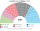
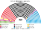
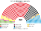
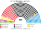
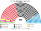
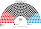
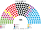

# 近期大選重算

> **這檔是什麼**：近期大選得票**怎麼**套進本夾選制（方法、假設、對照）。席次一覽與圖見 [`估計結果.md`](估計結果.md) §1、[`席次圖.md`](席次圖.md)。

2025、2021 套新制

**問題**：2025-02 與 2021-09 的選民照原本的偏好投票，在本夾的制度下會選出什麼樣的國會和政府？

**方法**：[`生態模型.py`](生態模型.py)。第一偏好是 Bundeswahlleiterin **Wahlbezirksstatistik** 逐投票區 Zweitstimme（[`資料/wbz-2025.csv`](資料/wbz-2025.csv)、[`資料/wbz-2021.csv`](資料/wbz-2021.csv)，[`_build_wbz.py`](_build_wbz.py)）。郵寄投票區（約 2.9 萬個，占票約四成）不對應實體投票所，依同市鎮各投票區「已領郵寄選票人數」（A2）比例分回；實體投票區再依投票區號 //100 合併（大城市約等於城區），2025 年 13,412 個、2021 年 13,812 個單位。2025 年加總與官方一致；2021 年檔案已含 2024-02 柏林部分重投結果，有效票比原始結果少 0.3%；偏好排序是假設（[`12`](12-預期政治生態.md) §2）。單一選區在邦內依選區號、單位序切，席次配額見 [`01`](01-國會與選制.md)。**不是**全國比例拆單一；**不是** Zweitstimme 定總席；**不模擬**政黨在新制下的重組（第 3 屆誘因假設見 [`估計結果`](估計結果.md) §3）。

## 1 一覽

| | 實際（聯立／Zweit 定總；總席次每屆不同） | 實際組閣 | **新制全院 420** | **新制首長** | **組閣聯盟／多數派政府** |
|---|---|---|---|---|---|
| 2025-02 | CDU 26.0%、AfD 24.1%、SPD 19.0%、GRÜNE 13.5%、LINKE 10.2%、CSU 7.0%、SSW 0.2% | 黑紅；Brandmauer | CDU **46.9%**、SPD 18.6%、CSU 11.4%、AfD 9.5%、LINKE 5.0%、GRÜNE 4.5%、BSW 2.4%、FDP 1.4%、FW 0.2% | **CDU**（最弱 270） | **CDU＋FW＋CSU＝246** |
| 2021-09 | SPD 28.0%、CDU 20.7%、GRÜNE 16.1%、FDP 12.4%、AfD 11.3%、CSU 6.1%、LINKE 5.3%（735） | Ampel | SPD **53.1%**、CDU 18.8%、CSU 9.0%、GRÜNE 6.0%、FDP 5.2%、AfD 4.3%、LINKE 2.1%、FW 1.4% | **SPD**（最弱 257） | **SPD＝223** |
| 2017-09 | CDU 28.2%、SPD 21.6%、AfD 13.3%、FDP 11.3%、LINKE 9.7%、GRÜNE 9.4%、CSU 6.5%（709） | 黑紅（組閣近 6 個月） | CDU **48.3%**、SPD 22.1%、CSU 11.9%、AfD 5.2%、FDP 4.5%、LINKE 4.0%、GRÜNE 3.6%、FW 0.2% | **CDU**（最弱 287） | **CDU＋FW＋CSU＝254** |
| 2013-09 | CDU 40.4%、SPD 30.6%、LINKE 10.1%、GRÜNE 10.0%、CSU 8.9%（631） | 黑紅 | CDU **44.3%**、SPD 32.4%、CSU 12.9%、GRÜNE 3.3%、LINKE 3.3%、FDP 1.9%、AfD 1.7%、FW 0.2% | **CDU**（最弱 256） | **CDU＋FW＋CSU＝241** |

## 2 2025-02

| 政黨 | 得票% | 實際 | 單一 252 | 複數 168 | **新制** |
|---|--:|--:|--:|--:|--:|
| CDU | 22.6 | 164 | 154 | 41 | **195** |
| AfD | 20.8 | 152 | 5 | 35 | **40** |
| SPD | 16.4 | 120 | 56 | 29 | **85** |
| GRÜNE | 11.6 | 85 | 0 | 19 | **19** |
| LINKE | 8.8 | 64 | 0 | 16 | **16** |
| CSU | 6.0 | 44 | 37 | 11 | **48** |
| BSW | 4.981 | 0 | 0 | 10 | **10** |
| FDP | 4.3 | 0 | 0 | 6 | **6** |
| FW | 1.5 | 0 | 0 | 1 | **1** |

| 邦（單一） | 結果 |
|---|---|
| NW（54） | CDU 39、SPD 15 |
| BY（40） | CSU 37、SPD 3 |
| BW（34） | CDU 31、SPD 3 |
| NI（24） | CDU 17、SPD 7 |
| HE（19） | CDU 15、SPD 4 |
| RP（13） | CDU 13 |
| SN（12） | CDU 8、AfD 3、LINKE 1 |
| BE（11） | SPD 5、LINKE 4、CDU 2 |
| SH（9） | CDU 6、SPD 3 |
| BB（8） | CDU 7、SPD 1 |
| ST（6） | CDU 5、AfD 1 |
| TH（6） | CDU 5、AfD 1 |
| HH（6） | SPD 6 |
| MV（5） | CDU 5 |
| SL（3） | CDU 3 |
| HB（2） | SPD 2 |

- **AfD 24.1% → 9.5%**：全國第二偏好，單一只 5（薩克森 3、薩克森-安哈特 1、圖林根 1）。決選三人常見含 AfD，但 AfD 幾乎不是第二偏好。
- **BSW 0 → 10**：無全國門檻治 4.981% 歸零。
- **71 區**「非第一偏好第一名當選」。
- **首長 CDU**；組閣聯盟／多數派政府 **CDU＋FW＋CSU＝246**（過半 211）。模型**不編碼** Brandmauer；若行為仍排除 AfD，路徑本來就不必找 AfD。

## 3 2021-09

| 政黨 | 得票% | 實際 | 單一 252 | 複數 168 | **新制** |
|---|--:|--:|--:|--:|--:|
| SPD | 25.7 | 206 | 175 | 48 | **223** |
| CDU | 18.9 | 152 | 44 | 35 | **79** |
| GRÜNE | 14.8 | 118 | 0 | 25 | **25** |
| FDP | 11.5 | 91 | 0 | 22 | **22** |
| AfD | 10.3 | 83 | 0 | 18 | **18** |
| CSU | 5.2 | 45 | 29 | 9 | **38** |
| LINKE | 4.9 | 39 | 0 | 9 | **9** |
| FW | 2.4 | 0 | 4 | 2 | **6** |

- **SPD 單獨 223 過半**：現實是 Ampel 三黨；新制下聯盟協議不是就任條件。
- **AfD 11.3% → 4.3%**：單一只 0。
- 首長 SPD（最弱 ≥211）。

## 3a 2017-09 與 2013-09

資料：Bundeswahlleiterin Wahlbezirksstatistik 舊格式（`btw17_wbz.zip`、`btw13_wbz.zip`；[`_build_wbz_old.py`](_build_wbz_old.py) → [`資料/wbz-2017.csv`](資料/wbz-2017.csv)、[`資料/wbz-2013.csv`](資料/wbz-2013.csv)；16,300／16,725 個單位）。全國加總與官方一致：2017 有效 Zweitstimmen 46,515,492（CDU 26.8、SPD 20.5、AfD 12.6、FDP 10.7）；2013 為 43,726,856（CDU 34.1、SPD 25.7、LINKE 8.6、GRÜNE 8.4、FDP 4.8、AfD 4.7）。

| 政黨 | 2017 得票% | 2017 實際 709 | 2017 單一／複數 | **2017 新制** | 2013 得票% | 2013 實際 631 | 2013 單一／複數 | **2013 新制** |
|---|--:|--:|--:|--:|--:|--:|--:|--:|
| CDU | 26.8 | 200 | 155 | **202** | 34.1 | 255 | 47 | **186** |
| SPD | 20.5 | 153 | 57 | **94** | 25.7 | 193 | 37 | **136** |
| CSU | 6.2 | 46 | 39 | **50** | 7.4 | 56 | 11 | **54** |
| AfD | 12.6 | 94 | 0 | **22** | 4.7 | 0 | 22 | **7** |
| FDP | 10.7 | 80 | 0 | **19** | 4.8 | 0 | 19 | **8** |
| LINKE | 9.2 | 69 | 1 | **17** | 8.6 | 64 | 16 | **14** |
| GRÜNE | 8.9 | 67 | 0 | **15** | 8.4 | 63 | 15 | **14** |
| FW | 1.0 | 0 | 0 | **1** | 1.0 | 0 | 1 | **1** |

- **2017**：CDU 202 差 9 席過半，與 CSU 合 252（加 FW 253）。現實是 Jamaika 談判破裂、組閣拖了近 6 個月（2017-09-24 到 2018-03-14），最後回到黑紅大聯合。新制下 CDU＋CSU 不需要第三黨，**聯合政府協議不是就任條件**。AfD 席次 13.3% → 5.2%。
- **2013**：CDU 186、CSU 54，合 240 過半；SPD 單一拿到 88 區（現行制度下 58 個 Wahlkreis）：LINKE、GRÜNE 選民把 SPD 排在 CDU 前，在 CDU 領先不多的區翻盤。FDP、AfD 在現行 5% 門檻下 0 席，新制各有 8、7 席。
- **限制**：偏好位置用的是 2025 年的設定；**2013 年的 AfD 還是反歐元的經濟自由派**，位置應更接近 FDP，這裡沒有逐屆調整。

## 4 敏感度與穩健性（2025）

| 檢查 | 結果 |
|---|---|
| 選民全部重經濟 | 單一 CDU 仍最大；首長 **CDU** |
| 選民全部重文化 | 單一 CDU；首長 CDU |
| 全部均衡 | 單一 CDU；首長 CDU |
| AfD −6 點 | 全院 CDU 175、SPD 117、AfD 24；首長 CDU |
| AfD ＋6 點 | 全院 CDU 200、AfD 66、SPD 60；首長 **仍 CDU** |

★ 在本夾偏好假設下，2025 基準的首長結果對 AfD ±6 點不敏感；若改文化軸權重或 AfD 第二偏好結構，才可能動搖——改 [`12`](12-預期政治生態.md) §2.1 就重跑。

## 5 限制

- 偏好排序是假設的二維空間，不是真實排序票。
- 單一選區依選區號、投票區單位序連續切，不是官方 252 區劃界；郵寄票按 A2 比例分回是近似（實際郵寄投票者的政黨傾向可能與同區實體投票者不同，這裡用的是同市鎮郵寄票的政黨比例，不是同區實體票的比例）。
- 用 Zweitstimme 當第一偏好強度；Erststimme 地圖未單獨跑（並立層不聯立）。
- 不模擬新制下的政黨重組（那是 §3 長期，不是本檔）。

## 來源

- Die Bundeswahlleiterin，《Bundestagswahl 2025／2021》終局 kerg2（[`資料/btw25_kerg2.csv`](資料/btw25_kerg2.csv)、[`資料/btw2021_kerg2.csv`](資料/btw2021_kerg2.csv)）。
- 實際席次與組閣：Bundeswahlausschuss 終局；2025 黑紅為公開組閣結果。
