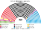
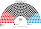
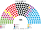
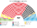
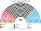
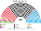
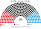
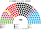

# 估計結果

> 席次**表**——§1 近期大選、§2 民調、§3 長期。圖庫見 [`席次圖.md`](席次圖.md)；算法見 [`14`](14-近期大選重算.md)、[`生態模型.py`](生態模型.py)。

選制摘要：全院 **420＝單一 252（top-3 孔多賽）＋複數 168（聖拉古、無全國門檻、十六邦）**。詳 [`01`](01-國會與選制.md)。

## 計算方式

| 層 | 做法 |
|---|---|
| 民意層 | 聯邦選舉主任逐投票區第二票（政黨票），郵寄票依已領郵寄選票人數分回。第二票是比例名單，棄保失真比第一票小 |
| 參選方層 | 每黨都可推人；地方性政黨只在本地參選；相鄰政黨在合起來能進前 3、且雙方都偏好合併後勝者時共同提名（席次圖產生器）；CSU 只在巴伐利亞、CDU 不在巴伐利亞，SSW 只在什列斯威 |
| 單一 252 | 依邦配額，邦內依選區號、投票區順序連續切成票數相近的選區（不跨邦，不是官方劃界）；前 3 名、全體選民完整排序兩兩對決，循環用 Ranked Pairs。選民排序由各黨在經濟、文化兩軸的位置推得 |
| 複數 168 | 十六邦聖拉古、無全國門檻 |
| 首長、組閣 | 全院 420 記名排名，孔多賽；組閣由首長往外依政策距離加黨到 ≥211 |
| 民調 | 全國投票意向，以 2025 投票區地理縮放 |

程式：[`生態模型.py`](生態模型.py)；細節見 [`14`](14-近期大選重算.md)、共同算法 [`選舉結果計算方式`](../../../notes/算法/選舉結果計算方式.md)。

## 1 近期大選

BWL **Wahlbezirksstatistik**（逐投票區 Zweitstimme，約 13,400 個單位；郵寄票依已領郵寄選票人數分回）套本夾（**不是**比例拆單一；**不是** Zweit 定總）。細節見 [`14`](14-近期大選重算.md)。**不是第 3 屆。**

| | 實際（630） | **本夾全院 420** | 首長 |
|---|---|---|---|
| 2025-02 | CDU 26.0%、AfD 24.1%、SPD 19.0%、GRÜNE 13.5%、LINKE 10.2%、CSU 7.0%、SSW 0.2%；黑紅 | CDU **46.9%**、SPD 18.6%、CSU 11.4%、AfD 9.5%、LINKE 5.0%、GRÜNE 4.5%、BSW 2.4%、FDP 1.4%、FW 0.2% | **CDU** |
| 2021-09 | SPD 28.0%、CDU 20.7%、GRÜNE 16.1%、FDP 12.4%、AfD 11.3%、CSU 6.1%、LINKE 5.3%；Ampel | SPD **53.1%**、CDU 18.8%、CSU 9.0%、GRÜNE 6.0%、FDP 5.2%、AfD 4.3%、LINKE 2.1%、FW 1.4% | **SPD** |
| 2017-09 | CDU 28.2%、SPD 21.6%、AfD 13.3%、FDP 11.3%、LINKE 9.7%、GRÜNE 9.4%、CSU 6.5%；黑紅（組閣近 6 個月） | CDU **48.3%**、SPD 22.1%、CSU 11.9%、AfD 5.2%、FDP 4.5%、LINKE 4.0%、GRÜNE 3.6%、FW 0.2% | **CDU** |
| 2013-09 | CDU 40.4%、SPD 30.6%、LINKE 10.1%、GRÜNE 10.0%、CSU 8.9%；黑紅 | CDU **44.3%**、SPD 32.4%、CSU 12.9%、GRÜNE 3.3%、LINKE 3.3%、FDP 1.9%、AfD 1.7%、FW 0.2% | **CDU** |

### 2025-02 單一／複數

| 政黨 | 單一 252 | 複數 168 | **全院** |
|---|--:|--:|--:|
| CDU | 154 | 41 | **195** |
| SPD | 56 | 29 | **85** |
| CSU | 37 | 11 | **48** |
| AfD | 5 | 35 | **40** |
| LINKE | 0 | 16 | **16** |
| GRÜNE | 0 | 19 | **19** |
| BSW | 0 | 10 | **10** |
| FDP | 0 | 6 | **6** |
| FW | 0 | 1 | **1** |

**組閣聯盟／多數派政府**：首長 **CDU**；CDU＋FW＋CSU＝**244**（過半 211）。改規則要複數 ≥101（CDU 僅 41）。

**預期政治生態**：聯盟黨（CDU＋CSU）不需要 SPD 就能執政，現實中的黑紅大聯合不再必要。AfD 第二票 24% 卻只有 40 席，單一 5 席：是「票多席少」的最大反對黨，會把選制當成政治議題。改規則要全院 ≥252 且複數 ≥101：聯盟黨複數 52，連同 SPD 是 81，還要拉 Grüne 與 LINKE 或 AfD，跨陣營協商不可免。

### 2021-09

| 政黨 | 單一 252 | 複數 168 | **全院** |
|---|--:|--:|--:|
| SPD | 175 | 48 | **223** |
| CDU | 44 | 35 | **79** |
| CSU | 29 | 9 | **38** |
| GRÜNE | 0 | 25 | **25** |
| FDP | 0 | 22 | **22** |
| AfD | 0 | 18 | **18** |
| LINKE | 0 | 9 | **9** |
| FW | 4 | 2 | **6** |

**組閣聯盟／多數派政府**：首長 **SPD**；SPD 單獨 **223**（現實為 Ampel）。

**預期政治生態**：SPD 單獨過半，現實的交通燈三黨聯合變成一黨政府，Grüne、FDP 回到名單層反對。聯盟黨 117 席是唯一像樣的反對黨；SPD 只多 12 席，黨內派系的籌碼比黨際談判重要。

## 2 民調

方法：以 **2025 逐投票區地理** 為基底，按民調全國得票%縮放後跑本夾——**單一** top-3 孔多賽、**複數** 聖拉古（**不是**比例拆單一）。

### Forsa 示意（約 2026-10；模型內 `POLL_FORSA`）

全國意向（含 CSU 分列）：AfD 26、CDU 24、SPD 14、Grüne 11、Linke 10、CSU 6、BSW 4、FDP 3。

| 政黨 | 單一 252 | 複數 168 | **全院** |
|---|--:|--:|--:|
| CDU | 167 | 45 | **212** |
| AfD | 14 | 42 | **56** |
| SPD | 30 | 24 | **54** |
| CSU | 38 | 10 | **48** |
| LINKE | 3 | 20 | **23** |
| GRÜNE | 0 | 18 | **18** |
| BSW | 0 | 5 | **5** |
| FDP | 0 | 3 | **3** |
| FW | 0 | 1 | **1** |

**首長：CDU**。  
**組閣聯盟／多數派政府**（模型：偏好距離由近到遠）：**CDU 單獨 212**（過半 211，只多 1 席）。  

**預期政治生態**：AfD 民調第一，席次卻只有 56，首長仍是 CDU。CDU 單獨只多 1 席，實際上會帶 CSU 一起執政（260 席）。AfD 與 SPD 同為 54–56 席，反對陣營分成左右兩塊，湊不出共同的首長人選。
★ 模型**不編碼** Brandmauer；若政治行為仍排除 AfD，機械過半路徑本來就不含 AfD。

## 3 長期運行（推估第 3 屆）

生態模型示意 **推估第 3 屆**（假設見 [`12`](12-預期政治生態.md) §2.3；`python 生態模型.py --projection`）。

**與 §1 不同**：不是 2025 得票重跑。假設兩屆孔多賽後——（1）部分第一偏好從 AfD 移回中間黨；（2）AfD 為搶第二偏好，文化軸從 1.0 軟化到 0.6；（3）BSW／FDP 維持低門檻進場。地理形狀仍用 2025。

目標全國得票%：CDU 26、AfD 18、SPD 17、Grüne 12、Linke 9、CSU 6.5、BSW 5、FDP 4。

| 政黨 | 單一 252 | 複數 168 | **全院 420** |
|---|--:|--:|--:|
| CDU | 140 | 47 | **187** |
| SPD | 55 | 31 | **86** |
| CSU | 37 | 11 | **48** |
| AfD | 20 | 28 | **48** |
| LINKE | 0 | 17 | **17** |
| GRÜNE | 0 | 20 | **20** |
| BSW | 0 | 8 | **8** |
| FDP | 0 | 5 | **5** |
| FW | 0 | 1 | **1** |

**組閣聯盟／多數派政府**：首長 **CDU**；CDU＋FW＋CSU＝**236**（過半 211）。相對 §1：AfD 單一回升（軟化），全院仍低於第一偏好份額。朝野見 [`12`](12-預期政治生態.md)。

**預期政治生態**：與 2025 相同：聯盟黨執政，AfD 在單一席次回升到 20 席，仍是名單層為主的反對黨；改規則仍要跨陣營。
