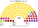
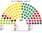

# 近期大選套新制

> 席次一覽與圖見 [`估計結果.md`](估計結果.md) §1、[`席次圖.md`](席次圖.md)。本檔講**怎麼**套。

## 1 方法

| 項目 | 來源與做法 |
|---|---|
| 第一偏好 | 2022：CVK 開放資料逐投票所（iecirknis）名單票 1,055 個（含海外），[`_build_lv.py`](_build_lv.py) → [`資料/lv-2022.csv`](資料/lv-2022.csv)。2026：CVK 只公布 5 個選區的政黨得票；每黨在選區內沿用 2022 母黨的投票所分布、縮放到 2026 選區得票（[`_build_lv2026.py`](_build_lv2026.py) → [`資料/lv-2026.csv`](資料/lv-2026.csv)）。**選區總數與官方一致，選區內分布是推估** |
| 驗證 | 2022 全國有效票 903,639；新團結 19.19%、綠農 12.58%、團結名單 11.14%、民族聯盟 9.40%、穩定！6.88%、拉脫維亞優先 6.31%、進步黨 6.23%，和官方一致。2026 各黨全國票（團結名單 283,892、拉脫維亞優先 105,198 …）和官方一致 |
| 座標 | Wikidata 市鎮／直轄市中心點（43 個全部對上）；同市鎮的投票所依編號排序 |
| 單一 60 | 5 個國內區內依座標 Hilbert 序、按有效票連續切；top-3 孔多賽 |
| 複數 40 | 5 國內區＋海外 1 席，聖拉古、無門檻 |
| 首長 | 全院 100 記名排名，須 ≥51 |

## 2 2026-10-03

實際（100）：AS 41、LPV 17、SV 15、NA 10、PRO 10、JV 7；**選後協商中**。綠農（4.5%）、我們改變規則（3.5%）、為發展、穩定！等約 15% 的票沒有換到席次。

| 政黨 | 得票% | 實際 100 | 單一 60 | 複數 40 | **新制 100** |
|---|--:|--:|--:|--:|--:|
| **AS** | 35.8 | 41 | 54 | 16 | **70** |
| LPV | 13.3 | 17 | 6 | 7 | **13** |
| SV | 11.9 | 15 | 0 | 5 | **5** |
| NA | 9.0 | 10 | 0 | 5 | **5** |
| PRO | 8.0 | 10 | 0 | 3 | **3** |
| JV | 6.4 | 7 | 0 | 2 | **2** |
| ZZS | 4.5 | 0 | 0 | 1 | **1** |
| MMN | 3.5 | 0 | 0 | 1 | **1** |

| 區（單一） | 結果 |
|---|---|
| 里加（18） | AS 17、LPV 1 |
| 維澤梅（18） | AS 18 |
| 拉特加萊（7） | LPV 5、AS 2 |
| 庫爾澤梅（8） | AS 8 |
| 澤姆加萊（9） | AS 9 |

- 60 位單一當選人中 4 位不是第一偏好第一名；當選者第一偏好中位數 **37.0%**；第一偏好過半 6 區；循環 0。
- **首長 AS**；組閣 **AS＝70**；複數 16，改不了組織法（[`05`](05-法規位階與修憲.md)）。

## 3 2022-10-01

實際（100）：JV 26、ZZS 16、AS 15、NA 13、S! 11、PRO 10、LPV 9；**JV＋AS＋NA 54（Kariņš）；2023-09 起 JV＋ZZS＋PRO 52（Siliņa）**。為發展（5.0%，差一點）、和諧（4.9%）、給每個人、俄羅斯人聯盟、主權力量、保守黨等約 28% 的票沒有換到席次。

| 政黨 | 得票% | 實際 100 | 單一 60 | 複數 40 | **新制 100** |
|---|--:|--:|--:|--:|--:|
| **AS** | 11.1 | 15 | 26 | 6 | **32** |
| ZZS | 12.6 | 16 | 20 | 7 | **27** |
| JV | 19.2 | 26 | 1 | 10 | **11** |
| LPV | 6.3 | 9 | 7 | 2 | **9** |
| NA | 9.4 | 13 | 1 | 4 | **5** |
| SDPS | 4.9 | 0 | 4 | 2 | **6** |
| S! | 6.9 | 11 | 1 | 2 | **3** |
| PRO | 6.2 | 10 | 0 | 2 | **2** |
| LKS | 3.7 | 0 | 0 | 2 | **2** |
| AP | 5.0 | 0 | 0 | 1 | **1** |
| KuK | 3.7 | 0 | 0 | 1 | **1** |
| SV | 3.3 | 0 | 0 | 1 | **1** |

| 區（單一） | 結果 |
|---|---|
| 里加（18） | LPV 7、AS 7、NA 1、JV 1、ZZS 1、SDPS 1 |
| 維澤梅（18） | AS 13、ZZS 5 |
| 拉特加萊（7） | SDPS 3、ZZS 3、S! 1 |
| 庫爾澤梅（8） | AS 5、ZZS 3 |
| 澤姆加萊（9） | ZZS 8、AS 1 |

- 60 位單一當選人中 41 位不是第一偏好第一名；當選者第一偏好中位數 **15.1%**；第一偏好過半 0 區；循環 0。
- **首長 AS**；組閣 **AS＋ZZS＝59**；複數 13，改不了組織法（[`05`](05-法規位階與修憲.md)）。

## 4 民調

見 [`估計結果.md`](估計結果.md) §2（2 家；首長：AS）。

## 5 敏感度（`--sweep`）

| 檢查 | 2026-10 單一 60 | 首長 | 2022-10 單一 60 | 首長 |
|---|---|---|---|---|
| 基準 | AS 54、LPV 6 | AS | AS 26、ZZS 20、LPV 7、JV 1、SDPS 4、NA 1、S! 1 | AS |
| 全部重地緣 | AS 54、LPV 6 | AS | AS 32、ZZS 12、JV 1、LPV 6、NA 5、SDPS 4 | AS |
| 全部重文化 | AS 53、LPV 6、ZZS 1 | AS | ZZS 27、AS 22、LPV 5、JV 1、S! 2、SDPS 2、NA 0 | ZZS |
| 全部均衡 | AS 54、LPV 6 | AS | AS 28、ZZS 19、JV 1、LPV 5、SDPS 5、NA 2 | AS |
| 切線位移半區 | AS 53、LPV 7 | — | AS 33、ZZS 15、LPV 6、SDPS 4、JV 1、NA 0、S! 1 | — |
| 2026：團結名單 -6／拉脫維亞優先 +6 點 | AS 45、LPV 12、ZZS 3 | AS | — | — |
| 2026：團結名單 +6／拉脫維亞優先 -6 點 | AS 56、LPV 4 | AS | — | — |

**結論**：居中最大黨（AS）在所有情境都是單一席次與首長的贏家。

## 6 走向（推測）

| 時點 | 現實 | **新制** |
|---|---|---|
| 2011 | 總統 Zatlers 發動解散國會公投、國會被解散 | 無解散；總統不能提議解散 |
| 2011–2018 | 和諧黨多次第一大黨、從未入閣 | 首長由全院排名投票選出；和諧黨的第二偏好有價格 |
| 2023-09 | Kariņš 改組失敗辭職、Siliņa 組閣 | 建設性更新：繼任者要贏現任 |
| 2026-10 | 團結名單 41 席、選後協商 | 團結名單 70，單獨過半；改不了組織法 |

## 7 出處

| 數字 | 出處 |
|---|---|
| 2022 逐投票所 | data.gov.lv 資料集 `14-saeimas-velesanas-sv2022`（CVK，CC0） |
| 2026 選區得票 | cvk.lv `/data/rezultati/latest.json`（status galigi，2026-10-16） |
| 市鎮座標 | Wikidata rdfs:label（拉脫維亞文）→ P625 |
| 政黨位置 | CHES 2024（拉脫維亞） |
| 民調 | 維基 2026 Latvian parliamentary election → Opinion polls |
| 實際席次 | 維基 2026、2022 Latvian parliamentary election |
