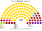
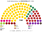
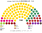
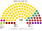

# 估計結果

> 席次**表**——§1 近期大選、§2 民調、§3 長期。圖庫見 [`席次圖.md`](席次圖.md)；算法見 [`14`](14-近期大選重算.md)、[`生態模型.py`](生態模型.py)、[`民調推估.py`](民調推估.py)。

選制：全院 **100＝單一 60（top-3 孔多賽）＋複數 40（聖拉古、無門檻）**；首長全院排名投票選出（棄權不計）；供給、建設性更新 ≥51；組織法全院 ≥60 且複數 ≥24。詳 [`01`](01-國會與選制.md)。

## 計算方式

| 層 | 做法 |
|---|---|
| 民意層 | 中央選舉委員會逐投票所名單票（2022）；2026 只公布到選區，各黨在選區內沿用 2022 母黨的投票所分布。現行是比例名單，棄保失真小 |
| 參選方層 | 每黨都可推人；地方性政黨只在本地參選；相鄰政黨在合起來能進前 3、且雙方都偏好合併後勝者時共同提名（席次圖產生器） |
| 單一 60 | 5 個國內區內依座標 Hilbert 序、按有效票連續切；前 3 名、全體選民完整排序兩兩對決，循環用 Ranked Pairs。選民排序由各黨在地緣、文化兩軸的位置推得 |
| 複數 40 | 5 個國內區＋海外 1 席，聖拉古、無門檻 |
| 首長、組閣 | 全院 100 記名排名，孔多賽；組閣由首長往外依政策距離加黨到 ≥51 |
| 民調 | 全國投票意向，以投票所地理縮放 |

程式：[`生態模型.py`](生態模型.py)、[`民調推估.py`](民調推估.py)；細節見 [`14`](14-近期大選重算.md)、共同算法 [`選舉結果計算方式`](../../../notes/算法/選舉結果計算方式.md)。

## 1 近期大選

中央選舉委員會（CVK）：2022 data.gov.lv「14. Saeimas vēlēšanas sv2022」逐投票所（`departmentresults.json`）；2026 cvk.lv/data/rezultati/latest.json（5 選區最終結果，2026-10-16）。

| | 實際（100） | **本夾全院 100** | 首長 | 組閣 |
|---|---|---|---|---|
| 2026-10 | AS 41、LPV 17、SV 15、NA 10、PRO 10、JV 7；選後協商中 | **AS 70、LPV 13、NA 5、SV 5、PRO 3、JV 2、MMN 1、ZZS 1** | **AS** | AS＝70 |
| 2022-10 | JV 26、ZZS 16、AS 15、NA 13、S! 11、PRO 10、LPV 9；JV＋AS＋NA 54（Kariņš）；2023-09 起 JV＋ZZS＋PRO 52（Siliņa） | **AS 32、ZZS 27、JV 11、LPV 9、NA 5、SDPS 6、S! 3、LKS 2、PRO 2 …** | **AS** | AS＋ZZS＝59 |

| 政黨 | 單一 60 | 複數 40 | **全院** |
|---|--:|--:|--:|
| AS | 54 | 16 | **70** |
| LPV | 6 | 7 | **13** |
| NA | 0 | 5 | **5** |
| SV | 0 | 5 | **5** |
| PRO | 0 | 3 | **3** |
| JV | 0 | 2 | **2** |
| MMN | 0 | 1 | **1** |
| ZZS | 0 | 1 | **1** |

**組閣聯盟／多數派政府**：首長 **AS**；**AS＝70**。組織法：AS 複數 16，改不了。

**預期政治生態**：團結名單單獨 70 席，不必經過現實的多黨協商。拉脫維亞優先 13 席是最大反對黨；主權力量等親俄、主權派政黨只在名單層有席次。改組織法要全院 ≥60 且複數 ≥24：團結名單全院夠，但複數只有 16，至少要再拉兩個名單層政黨。

| 政黨 | 單一 60 | 複數 40 | **全院** |
|---|--:|--:|--:|
| AS | 26 | 6 | **32** |
| ZZS | 20 | 7 | **27** |
| JV | 1 | 10 | **11** |
| LPV | 7 | 2 | **9** |
| NA | 1 | 4 | **5** |
| SDPS | 4 | 2 | **6** |
| S! | 1 | 2 | **3** |
| LKS | 0 | 2 | **2** |
| PRO | 0 | 2 | **2** |
| AP | 0 | 1 | **1** |
| KuK | 0 | 1 | **1** |
| SV | 0 | 1 | **1** |

**組閣聯盟／多數派政府**：首長 **AS**；**AS＋ZZS＝59**。組織法：AS＋ZZS 複數 13，改不了。

**預期政治生態**：現實中的總理黨新團結（JV）在本夾只有 11 席，掉出政府。團結名單與綠農聯盟合計 59，綠農是唯一夠用的夥伴，有要價空間；反對陣營分散在 JV、LPV、SDPS 等黨，地緣立場相反，湊不出共同的首長人選。

## 2 民調

**方法**：[`民調推估.py`](民調推估.py)；來源 [`資料/polls.csv`](資料/polls.csv)（維基 2026 Latvian parliamentary election 的 Opinion polls；**選後還沒有民調**，用選前最後一個月各家最新一筆。以 2026 逐投票所（推估）地理縮放）。

| 民調 | 投票意向（前五） | **本夾全院 100** | 單一 60 | 首長 | 組閣（機械） |
|---|---|---|---|---|---|
| SKDS（2026-09-04..16） | AS 22.8、SV 14.1、LPV 13.3、PRO 10.2、NA 8.7 | AS 56、LPV 18、SV 6、ZZS 7、NA 4、PRO 4、JV 2 … | AS 45、LPV 12、ZZS 3 | **AS** | AS＝58 |
| Latvijas Fakti（2026-09） | AS 23.9、LPV 12.9、PRO 12.4、ZZS 10.6、NA 8.9 | AS 59、ZZS 12、LPV 10、PRO 6、NA 4、SV 4、JV 2 … | AS 48、ZZS 7、LPV 5 | **AS** | AS＝60 |

**讀法**：「組閣」是由首長往外依偏好距離加黨到 ≥51 的機械結果，不是預測。

**預期政治生態**：兩份民調下團結名單都單獨過半（56–59 席），格局與 2026 大選相同：一黨執政、反對黨分散。

## 3 長期運行（推估第 3 屆）

兩翼（進步黨、民族聯盟、主權力量、拉脫維亞優先）各讓出 1/8 第一偏好給團結名單與綠農（`python 生態模型.py --projection`）。

| 政黨 | 單一 60 | 複數 40 | **全院** |
|---|--:|--:|--:|
| AS | 51 | 18 | **69** |
| LPV | 5 | 6 | **11** |
| ZZS | 4 | 4 | **8** |
| NA | 0 | 4 | **4** |
| SV | 0 | 4 | **4** |
| JV | 0 | 2 | **2** |
| PRO | 0 | 2 | **2** |

首長 **AS**，AS＝69；複數 18，改不了組織法。

**預期政治生態**：團結名單長期單獨執政的風險是黨內派系取代黨際競爭；名單層的反對黨靠組織法的複數 3/5 擋下規則改寫。
