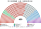
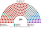
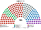

# 席次圖

> **這檔是什麼**：仿維基席次**圖庫**（長期示意；有則附大選重算／現行圖）。席次**數字表**與民調見 [`估計結果.md`](估計結果.md)；大選算法細節見本夾 `*大選重算*`／`*近期大選*` 檔。朝野互動見「預期政治生態」。

對應表允許以**意識形態帶**代替政黨表示議會分布（見 [`15`](15-預期政治生態.md) §2）。數字來自同檔第 4 屆示意；產生器：席次圖產生器。座位由左至右依光譜排列，不用政黨代表色。

## 推估第 4 屆

### 全院 450

### 單一席次 260

### 複數席次 190

| 意識形態帶 | 單一 260 | 複數 190 | **全院** |
|---|--:|--:|--:|
| 發展優先 | 118 | 50 | **168** |
| 技術官僚中間 | 48 | 34 | **82** |
| 社會保障 | 40 | 34 | **74** |
| 市場改革 | 30 | 31 | **61** |
| 地方分權 | 18 | 20 | **38** |
| 環境與民生 | 6 | 21 | **27** |

過半 **226**、3/5 **270**、2/3 **300**。最大帶 168，差 58 過半——法律與首長／供給都要跨帶；發展優先＋技術官僚中間＝250。環境與民生 27 席中有 21 席在複數（無得票門檻）。首長與供給由全院決定（[`02`](02-政府組成與建設性更新.md)、[`03`](03-行政權預算與供給.md)）。

## 顏色

依光譜位置著色。順序見 [`15`](15-預期政治生態.md) §3。
