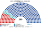

# 估計結果

> **這檔是什麼**：民意套本夾選制的席次**表**（如組閣聯盟／多數派政府）——§1 近期大選、§2 民調（若有）、§3 長期。圖庫見 [`席次圖.md`](席次圖.md)；大選算法細節見本夾重算檔。朝野互動見「預期政治生態」。

選制摘要：全院 **300＝單一 180（top-3 孔多賽）＋複數 120（11 區彈性名單、聖拉古、無全國門檻）**。詳 [`01`](01-國家杜馬與選制.md)。

## 1 近期大選

用**官方公布**的 2021 年杜馬聯邦名單得票率套本夾（無本機逐選區／投開票所 CSV；區域偏移見 [`生態模型.py`](生態模型.py) 的 11 區示意）。計票本身有爭議（[`01`](01-國家杜馬與選制.md)「計票」、[`16`](16-預期政治生態.md) §2.2）——本節只把公布的全國得票量級跑進本夾選制，**不是**認定開票無誤。

得票率：統一俄羅斯 49.8%、聯邦共產黨 18.9%、自由民主黨 7.5%、公正俄羅斯 7.5%、新人 5.3%、其他 11.0%。方法：**單一 180** top-3 孔多賽、**複數 120** 聖拉古（兩邊獨立加總）。

| 政黨 | 單一 180 | 複數 120 | **全院** |
|---|--:|--:|--:|
| 統一俄羅斯 | 142 | 66 | **208** |
| 俄羅斯聯邦共產黨 | 28 | 25 | **53** |
| 俄羅斯自由民主黨 | 10 | 10 | **20** |
| 公正俄羅斯 | 0 | 10 | **10** |
| 新人 | 0 | 9 | **9** |

**組閣聯盟／多數派政府**：統一俄羅斯全院 **208**≥151（且 ≥200），法律／供給／全院 2/3 議會端可單獨過；複數 66＜72／80，基本法／修憲要再拉一黨。

## 2 民調

**跳過。** 無可信、可複核的自由競爭全國投票意向表可套本夾；不另造民調席次。長期運行假設見 §3 與 [`16-預期政治生態.md`](16-預期政治生態.md)。

## 3 長期運行假設下

生態模型示意 **第 3 屆**（假設見 [`16-預期政治生態.md`](16-預期政治生態.md)；數字由 [`生態模型.py`](生態模型.py) 算出）。

| 政黨／派系 | 單一 180 | 複數 120 | 全院 300 |
|---|--:|--:|--:|
| 統一俄羅斯・領土經營派 | 120 | 19 | 139 |
| 統一俄羅斯・名單協調派 | 21 | 45 | 66 |
| **統一俄羅斯計** | **141** | **64** | **205** |
| 俄羅斯聯邦共產黨 | 29 | 26 | **55** |
| 俄羅斯自由民主黨 | 10 | 10 | **20** |
| 公正俄羅斯 | 0 | 10 | **10** |
| 新人 | 0 | 10 | **10** |
| **計** | **180** | **120** | **300** |

| | 第 3 屆 | 第 5 屆 | 第 8 屆 |
|---|--:|--:|--:|
| 全院 統一俄羅斯 | 205 | 206 | 190 |
| 單一 統一俄羅斯／聯邦共產黨／新人 | 141／29／0 | 145／0／**35** | 135／0／**45** |
| 複數 統一俄羅斯 | 64 | 61 | 55 |

**組閣聯盟／多數派政府**：統一俄羅斯全院 **205**≥151，法律與供給案議會端可單獨過；修憲要複數 ≥72（現 64），須再拉一黨。

統一俄羅斯全院 205：單獨過法律與任期供給案議會端（≥151）；基本法／修憲要全院與複數各自達標——複數 64 不過 72，須再拉一黨。
朝野互動與候選人行為見 [`16-預期政治生態.md`](16-預期政治生態.md)。
