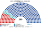
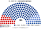

# 席次圖

> **這檔是什麼**：仿維基席次**圖庫**（長期示意；有則附大選重算／現行圖）。席次**數字表**與民調見 [`估計結果.md`](估計結果.md)；大選算法細節見本夾 `*大選重算*`／`*近期大選*` 檔。朝野互動見「預期政治生態」。

數字來自 [`估計結果.md`](估計結果.md)／[`生態模型.py`](生態模型.py)。產生器：席次圖產生器。座位由左至右依政治光譜排列。

## 2021 官方得票套本夾

見 [`估計結果.md`](估計結果.md) §1（計票爭議標註）。

## 推估第 3 屆

### 全院 300

### 單一席次 180

### 複數席次 120

| 政黨 | 單一 180 | 複數 120 | **全院** |
|---|--:|--:|--:|
| 統一俄羅斯 | 141 | 64 | **205** |
| 俄羅斯聯邦共產黨 | 29 | 26 | **55** |
| 俄羅斯自由民主黨 | 10 | 10 | **20** |
| 公正俄羅斯 | 0 | 10 | **10** |
| 新人 | 0 | 10 | **10** |

過半 **151**、3/5 **180**、2/3 **200**。統一俄羅斯單獨過全院 2/3，但基本法／修憲還要看複數 3/5 **72**、2/3 **80**（[`05`](05-法律基本法與修憲.md) §2.3）——要再拉一至兩黨。單一放大明顯：約 48% 區域第一偏好 → 78% 單一席次。

## 顏色

統一俄羅斯按派系分色（母黨色變體）。
