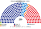

# 近期大選重算

> **這檔是什麼**：近期大選得票**怎麼**套進本夾選制（方法、假設、對照）。席次一覽與圖見 [`估計結果.md`](估計結果.md) §1、[`席次圖.md`](席次圖.md)。

用**當時實際的得票**，把 2024 年國會、2025 年與 2022 年總統選舉套進本夾的制度。數字由 [`近期大選重算.py`](近期大選重算.py) 算出。

與 [`15`](15-預期政治生態.md) 不同：15 的第一偏好是假設，這裡是開票紀錄；**只有第二偏好仍用 15 §2.3 的假設**（改革新黨選民 60% 把國民力量排在民主黨前、國民力量選民 90% 把改革新黨排在民主黨前、民主黨選民 55% 把改革新黨排在國民力量前）。

## 1 國會 2024-04

### 1.1 實際（現行 300＝區域 254＋比例 46）

| 政黨 | 區域得票 | 比例得票 | 席次 |
|---|--:|--:|--:|
| 民主黨（比例為更民主聯合） | 50.5% | 26.7% | 169（另盟友 進步黨 3、新進步聯合 2、無黨籍 2） |
| 國民力量（比例為國民未來） | 45.1% | 36.7% | 108 |
| 祖國革新黨 | — | 24.3% | 12 |
| 改革新黨 | 0.7% | 3.6% | 3 |
| 新未來 | 0.7% | 1.7% | 1 |

### 1.2 本夾（250＝單一 150＋複數 100）

| 政黨 | 單一 150 | 複數 100 | **全院 250** |
|---|--:|--:|--:|
| **民主黨** | 103 | 28 | **131** |
| 國民力量 | 47 | 38 | 85 |
| 祖國革新黨 | 0 | 25 | 25 |
| 改革新黨 | 0 | 8 | 8 |
| 綠色正義黨 | 0 | 1 | 1 |
**單一 150 的做法。** 各市道依選舉人數分到新區數（最大餘數），市道內把**逐邑面洞**得票（中央選管委開票結果，2,847 個單位；選區外事前投票、不在籍、海外票依各邑面洞選舉人比例分回；逐選區加總與 254 區一致）依現行選區順序（大致依區、郡相鄰）、選區內官方邑面洞順序排好，按選舉人數切成等大的新區，跨界的邑面洞按比例拆分。決選者是第一輪前 3 名。

| 市道 | 民主黨 | 國民力量 | 市道 | 民主黨 | 國民力量 |
|---|--:|--:|---|--:|--:|
| 首爾 | 23 | 5 | 江原 | 1 | 4 |
| 京畿 | 37 | 2 | 忠北 | 5 | 0 |
| 仁川 | 8 | 1 | 忠南 | 5 | 1 |
| 大田 | 4 | 0 | 世宗 | 1 | 0 |
| 光州、全北、全南 | 14 | 0 | 濟州 | 2 | 0 |
| 釜山 | 0 | 10 | 慶南 | 1 | 8 |
| 大邱 | 0 | 7 | 慶北 | 0 | 8 |
| 蔚山 | 2 | 1 | **計** | **103** | **47** |

- **孔多賽 vs 相對多數**（同樣 150 區）：相對多數是 民主 99／國民力量 51；孔多賽下 4 區翻成民主黨：蔚山 2 區、世宗 1 區、忠北 1 區。這些新區合併了現實中「聯盟只推一人」的舊區（蔚山北區是進步黨、世宗甲是新未來），合併後左翼的票分在兩個候選人之間，相對多數下國民力量以 4 成多撿到；孔多賽下小黨的票轉給民主黨。
- **鐵票區 148／150**：當選人所屬陣營的第一偏好就過半。2024 年的第一偏好是在相對多數下投的，小黨候選人少、棄保多；本夾下小黨會多出來，這個數字偏高。
- **改革新黨的華城乙**（李俊錫當選）：與鄰區合併後，改革新黨在新區的第一偏好掉到兩成以下，進不了前 2（舊版以整區切時是 民主 54.4%、國民力量 30.8%、改革新黨 13.9%；逐邑面洞版未逐區重核數字）。這是劃界造成的，不是孔多賽造成的。

**複數 100 的做法。** 本夾 8 區（M 同 [`01`](01-議會組成與選制.md) §2.1）；首都圈四區由首爾、仁川、京畿、江原的市道比例得票按人口混合（首爾南北兩半因此得票相同，是簡化）。黑爾額數＋最大餘數、無門檻。更民主聯合的票算民主黨（名單裡有進步黨、新進步聯合的人；本夾下他們會自己提名單）。

| 複數區（M） | 國民力量 | 民主黨 | 祖國革新黨 | 改革新黨 | 其他 |
|---|--:|--:|--:|--:|---|
| 首爾北＋京畿東北（14） | 5 | 4 | 3 | 1 | 綠色正義 1 |
| 首爾南＋京畿南（13） | 5 | 4 | 3 | 1 | |
| 仁川＋京畿西（13） | 5 | 4 | 3 | 1 | |
| 京畿東南＋江原（13） | 5 | 4 | 3 | 1 | |
| 忠清（11） | 4 | 3 | 3 | 1 | |
| 湖南＋濟州（11） | 1 | 4 | **5** | 1 | |
| 大邱慶北＋蔚山（12） | 7 | 2 | 2 | 1 | |
| 釜山慶南（13） | 6 | 3 | 3 | 1 | |
| **計** | **38** | **28** | **25** | **8** | 1 |

改革新黨 3.6% 拿 8 席：每區都以最大餘數拿 1 席（[`01`](01-議會組成與選制.md) §2.3 說過黑爾＋最大餘數對 4% 上下的黨很寬）。

### 1.3 門檻

| 門檻 | 誰過 |
|---|---|
| 全院過半 126（法律、預提的任內調整、未覆蓋部分） | **民主黨 131 單獨** |
| 單一過半 76（參考） | **民主黨 103 單獨**（也過 2/3 的 100） |
| 複數過半 51 | 無一黨；民主黨＋祖國革新黨 53 |
| 修憲：全院 ≥150 且複數 ≥60 | 民主黨＋祖國革新黨 全院 155 過，但複數 53 不過——**要國民力量** |

與現行比：民主黨陣營在現行制度拿 175／300（58%），本夾 157／250（63%，含祖國革新黨與綠色正義黨）；但民主黨本身從 169／300（56%）降到 131／250（52%），祖國革新黨從 12 升到 25。國民力量 36% → 34%。

## 2 2025-06 民意套國會（代理）

2025 年沒有國會選舉。把 2024 年的逐邑面洞得票加上各市道到 2025 年總統得票的擺動：民主黨、國民力量用市道內加法擺動，改革新黨（李俊錫 8.3%）與左翼小黨（權英國 1.0%）在市道內均勻分布。名單票把 2024 年的名單按陣營縮放到 2025 年的總統得票（左：李在明＋權英國；右：金文洙；改革新黨：李俊錫）。

| 政黨 | 單一 150 | 複數 100 | **全院 250** |
|---|--:|--:|--:|
| **民主黨** | 100 | 27 | **127** |
| 國民力量 | 50 | 39 | 89 |
| 祖國革新黨 | 0 | 24 | 24 |
| 改革新黨 | 0 | 8 | 8 |
| 自由統一黨 | 0 | 2 | 2 |
- 蔚山 3 區全歸國民力量（2024 年民主黨 2）；江原民主黨 1 → 2；忠北、忠南各有 1 區轉向國民力量。
- 孔多賽 vs 相對多數：相對多數 102／48，孔多賽 100／50——2 個民主黨以些微差距領先、改革新黨約 7–8% 的區，**改革新黨的選民偏向國民力量，讓這些區換手**。
- 鐵票區 110／150。
- 門檻與 2024 相同：民主黨單獨過全院與單一的過半；修憲要國民力量（民主黨＋祖國革新黨 複數 51）。

### 2.1 樞紐仍是改革新黨的選民

只動「改革新黨選民把國民力量排在民主黨前」：

| 該比例 | 2024 單一 民主／國民力量 | 2025 代理 單一 民主／國民力量 |
|:--:|:--:|:--:|
| 40% | 103／47 | 106／44 |
| 50% | 103／47 | 103／47 |
| **60%** | **103／47** | **100／50** |
| 70% | 103／47 | 96／54 |
| 80% | 103／47 | 91／59 |
| 90% | 103／47 | 82／68 |

2024 年改革新黨只在少數選區出馬，第二偏好動不了席次；2025 年它有 8.3%，從 40% 到 90% 民主黨單一席次由 106 掉到 82——**但都過 76**。另外兩個第二偏好參數（國民力量選民 50%–90%、民主黨選民 30%–80%）不動席次。改革新黨在任何參數下都拿不到單一席次。

## 3 總統

### 3.1 2025-06：結果不變

| 候選人 | 第一輪 | 本夾兩兩對決 |
|---|--:|---|
| **李在明**（民主黨） | 49.42% | 對金文洙 **53.8%**、對李俊錫 54.5% |
| 金文洙（國民力量） | 41.15% | 對李俊錫 63.4% |
| 李俊錫（改革新黨） | 8.34% | — |
| 權英國（民主勞動黨） | 0.98% | （第一輪淘汰） |

李在明是孔多賽贏家，沒有循環。改革新黨選民即使 100% 把金文洙排前，金文洙也只到約 49.5%。

### 3.2 2022-03：太接近，模型判不出

| 候選人 | 第一輪 |
|---|--:|
| 尹錫悅（國民力量） | 48.56% |
| 李在明（民主黨） | 47.83% |
| 沈相奵（正義黨） | 2.37% |
| 其他 10 人 | 1.24% |

決選者是尹、李、沈；沈相奵贏不了任何一人，勝負只看李對尹。**李在明要贏，沈相奵的選民要有 63.3% 以上把他排在尹錫悅前**（許京寧等其他候選人的選民按一半一半）：

| 沈相奵選民把李排前 | 李 : 尹 |
|:--:|:--:|
| 50% | 49.68 : 50.32 |
| 60% | 49.92 : 50.08 |
| 65% | 50.04 : 49.96 |
| 80% | 50.40 : 49.60 |

正義黨選民多半偏左，但 2022 年有一部分是對兩大黨都不滿的票，沒有資料能把這個比例定在 63% 的哪一邊。**另一個沒算進去的：安哲秀**在投票前 6 天退選、支持尹錫悅；本夾下第三名不是「分票者」，他很可能留在選票上，第一輪前 3 名會變成尹、李、安。這一場的實際結果是 0.73 個百分點，本夾的第二偏好假設不足以翻轉或確認它。

## 4 合起來看：同日選舉下的 2024–25

本夾三場同日選。用 2025 年的民意：

| | 結果 |
|---|---|
| 總統 | 李在明（對金文洙 53.8%） |
| 單一 150 | 民主黨 100 |
| 全院 250 | 民主黨 127 → **法律與預提的議會鑰匙皆單獨過** |
| 修憲 | 要國民力量（複數 60 過不了） |
| 預提 | 李在明的任期供給案由選民授權；任內調整由總統＋民主黨全院 127 席即可 |

**一致政府**，與現實（2025 年 6 月起李在明＋2024 年選出的民主黨多數）同一個方向；但民主黨在全院的比例從 56%（169／300）降到 51%，**修憲不能只靠民主黨陣營**。

## 5 模型的限制

- **2024 的第一偏好是在相對多數下投的**：改革新黨、進步黨、綠色正義黨在大多數選區沒有出馬或被棄保。本夾下它們的第一偏好會更多，但總和會從兩大黨流出多少沒有資料。
- **合併方式**：照條目順序切，不是實際劃界；市道內反向切，2024 年結果相同（民主 102／國民力量 48）。
- **首爾南北兩半在名單上得票相同**：江南三區偏保守，實際劃區後兩區之間可能差 1 席，全國總數大致不變。
- **2025 是代理**：均勻擺動，假設改革新黨的票在市道內平均分布。
- 2020 年國會沒有重算。

## 6 資料來源

| 數字 | 出處 |
|---|---|
| 2024 年逐邑面洞（投票區）逐候選人得票、選舉人數 | 中央選舉管理委員會，公共資料入口網 data.go.kr 15025527「국회의원선거 개표결과_20240410」（[`_build_emd.py`](_build_emd.py) → [`資料/emd-2024.csv`](資料/emd-2024.csv)）；逐選區加總與舊版 ko.wikipedia 17 個市道條目的 254 區資料一致 |
| 2024 年逐選區當選人、次高票（用來更正 ko 兩處誤植）、各市道比例得票率、全國結果 | en.wikipedia：2024 South Korean legislative election |
| 2024 年各市道投票者數 | ko.wikipedia：대한민국 제22대 국회의원 선거 |
| 2025 年總統各市道得票 | en.wikipedia：2025 South Korean presidential election |
| 2022 年總統各市道得票、安哲秀退選 | en.wikipedia：2022 South Korean presidential election |
