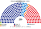
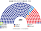

# 估計結果

> **這檔是什麼**：民意套本夾選制的席次**表**（如組閣聯盟／多數派政府）——§1 近期大選、§2 民調（若有）、§3 長期。圖庫見 [`席次圖.md`](席次圖.md)；大選算法細節見本夾重算檔。朝野互動見「預期政治生態」。

選制摘要：全院 **250＝單一 150（top-3 孔多賽）＋複數 100（黑爾額數＋最大餘數、無門檻）**。詳 [`01`](01-議會組成與選制.md)。

## 1 近期大選

用當時實際得票套本夾（單一 150 將 2,847 個邑面洞得票依在地陣營比與市道比例代表名單拆回實際政黨，避開現行相對多數下祖國革新黨不推區域候選人的提名扭曲）。細節與方法見 [`17-近期大選重算.md`](17-近期大選重算.md)（[`近期大選重算.py`](近期大選重算.py)）。

| | 現實（300） | **本夾全院 250** |
|---|---|---|
| 2024-04 國會 | 民主黨 169＋盟友 7、國民力量 108、祖國革新黨 12、改革新黨 3、新未來 1 | **民主黨 121**、國民力量 87、祖國革新黨 33、改革新黨 8、綠色正義黨 1 |
| 2025-06 民意套國會（代理） | — | **民主黨 117**、國民力量 89、祖國革新黨 34、改革新黨 8、自由統一黨 2 |

### 2024-04 單一／複數

| 政黨 | 單一 150 | 複數 100 | **全院** |
|---|--:|--:|--:|
| 民主黨 | 93 | 28 | **121** |
| 國民力量 | 49 | 38 | **87** |
| 祖國革新黨 | 8 | 25 | **33** |
| 改革新黨 | 0 | 8 | **8** |
| 綠色正義黨 | 0 | 1 | **1** |

**組閣聯盟／多數派政府**：總統制——國會民主黨全院 **121** 未單獨過半（過半 126），須與祖國革新黨（33）合作（121＋33＝**154**）通過法律、預提任內調整與未覆蓋部分；修憲須全院 ≥150 且複數 ≥60（民主黨 28＋祖國革新黨 25＋綠色正義黨 1＝54＜60，仍要國民力量）。

### 2025-06 代理

| 政黨 | 單一 150 | 複數 100 | **全院** |
|---|--:|--:|--:|
| 民主黨 | 90 | 27 | **117** |
| 國民力量 | 50 | 39 | **89** |
| 祖國革新黨 | 10 | 24 | **34** |
| 改革新黨 | 0 | 8 | **8** |
| 自由統一黨 | 0 | 2 | **2** |

**組閣聯盟／多數派政府**：民主黨（117）＋祖國革新黨（34）＝**151**≥126；修憲複數 51＜60，仍看跨陣營共識。

## 2 民調

**方法**：[`民調重算.py`](民調重算.py)；來源 [`資料/polls.csv`](資料/polls.csv)。

南韓公開民調多是**政黨支持率**，不是投票意向。無黨派占兩到三成；祖國革新黨的支持率只有 3%，遠低於它 2024 年的名單得票（24%）。所以把支持率正規化當得票率會錯。

**本版**採「相對選前變化」，同日本夾的做法：

- **比值**：r＝（最新支持率＋0.5）／（同一家 2024 選前最後一期支持率＋0.5）。基準是蓋洛普 2024-03-26..28：國民力量 37、民主黨 29、祖國革新黨 12、改革新黨 3、無黨派 17。
- **區域 150**：2024 **逐邑面洞各政黨偏好**每黨 × r 後正規化，同一套切區與 top-3 孔多賽。
- **名單 100**：2024 各市道名單得票率每黨 × r 後正規化。
- **其他黨**：民調沒列、或選前沒列的黨，r＝1。
- **Realmeter**：手上沒有它 2024 選前同一題的基準，所以不用。

| 蓋洛普 | 支持率 民主／國民力量／祖國／改革／無黨 | r 民主／國民力量／祖國／改革 | 單一 150 | 複數 100 | **全院 250** |
|---|---|---|---|---|---|
| **2026-10-27..29**（最新） | 35／30／3／2／28 | 1.20／0.81／0.28／0.71 | 民主黨 97、國民力量 53 | 民主黨 42、國民力量 38、祖國革新黨 9、改革新黨 5、自由統一黨 3、綠色正義黨 2、新未來 1 | **民主黨 139**、國民力量 91、祖國革新黨 9、改革新黨 5、自由統一黨 3、綠色正義黨 2、新未來 1 |
| 2026-09-15..17（對照） | 40／27／3／3／25 | 1.37／0.73／0.28／1.00 | 民主黨 112、國民力量 38 | 民主黨 44、國民力量 34、祖國革新黨 9、改革新黨 8、自由統一黨 3、綠色正義黨 2 | **民主黨 156**、國民力量 72、祖國革新黨 9、改革新黨 8、自由統一黨 3、綠色正義黨 2 |

**讀法**：

- **祖國革新黨回落、民主黨吸收進步票**：祖國革新黨支持率從選前 12% 掉到 3%（r＝0.28），2024 重算在湖南拿下的 8 席單一席次全數回到民主黨，名單席次從 25 席降為 9 席。
- **國民力量守住基本盤**：改以逐邑面洞政黨偏好乘 r 後，國民力量在嶺南與首都圈保守區仍保住 38–53 席單一席次（全院 72–91 席），不再因兩黨區域票直接縮放而失真崩盤。
- **民主黨單獨過全院半數（126），不過全院 2/3（167）**：全院 139–156 席可單獨通過普通法律；修憲仍須複數 ≥60，民主黨複數 42–44，加祖國革新黨與綠色正義黨也只有 53–55，仍要國民力量。
- **限制**：比值法把祖國革新黨流失的票按比例分給同區各黨（包括國民力量），而實際上多半會流向民主黨。國民力量席次因此可能略偏高。

## 3 長期運行假設下

生態模型示意 **第 3 屆**（以 2,847 個邑面洞政黨地理縮放至長期全國份額假設；詳見 [`15-預期政治生態.md`](15-預期政治生態.md)，數字由 [`生態模型.py`](生態模型.py) 算出）。

| 政黨 | 單一 150 | 複數 100 | **全院** |
|---|--:|--:|--:|
| 民主黨 | 94 | 37 | **131** |
| 國民力量 | 53 | 35 | **88** |
| 改革新黨 | 3 | 10 | **13** |
| 祖國革新黨 | 0 | 9 | **9** |
| 綠色正義黨 | 0 | 8 | **8** |
| 自由統一黨 | 0 | 1 | **1** |
| **計** | **150** | **100** | **250** |

| | 第 3 屆 | 第 5 屆 | 第 8 屆 |
|---|--:|--:|--:|
| **總統** | **民主黨** | **國民力量** | **民主黨** |
| 單一 民主黨／國民力量／改革新黨 | 94／53／3 | 61／85／4 | 74／72／4 |
| 全院 民主黨／國民力量／改革新黨／祖國／綠正／其他 | 131／88／13／9／8／1 | 97／123／13／9／8／0 | 111／106／16／9／8／0 |
| 全院過半（≥126） | 民主黨 131 單獨 | 無一黨過半（改革新黨 13 為樞軸） | 民主黨 111＋祖國 9＋綠正 8＝128 |

朝野互動、派系拆分與候選人行為見 [`15-預期政治生態.md`](15-預期政治生態.md)。
