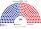

# 估計結果

> **這檔是什麼**：民意套本夾選制的席次**表**（如組閣聯盟／多數派政府）——§1 近期大選、§2 民調（若有）、§3 長期。圖庫見 [`席次圖.md`](席次圖.md)；大選算法細節見本夾重算檔。朝野互動見「預期政治生態」。

選制摘要：全院 **250＝單一 150（top-3 孔多賽）＋複數 100（黑爾額數＋最大餘數、無門檻）**。詳 [`01`](01-議會組成與選制.md)。

## 1 近期大選

用當時實際得票套本夾。細節與方法見 [`17-近期大選重算.md`](17-近期大選重算.md)（[`近期大選重算.py`](近期大選重算.py)）。

| | 現實（300） | **本夾全院 250** |
|---|---|---|
| 2024-04 國會 | 民主黨 169＋盟友、國民力量 108、祖國革新黨 12、改革新黨 3 … | **民主黨 130**、國民力量 86、祖國革新黨 25、改革新黨 8、綠色正義黨 1 |
| 2025-06 民意套國會（代理） | — | **民主黨 128**、國民力量 88、祖國革新黨 24、改革新黨 8、自由統一黨 2 |

### 2024-04 單一／複數

| 政黨 | 單一 150 | 複數 100 | **全院** |
|---|--:|--:|--:|
| 民主黨 | 102 | 28 | **130** |
| 國民力量 | 48 | 38 | **86** |
| 祖國革新黨 | 0 | 25 | **25** |
| 改革新黨 | 0 | 8 | **8** |
| 綠色正義黨 | 0 | 1 | **1** |

**組閣聯盟／多數派政府**：總統制——國會民主黨全院 **130**≥126、單一 **102**≥76，預算雙鑰匙／未覆蓋可過；修憲複數須 ≥60（民主黨複數 28，要拉國民力量）。

民主黨單獨過全院過半（126）與單一過半（76）；修憲在複數過不了 60，要國民力量。

### 2025-06 代理

| 政黨 | **全院** |
|---|--:|
| 民主黨 | **128** |
| 國民力量 | **88** |
| 祖國革新黨 | **24** |
| 改革新黨 | **8** |
| 自由統一黨 | **2** |

**組閣聯盟／多數派政府**：民主黨全院 **128**≥126；修憲仍看複數門檻。

## 2 民調

民調與得票摘自 parliament_condorcet 研究抽取／維基等彙整之 CSV（`parliament_condorcet/<country>/data/`），非本倉內建資料。下列支持率來自 `korea/data/input_vote_shares.csv`（無黨派不計；分母為表列政黨）。方法：支持度當全國第一偏好，套本夾生態模型——**單一 150** top-3 孔多賽、**複數 100** 黑爾＋最大餘數（不是全國比例拆單一）。祖國革新黨主要進複數；區域第一偏好併入進步小黨塊。

### 韓國蓋洛普 政黨支持度（2026-10-13..15，n＝1003）

支持率%；無黨派 29% 不計；未列小黨＝0

| 政黨 | 支持度 | 單一 150 | 複數 100 | 全院 250 |
|---|--:|--:|--:|--:|
| 民主黨 | 36% | 121 | 49 | **170** |
| 國民力量 | 27% | 29 | 38 | **67** |
| 祖國革新黨 | 3% | 0 | 8 | **8** |
| 改革新黨 | 2% | 0 | 5 | **5** |
| 進步黨 | 1% | 0 | 0 | **0** |

### Realmeter 政黨支持度（2026-09-10..11，n＝1003）

支持率%；其他 2.3%、無黨派 12.2% 不計

| 政黨 | 支持度 | 單一 150 | 複數 100 | 全院 250 |
|---|--:|--:|--:|--:|
| 國民力量 | 42.1% | 78 | 50 | **128** |
| 民主黨 | 36.1% | 72 | 41 | **113** |
| 祖國革新黨 | 4.7% | 0 | 8 | **8** |
| 改革新黨 | 1.3% | 0 | 1 | **1** |
| 進步黨 | 1.3% | 0 | 0 | **0** |

## 3 長期運行假設下

生態模型示意 **第 3 屆**（假設見 [`15-預期政治生態.md`](15-預期政治生態.md)；數字由 [`生態模型.py`](生態模型.py) 算出）。

| 政黨／派系 | 單一 150 | 複數 100 | 全院 |
|---|--:|--:|--:|
| 民主黨・改革派 | 57 | 19 | 76 |
| 民主黨・勞動派 | 46 | 19 | 65 |
| 國民力量・傳統派 | 37 | 14 | 51 |
| 國民力量・改革派 | 10 | 21 | 31 |
| 祖國革新黨 | 0 | 8 | 8 |
| 改革新黨 | 0 | 8 | 8 |
| 進步黨 | 0 | 8 | 8 |
| 正義黨 | 0 | 3 | 3 |
| **計** | **150** | **100** | **250** |

| | 第 3 屆 | 第 5 屆 | 第 8 屆 |
|---|--:|--:|--:|
| 單一 民主／國民力量 | 103／47 | 77／73 | 98／52 |
| 全院民主黨陣營（含祖國、進步） | 157 | 128 | 150 |

朝野互動與候選人行為見 [`15-預期政治生態.md`](15-預期政治生態.md)。
