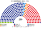
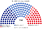
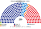
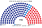
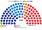
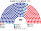

# 席次圖

> **這檔是什麼**：仿維基席次**圖庫**（長期示意；有則附大選重算／現行圖）。席次**數字表**與民調見 [`估計結果.md`](估計結果.md)；大選算法細節見本夾 `*大選重算*`／`*近期大選*` 檔。朝野互動見「預期政治生態」。

數字來自 [`15`](15-預期政治生態.md) 第 3 屆（[`生態模型.py`](生態模型.py)）。產生器：席次圖產生器。座位由左至右依政治光譜排列。

## 推估第 3 屆

### 全院 250

### 單一席次 150

### 複數席次 100

| 政黨 | 單一 150 | 複數 100 | **全院** |
|---|--:|--:|--:|
| 民主黨 | 103 | 38 | **141** |
| 國民力量 | 47 | 35 | **82** |
| 祖國革新黨 | 0 | 8 | **8** |
| 改革新黨 | 0 | 8 | **8** |
| 進步黨 | 0 | 8 | **8** |
| 正義黨 | 0 | 3 | **3** |

過半 **126**、3/5 **150**、2/3 **167**。民主黨單獨過法律門檻；加祖國革新黨、進步黨＝157 過全院 3/5，但修憲另要複數 ≥60（[`05`](05-法律與修憲.md) §2.2a）——民主黨陣營複數 54，要跨陣營。四個小黨 27 席全在複數。

## 2024-04 得票套新制

數字見 [`17`](17-近期大選重算.md)。

### 全院 250

### 單一席次 150

### 複數席次 100

| 政黨 | 單一 150 | 複數 100 | **全院** |
|---|--:|--:|--:|
| 民主黨 | 102 | 28 | **130** |
| 國民力量 | 48 | 38 | **86** |
| 祖國革新黨 | 0 | 25 | **25** |
| 改革新黨 | 0 | 8 | **8** |
| 綠色正義黨 | 0 | 1 | **1** |

民主黨單獨過全院過半（126）與單一過半（76）；修憲在複數過不了 60，要國民力量。

## 2025-06 總統得票擺動（代理）

| 政黨 | **全院** |
|---|--:|
| 民主黨 | **128** |
| 國民力量 | **88** |
| 祖國革新黨 | **24** |
| 改革新黨 | **8** |
| 自由統一黨 | **2** |

## 現行制度 2024-04 實際結果（300）

## 顏色

兩大黨按派系分色（母黨色變體）。
