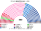
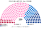
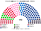
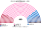
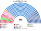
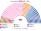
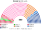

# 估計結果

> **這檔是什麼**：民意套本夾選制的席次**表**（如組閣聯盟／多數派政府）——§1 近期大選、§2 民調（若有）、§3 長期。圖庫見 [`席次圖.md`](席次圖.md)；大選算法細節見本夾重算檔。朝野互動見「預期政治生態」。

選制摘要：全院 **400＝單一 230（top-3 孔多賽）＋複數 170（彈性名單、14 區聖拉古、無門檻）**。詳 [`01`](01-國民議會與選制.md)。

## 1 近期大選

用當時實際得票套本夾。細節與方法見 [`16-近期大選重算.md`](16-近期大選重算.md)（[`近期大選重算.py`](近期大選重算.py)）。

| | 現實（577） | **本夾全院 400** |
|---|---|---|
| 2024-06 國會 | 新人民陣線 178、Ensemble 150、國民聯盟 125＋Ciotti 派 17、共和黨 39、其他 68；無多數 | **中間 159**、國民聯盟系 102、左翼 72、共和黨系 51、收復黨 14、鄉村聯盟 2 |
| 2022-06 國會 | Ensemble 245（相對多數）、NUPES 131、國民聯盟 89、UDC 64 | **中間 246**、左翼 65、共和黨系 42、國民聯盟系 34、極右小黨 13 |

### 2024-06 單一／複數

| 陣營／政黨 | 單一 230 | 複數 170 | **全院** |
|---|--:|--:|--:|
| 中間陣營（Ensemble） | 133 | 26 | **159** |
| 國民聯盟系（含 Ciotti 派） | 43 | 59 | **102** |
| 左翼：新人民陣線共同候選人 | 17 | — | 17 |
| 　　社會黨系 | — | 25 | 25 |
| 　　不屈法國系 | — | 17 | 17 |
| 　　生態派 | — | 13 | 13 |
| 共和黨系 | 37 | 14 | **51** |
| 收復黨 | — | 14 | **14** |
| 鄉村聯盟 | — | 2 | **2** |

**組閣聯盟／多數派政府**：首長／供給門檻全院 **201**——中間 159 不過；中間＋共和黨系＝**210** 過。組織法／修憲：全院 ≥240 且複數 ≥102（現複數扣極右後 97，未達）。

中間全院 159，不過首長／供給／建設性更新門檻 **201**；加共和黨系 51＝210。組織法與修憲要全院 ≥240 **且**複數 ≥102：複數扣掉國民聯盟 59＋收復黨 14 後剩 97，未達。

### 2022-06

| 陣營 | **全院** |
|---|--:|
| 中間 | **246** |
| 左翼 | **65** |
| 共和黨系 | **42** |
| 國民聯盟系 | **34** |
| 極右小黨 | **13** |

**組閣聯盟／多數派政府**：中間全院 **246** 單獨過首長／供給門檻 201；改規則仍看複數門檻。

## 2 民調

公開全國投票意向（維基「Opinion polling for the 2027 French legislative election」／法文立法民調表）。方法：民調合併欄當全國第一偏好，套本夾生態模型——**單一 230** top-3 孔多賽（陣營；區域偏移見模型）、**複數 170** 聖拉古（不是全國比例拆單一）。NFP／各類左→左翼陣營；ENS→中間；RN→國民聯盟系；LR／各類右→共和黨系；收復等→其他。單一欄為陣營孔多賽席次再按模型內部分拆到政黨。

### Ifop（2025-10-07..08，n＝1386；立法意向、NFP 合併欄）

首長 **共和黨系**（孔多賽妥協；對假設敏感）。

| 政黨 | 單一 230 | 複數 170 | 全院 400 |
|---|--:|--:|--:|
| 共和黨系 | 192 | 23 | **215** |
| 國民聯盟系 | 17 | 70 | **87** |
| 不屈法國系 | 8 | 19 | **27** |
| 社會黨系 | 7 | 15 | **22** |
| 復興系（中間） | 2 | 19 | **21** |
| 生態派 | 3 | 12 | **15** |
| 民主運動 | 0 | 12 | **12** |
| 共產黨系 | 1 | 0 | **1** |

單一（陣營）：國民聯盟系 17；左翼陣營 19；中間陣營 2；共和黨系 192。

### OpinionWay（2025-10-06..07，n＝1012；立法意向、NFP 合併欄）

首長 **中間陣營**。

| 政黨 | 單一 230 | 複數 170 | 全院 400 |
|---|--:|--:|--:|
| 復興系（中間） | 149 | 23 | **172** |
| 國民聯盟系 | 28 | 66 | **94** |
| 民主運動 | 49 | 8 | **57** |
| 共和黨系 | 2 | 27 | **29** |
| 不屈法國系 | 1 | 19 | **20** |
| 社會黨系 | 1 | 15 | **16** |
| 生態派 | 0 | 12 | **12** |

單一（陣營）：國民聯盟系 28；左翼陣營 2；中間陣營 198；共和黨系 2。

## 3 長期運行假設下

生態模型示意 **第 3 屆**（假設見 [`14-預期政治生態.md`](14-預期政治生態.md)；數字由 [`生態模型.py`](生態模型.py) 算出）。

| 政黨 | 單一 230 | 複數 170 | 全院 400 |
|---|--:|--:|--:|
| 復興系（中間） | 164 | 25 | **189** |
| 民主運動 | 54 | 13 | **67** |
| 國民聯盟系 | 10 | 60 | **70** |
| 不屈法國系 | 1 | 24 | **25** |
| 社會黨系 | 1 | 19 | **20** |
| 生態派 | 0 | 14 | **14** |
| 共和黨系 | 0 | 15 | **15** |
| **計** | **230** | **170** | **400** |

中間陣營（復興＋民運）：單一 218、複數 38、全院 **256**（單獨過 201 與全院 3/5；複數 38 過不了組織法／修憲的 102）。

| | 第 3 屆 | 第 6 屆 |
|---|--:|--:|
| 單一 國民聯盟／左翼／中間 | 10／2／218 | 29／2／199 |
| 複數 國民聯盟／中間 | 60／38 | 62／36 |

朝野互動與候選人行為見 [`14-預期政治生態.md`](14-預期政治生態.md)。
