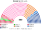
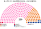
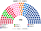
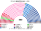
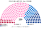
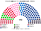
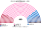
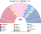

# 席次圖

> **這檔是什麼**：仿維基席次**圖庫**（長期示意；有則附大選重算／現行圖）。席次**數字表**與民調見 [`估計結果.md`](估計結果.md)；大選算法細節見本夾 `*大選重算*`／`*近期大選*` 檔。朝野互動見「預期政治生態」。

數字來自 [`14`](14-預期政治生態.md) 第 3 屆（[`生態模型.py`](生態模型.py)）。產生器：席次圖產生器。座位由左至右依政治光譜排列。

## 推估第 3 屆

### 全院 400

### 單一席次 230

### 複數席次 170

| 政黨 | 單一 230 | 複數 170 | **全院** |
|---|--:|--:|--:|
| 復興系 | 164 | 25 | **189** |
| 國民聯盟系 | 10 | 60 | **70** |
| 民主運動 | 54 | 13 | **67** |
| 不屈法國系 | 1 | 24 | **25** |
| 社會黨系 | 1 | 19 | **20** |
| 共和黨系 | 0 | 15 | **15** |
| 生態派 | 0 | 14 | **14** |

過半 **201**、3/5 **240**、2/3 **267**。中間陣營（復興＋民運）256，單獨過全院 3/5；組織法與修憲另要複數 3/5 **102**（[`06`](06-法律、組織法與修憲.md) §2.5）——兩翼在複數接近得票，中間只剩 38。首長與供給由全院表決（[`02`](02-政府組成與建設性更新.md)、[`03`](03-行政權預算與供給.md)）。

## 2024-06 得票套新制

數字見 [`16`](16-近期大選重算.md)。

### 全院 400

### 單一席次 230

### 複數席次 170

| 政黨 | 單一 230 | 複數 170 | **全院** |
|---|--:|--:|--:|
| 中間 | 133 | 26 | **159** |
| 國民聯盟系 | 43 | 59 | **102** |
| 共和黨系 | 37 | 14 | **51** |
| 社會黨系 | 0 | 25 | **25** |
| 不屈法國系 | 0 | 17 | **17** |
| 新人民陣線 | 17 | 0 | **17** |
| 收復黨 | 0 | 14 | **14** |
| 生態派 | 0 | 13 | **13** |
| 鄉村聯盟 | 0 | 2 | **2** |

中間全院 159，不過首長／供給門檻 **201**；加共和黨系 51＝210。組織法／修憲要全院 ≥240 且複數 ≥102：複數扣掉國民聯盟 59＋收復黨 14 後剩 97，未達。

## 2022-06 得票套新制

| 政黨 | **全院** |
|---|--:|
| 中間 | **246** |
| NUPES | **65** |
| 共和黨系 | **42** |
| 國民聯盟系 | **34** |
| 極右小黨 | **13** |

## 現行制度 2024-07 實際結果（577）

## 顏色

各黨代表色。
