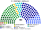
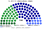
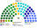

# 席次圖

> **這檔是什麼**：仿維基席次**圖庫**（長期示意；有則附大選重算／現行圖）。席次**數字表**與民調見 [`估計結果.md`](估計結果.md)；大選算法細節見本夾 `*大選重算*`／`*近期大選*` 檔。朝野互動見「預期政治生態」。

數字來自 [`15`](15-預期政治生態.md) 第 3 屆（[`生態模型.py`](生態模型.py)）。產生器：席次圖產生器。座位由左至右依政治光譜排列。

## 推估第 3 屆

### 全院 180

### 單一席次 100

### 複數席次 80

| 政黨 | 單一 100 | 複數 80 | **全院** |
|---|--:|--:|--:|
| 國民黨 | 62 | 24 | **86** |
| 民進黨 | 38 | 29 | **67** |
| 民眾黨 | 0 | 17 | **17** |
| 時代力量 | 0 | 6 | **6** |
| 台灣基進 | 0 | 2 | **2** |
| 綠黨與環境團體聯盟 | 0 | 2 | **2** |

過半 **91**、3/5 **108**。兩大黨相加 **153**。同屆總統亦為國民黨（[`15`](15-預期政治生態.md) §2.4）——雙鑰匙兩把同黨。複數無一黨過半（3/5 **48**）；基本法／修憲要兩大黨合計過門檻（[`05`](05-法律與法規位階.md) §2.3）。民眾黨 17 席全在複數。

## 顏色

兩大黨按派系分色（母黨色變體）。
