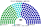
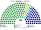
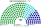
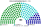
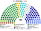

# 估計結果

> **這檔是什麼**：民意套本夾選制的席次**表**（如組閣聯盟／多數派政府）——§1 近期大選、§2 民調（若有）、§3 長期。圖庫見 [`席次圖.md`](席次圖.md)；大選算法細節見本夾重算檔（或台灣總統制／兩院見 [`../一院議會制/17-近期大選重算.md`](../一院議會制/17-近期大選重算.md)）。朝野互動見「預期政治生態」。

選制摘要：全院 **180＝單一 100（top-3 孔多賽）＋複數 80（彈性名單、7 區聖拉古、無門檻）**。詳 [`01`](01-議會組成與選制.md)。議會選制與 [`../一院議會制/`](../一院議會制/) 相同；總統另選，本檔席次表為**議會**。

## 1 近期大選

用當時實際得票套本夾議會選制。細節與方法見 [`../一院議會制/17-近期大選重算.md`](../一院議會制/17-近期大選重算.md)（同資料夾 [`../一院議會制/近期大選重算.py`](../一院議會制/近期大選重算.py)）。

| | 實際（113） | **本夾全院 180** |
|---|---|---|
| 2024-01（政黨票） | 國民黨 52、民進黨 51、民眾黨 8、無黨籍 2 | 國民黨 **85**、民進黨 66、民眾黨 29 |
| 2020-01（政黨票） | 民進黨 61、國民黨 38、民眾黨 5、時代力量 3 … | 民進黨 **108**、國民黨 51、民眾黨 10、時代力量 7、親民黨 3、台灣基進 1 |

### 2024-01 單一／複數

| 政黨 | 單一 100 | 複數 80 | **全院** |
|---|--:|--:|--:|
| 中國國民黨 | 55 | 30 | **85** |
| 民主進步黨 | 35 | 31 | **66** |
| 台灣民眾黨 | 10 | 19 | **29** |

**組閣聯盟／多數派政府**：總統制——預算由全院議決；國民黨全院 **85**＜91，須拉民眾黨（＋29＝114）或在野合作。

國民黨全院 85，差 6 過半（≥91）；行政權預算由**全院**議決（本夾不用預提）。

### 2020-01

**組閣聯盟／多數派政府**：民進黨全院 **108** 單獨過半（≥91）。

民進黨 **108**、國民黨 51、民眾黨 10、時代力量 7、親民黨 3、台灣基進 1。民進黨單獨過半。

## 2 民調

公開政黨**喜好度／好感度**（非立委政黨票）。**不是**全國比例拆單一。

方法：以 **2024-01 村里政黨票** 為地理基底，按喜好／好感度當全國權重縮放三黨得票後跑本夾——**單一 100** top-3 孔多賽、**複數 80** 聖拉古（與 §1 同一套重算；本節小黨欄歸零）。

### 美麗島電子報／趨勢（2026-09-29..10-02，n＝1201；喜好度）

議會單獨過半 **民進黨**（≥91）。

| 政黨 | 喜好度 | 單一 100 | 複數 80 | 本夾全院 |
|---|--:|--:|--:|--:|
| 民主進步黨 | 43.1% | 69 | 38 | **107** |
| 中國國民黨 | 26.5% | 17 | 24 | **41** |
| 台灣民眾黨 | 21.0% | 14 | 18 | **32** |

### 戴立安／畢肯（2026-10-20..22，n＝1075；好感度）

議會單獨過半 **民進黨**（≥91）。

| 政黨 | 好感度 | 單一 100 | 複數 80 | 本夾全院 |
|---|--:|--:|--:|--:|
| 民主進步黨 | 49.0% | 54 | 38 | **92** |
| 台灣民眾黨 | 26.3% | 35 | 21 | **56** |
| 中國國民黨 | 27.9% | 11 | 21 | **32** |

## 3 長期運行假設下

下表為政黨加總；[`席次圖.svg`](席次圖.svg) 圖例依**派系**分色，與 [`席次圖.md`](席次圖.md) 括號內服務／政策席次一致。

生態模型示意 **第 3 屆**（假設見 [`15-預期政治生態.md`](15-預期政治生態.md)）。

| 政黨／派系 | 單一 100 | 複數 80 | 全院 |
|---|--:|--:|--:|
| 民主進步黨 | 40 | 27 | **67** |
| 中國國民黨 | 33 | 22 | **55** |
| 台灣民眾黨 | 8 | 12 | **20** |
| 無黨籍／地方 | 12 | 4 | **16** |
| 時代力量 | 4 | 6 | **10** |
| 台灣基進 | 2 | 5 | **7** |
| 綠黨與環境團體聯盟 | 1 | 4 | **5** |
| **計** | **100** | **80** | **180** |

兩大黨全院相加 122。過半 91、基本法 108。
朝野互動與候選人行為見 [`15-預期政治生態.md`](15-預期政治生態.md)。
