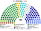
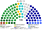
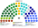

# 席次圖

> **這檔是什麼**：仿維基席次**圖庫**（長期示意；有則附大選重算／現行圖）。席次**數字表**與民調見 [`估計結果.md`](估計結果.md)；大選算法細節見本夾 `*大選重算*`／`*近期大選*` 檔。朝野互動見「預期政治生態」。

數字來自 [`15`](15-預期政治生態.md) 第 3 屆。產生器：席次圖產生器。座位由左至右依政治光譜排列。

## 推估第 3 屆

### 全院 180

### 單一席次 100

### 複數席次 80

| 政黨 | 單一 100 | 複數 80 | **全院** |
|---|--:|--:|--:|
| 民進黨 | 40 | 27 | **67** |
| 國民黨 | 33 | 22 | **55** |
| 民眾黨 | 8 | 12 | **20** |
| 無黨籍／地方 | 12 | 4 | **16** |
| 時代力量 | 4 | 6 | **10** |
| 基進 | 2 | 5 | **7** |
| 綠黨與環境團體聯盟 | 1 | 4 | **5** |

過半 **91**、3/5 **108**、2/3 **120**。兩大黨相加 **122**。行政權預算由全院表決（[`03`](03-行政權預算.md) §2.1）。無黨籍在單一佔 12%、在複數只佔 5%；綠黨聯盟 5 席中有 4 席在複數。

## 顏色

兩大黨按派系分色（母黨色變體）；無黨籍／地方用灰。
