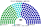
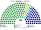
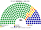
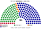
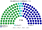
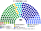

# 近期大選重算

> **這檔是什麼**：近期大選得票**怎麼**套進本夾選制（方法、假設、對照）。席次一覽與圖見 [`估計結果.md`](估計結果.md) §1、[`席次圖.md`](席次圖.md)。

2024、2020、2016、2012 套本夾

**問題**：如果各屆選民照原本的偏好投票，在本夾（單一 100 top-3 孔多賽＋複數 80 彈性名單；首長由全院 180 選出）的制度下，會選出什麼樣的國民議會與首長？

**方法**：[`近期大選重算.py`](近期大選重算.py)、[`政黨單位.py`](政黨單位.py)。

| 項目 | 做法 |
|---|---|
| 第一偏好 | 中選會逐**村里**的**不分區政黨票**（[`資料/`](資料/)）。除民進黨、國民黨、中位第三（2020＋**民眾黨**／2012–16 **親民黨**）直接取村里票外，村里的綠系小黨與非綠小黨依 [`資料/名單-YYYY.csv`](資料/) 各區實際政黨得票拆回各真實政黨（時代力量、綠黨、歐巴桑聯盟、台灣基進、台聯、新黨等）參選。另做**總統票版**（2024 賴／侯／柯；2016 蔡／朱／宋；2012 蔡／馬／宋） |
| 第二偏好 | **沿用 [`生態模型.py`](生態模型.py) 第 3 屆的 q**（完整多黨排序見 `政黨單位.tw_orders`）：民進黨選民把中位第三排在國民黨前 50%；國民黨選民把中位第三排在民進黨前 85%；中位第三選民把國民黨排在民進黨前 55%；綠系小黨排綠營在前、藍白居後；非綠小黨排藍白在前、綠營居後 |
| 單一 100 | 7 區配額照 `生態模型.region_seats(99)`＋澎金馬 1；區內依「縣市 → 現行立委選區 → 鄉鎮 → 村里」連續切成政黨票相近的選區（得跨縣市，[`01`](01-議會組成與選制.md) §2.6）；村里數不足則對半拆；多黨 top-3 孔多賽 |
| 複數 80 | 7 區，M＝`region_seats(80, 8, 14)`：臺北 8、新北 14、桃竹 12、中彰 14、雲嘉南 11、高屏 12、其餘縣市與離島 9；聖拉古、無門檻，每個政黨各自一張名單 |
| 首長 | **全院 180** 記名排名投票，各黨議員依 `生態模型.MP_RANK` 的固定排序；須 ≥91（[`02`](02-行政首長.md)） |

**不模擬政黨在新制下的重組與策略調整**：這是「同樣的民意、不同的規則」，不是預測。

## 1 一覽

| | 實際（113 席） | **本夾全院 180** | 單一 100 | **首長** | **組閣陣營** |
|---|---|---|---|---|---|
| 2024-01（政黨票） | 國民黨 52、民進黨 51、民眾黨 8、無黨籍 2 | 國民黨 85、民進黨 66、民眾黨 29 | 國民黨 55、民進黨 35、民眾黨 10 | **民眾黨**（對國民黨 95:85、對民進黨 114:66） | 民眾黨＋國民黨 114 |
| 2024-01（總統票） | 同上 | 國民黨 80、民進黨 63、民眾黨 37 | 國民黨 50、民進黨 32、民眾黨 18 | **民眾黨**（對國民黨 100:80） | 民眾黨＋國民黨 117 |
| 2020-01（政黨票） | 民進黨 61、國民黨 38、民眾黨 5、時代力量 3 … | 民進黨 108、國民黨 51、民眾黨 10、時代力量 7、親民黨 3、台灣基進 1 | 民進黨 78、國民黨 22 | **民進黨**（單獨 108） | 民進黨單獨 |
| 2016-01（政黨票） | 民進黨 68、國民黨 35、時代力量 5、親民黨 3 … | 民進黨 123、國民黨 40、時代力量 7、親民黨 6、新黨 4 | 民進黨 84、國民黨 16 | **民進黨**（單獨 123） | 民進黨單獨 |
| 2016-01（總統票） | 同上 | 民進黨 133、國民黨 30、時代力量 7、親民黨 6、新黨 4 | 民進黨 94、國民黨 6 | **民進黨**（單獨 133） | 民進黨單獨 |
| 2012-01（政黨票） | 國民黨 64、民進黨 40、親民黨 3、台聯 3 … | 國民黨 99、民進黨 68、台聯 8、親民黨 5 | 國民黨 62、民進黨 38 | **國民黨**（單獨 99） | 國民黨單獨 |
| 2012-01（總統票） | 同上 | 國民黨 101、民進黨 66、台聯 8、親民黨 5 | 國民黨 64、民進黨 36 | **國民黨**（單獨 101） | 國民黨單獨 |

## 2 2024-01：民眾黨首長、民眾黨＋國民黨執政
| 政黨 | 得票% | 實際 | 單一 100 | 複數 80 | **新制** |
|---|--:|--:|--:|--:|--:|
| 國民黨 | 34.6 | 52 | 55 | 30 | **85** |
| 民進黨 | 36.2 | 51 | 35 | 31 | **66** |
| 民眾黨 | 22.1 | 8 | 10 | 19 | **29** |

| 區（單一） | 結果 |
|---|---|
| 臺北市（11） | 國民黨 9、民進黨 2 |
| 新北市（17） | 國民黨 10、民眾黨 5、民進黨 2 |
| 桃園＋新竹縣市（14） | 國民黨 11、民眾黨 3 |
| 臺中＋彰化（17） | 國民黨 15、民眾黨 2 |
| 雲嘉南（14） | 民進黨 14 |
| 高屏（15） | 民進黨 15 |
| 其餘縣市與離島（11） | 國民黨 9、民進黨 2 |
| 澎金馬（1） | 國民黨 1 |

- **國民黨全院 85，差 6 席過半**。首長由全院記名排名選出：國民黨議員把民眾黨排第二、民進黨議員把民眾黨排在國民黨前，**民眾黨對每一方都贏**，首長出自民眾黨，組閣陣營是民眾黨＋國民黨 114。總理職位與閣員是兩黨的談判；國民黨是最大的執政夥伴。
- **政府多數就是立法多數**：114 席同時過法律的 91（「同意 > 總額半數」，[`05`](05-法律與法規位階.md)）。這和現實的「行政權在民進黨、國會多數在藍白」不同：政府、錢、法律都在同一個多數手上。
- **改規則**：民眾黨＋國民黨複數 49（要 48），全院 114（要 108），**一般軌修憲與基本法剛好過得去**；急迫軌（全院 120、複數 54）不行。
- **29 區循環**，約近三成：和 [`15`](15-預期政治生態.md) 的「約三分之一」同一個量級。循環區的當選人一定在某一場對決輸過，依 [`01`](01-議會組成與選制.md) §2.8 公告。
- **19 區的當選者不是第一偏好最多者**：大多是民進黨第一偏好領先、但民眾黨選民的第二偏好讓國民黨勝出的北部與中部選區。

### 2.1 總統票版

改用總統票當第一偏好（柯文哲 26.5%，高於民眾黨的政黨票 22.1%）：民眾黨單一 18、全院 37；首長仍是民眾黨，組閣陣營 117。

## 3 2020-01：民進黨單獨執政
| 政黨 | 得票% | 實際 | 單一 100 | 複數 80 | **新制** |
|---|--:|--:|--:|--:|--:|
| 民進黨 | 34.0 | 61 | 78 | 30 | **108** |
| 國民黨 | 33.4 | 38 | 22 | 29 | **51** |
| 民眾黨 | 11.2 | 5 | 0 | 10 | **10** |
| 時代力量 | 7.8 | 3 | 0 | 7 | **7** |
| 親民黨 | 3.7 | 0 | 0 | 3 | **3** |
| 台灣基進 | 3.2 | 1 | 0 | 1 | **1** |

- **民進黨單一 78**：中彰 17／17、雲嘉南與高屏全拿，北部也過半。當年民眾黨政黨票只有 11.2%，部分選區時代力量擠進前 3，兩者都不是孔多賽贏家。
- 全院 108，**單獨過 91**，首長出自民進黨、不需夥伴；複數 30（要 48）：**單獨執政、單獨立法，複數層鎖住改不了規則**。

## 4 2016-01：民進黨大勝、單獨過 3/5
| 政黨 | 得票% | 實際 | 單一 100 | 複數 80 | **新制** |
|---|--:|--:|--:|--:|--:|
| 民進黨 | 44.1 | 68 | 84 | 39 | **123** |
| 國民黨 | 26.9 | 35 | 16 | 24 | **40** |
| 時代力量 | 6.1 | 5 | 0 | 7 | **7** |
| 親民黨 | 6.5 | 3 | 0 | 6 | **6** |
| 新黨 | 4.2 | 0 | 0 | 4 | **4** |

- **中位第三＝親民黨**（尚無民眾黨；部分選區由時代力量擠進前 3）。單一席次親民與時力都進不了三人決選的贏家；複數無門檻分拿 6 與 7。
- 民進黨全院 **123**，過半 91 與 3/5 的 108 都過；首長民進黨、但複數 39（要 48），複數層仍鎖住改規則。
- 總統票版（蔡 56.1%）：單一 94、全院 133，同結論。

## 5 2012-01：國民黨單獨過半
| 政黨 | 得票% | 實際 | 單一 100 | 複數 80 | **新制** |
|---|--:|--:|--:|--:|--:|
| 國民黨 | 44.5 | 64 | 62 | 37 | **99** |
| 民進黨 | 34.6 | 40 | 38 | 30 | **68** |
| 台聯 | 9.0 | 3 | 0 | 8 | **8** |
| 親民黨 | 5.5 | 3 | 0 | 5 | **5** |

- **中位第三＝親民黨**（多數選區由台聯擠進前 3）。國民黨單一 62、全院 **99**，單獨過 91；首長國民黨。
- 總統票版（馬 51.6%）：單一 64、全院 101，同結論。
- 與 2024 對照：2012 國民黨第一偏好夠高，單一＋複數都能單獨過半；2024 國民黨全院 85 差 6，首長落到中位的民眾黨。

## 6 敏感度：首長取決於誰過半、誰在中間

### 6.1 民進黨選民把中位第三排在國民黨前的比例（q民進）

| q民進 | 2024 政黨票 單一 100 | 首長 | 2024 總統票 單一 100 | 首長 |
|:--:|---|---|---|---|
| 20% | 國民黨 61、民進黨 39 | **國民黨**（全院 91，單獨過半） | 國民黨 62、民進黨 38 | **國民黨** |
| 35% | 國民黨 61、民進黨 39 | **國民黨** | 國民黨 62、民進黨 38 | **國民黨** |
| **50%（基準）** | 國民黨 55、民進黨 35、民眾黨 10 | 民眾黨 | 國民黨 50、民進黨 32、民眾黨 18 | 民眾黨 |
| 65% | 民眾黨 49、民進黨 29、國民黨 22 | 民眾黨 | 民眾黨 52、民進黨 25、國民黨 23 | 民眾黨 |
| 80% | 民眾黨 64、民進黨 29、國民黨 7 | 民眾黨 | 民眾黨 70、民進黨 25、國民黨 5 | 民眾黨 |

### 6.2 民眾黨選民把國民黨排在民進黨前的比例（q民眾）

| q民眾 | 2024 政黨票 單一 100 | 首長 |
|:--:|---|---|
| 35% | 民進黨 37、民眾黨 34、國民黨 29 | 民眾黨 |
| 45% | 國民黨 42、民進黨 36、民眾黨 22 | 民眾黨 |
| **55%（基準）** | 國民黨 55、民進黨 35、民眾黨 10 | 民眾黨 |
| 65% | 國民黨 59、民進黨 34、民眾黨 7 | 民眾黨 |
| 75% | 國民黨 67、民進黨 30、民眾黨 3 | **國民黨**（全院 97） |

- **國民黨要單獨執政，得在全院過 91**。單一席次多拿 6 席（民進黨選民更少把民眾黨排前，或民眾黨選民更偏國民黨）就跨過去；跨不過去，首長就是兩大黨都能接受的民眾黨。
- **民眾黨的首長地位來自全院的排序，不是單一席次**：它在單一席次只有 10 席，但兩大黨的議員都把它排第二。
- **2012／2016／2020 對 q 不敏感**：最大黨全院單獨過半。
- 這是 [`15`](15-預期政治生態.md) §2.4 的另一面：**每一場區域對決都由不在場上那一方的選民決定**；全院選首長時，**中間那一黨決定誰執政**（僅當無人單獨過半）。

## 7 和 15 的推估對照

| | 15 推估第 3 屆 | 2024 實際得票 |
|---|---|---|
| 第一偏好 | 民進黨 38、國民黨 34、民眾黨 21 | 民進黨 36.2、國民黨 34.6、民眾黨 22.1（政黨票） |
| 單一 100 | 國民黨 61、民進黨 38、民眾黨 1 | 國民黨 55、民進黨 35、民眾黨 10 |
| 全院 180 | 國民黨 85、民進黨 66、民眾黨 18 … | 國民黨 85、民進黨 66、民眾黨 29 |
| 首長 | 民眾黨（民眾黨＋國民黨 103） | 民眾黨（民眾黨＋國民黨 114） |

真實地理下民眾黨多拿 9 個單一席次（新北、桃竹、中彰的都會選區），其餘方向一致。

## 8 限制

- **第一偏好用政黨票**：區域立委的候選人效應（現任、地方派系）沒有反映；總統票版是另一個極端。
- **第二偏好與議員排序是假設**：§6 顯示首長對 q 敏感，而 q 沒有實測值。
- 新選區沿村里的行政序切，假設行政序大致相鄰；村里數不足席次時對半拆（2012／2016 部分縣市單位較粗）。
- 原住民立委選區（山地、平地）的選票已含在村里的政黨票裡；本夾不設原住民保障席（[`01`](01-議會組成與選制.md) §2.6）。
- 2020 年有 2 個村里對不上現行立委選區（排在縣市最後）。

## 來源

- 中選會選舉資料庫 `votedata.zip`（data.cec.gov.tw），2012、2016、2020、2024 總統立委選舉的不分區政黨票、總統票逐村里結果（建檔：[`_build_cec_years.py`](_build_cec_years.py)、[`_fetch_cec.py`](_fetch_cec.py)）。
- 實際席次：2024 國民黨 52、民進黨 51、民眾黨 8、無黨籍 2；2020 民進黨 61、國民黨 38、民眾黨 5、時代力量 3、台灣基進 1、無黨籍 5；2016 民進黨 68、國民黨 35、時代力量 5、親民黨 3…；2012 國民黨 64、民進黨 40、親民黨 3、台聯 3…（中選會）。
