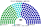
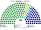
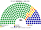
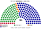
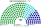
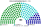
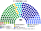

# 估計結果

> **這檔是什麼**：民意套本夾選制的席次**表**（如組閣聯盟／多數派政府）——§1 近期大選、§2 民調（若有）、§3 長期。圖庫見 [`席次圖.md`](席次圖.md)；大選算法細節見本夾重算檔。朝野互動見「預期政治生態」。

選制摘要：全院 **180＝單一 100（top-3 孔多賽）＋複數 80（彈性名單、7 區聖拉古、無門檻）**。詳 [`01`](01-議會組成與選制.md)。

## 1 近期大選

用當時實際得票套本夾。細節與方法見 [`17-近期大選重算.md`](17-近期大選重算.md)（[`近期大選重算.py`](近期大選重算.py)）。★ 2012／2016 尚無民眾黨：孔多賽中位第三＝**親民黨**（政黨票）或宋楚瑜（總統票）。

| | 實際（113） | **本夾全院 180** | 首長 |
|---|---|---|---|
| 2024-01（政黨票） | 國民黨 52、民進黨 51、民眾黨 8、無黨籍 2 | 國民黨 **86**、民進黨 66、民眾黨 28 | **民眾黨**（民眾黨＋國民黨 114） |
| 2024-01（總統票） | 同上 | 國民黨 80、民進黨 63、民眾黨 37 | **民眾黨**（民眾黨＋國民黨 117） |
| 2020-01（政黨票） | 民進黨 61、國民黨 38、民眾黨 5、時代力量 3 … | 民進黨 **106**、國民黨 53、民眾黨 10、時代力量 7、親民黨 3、台灣基進 1 | **民進黨**（單獨 106） |
| 2016-01（政黨票） | 民進黨 68、國民黨 35、時代力量 5、親民黨 3 … | 民進黨 **124**、國民黨 39、時代力量 7、親民黨 6、新黨 4 | **民進黨**（單獨 124） |
| 2016-01（總統票） | 同上 | 民進黨 **133**、國民黨 30、時代力量 7、親民黨 6、新黨 4 | **民進黨**（單獨 133） |
| 2012-01（政黨票） | 國民黨 64、民進黨 40、親民黨 3、台聯 3 … | 國民黨 **99**、民進黨 68、台聯 8、親民黨 5 | **國民黨**（單獨 99） |
| 2012-01（總統票） | 同上 | 國民黨 **101**、民進黨 66、台聯 8、親民黨 5 | **國民黨**（單獨 101） |

### 2024-01 單一／複數

| 政黨 | 單一 100 | 複數 80 | **全院** |
|---|--:|--:|--:|
| 國民黨 | 56 | 30 | **86** |
| 民進黨 | 35 | 31 | **66** |
| 民眾黨 | 9 | 19 | **28** |

**組閣聯盟／多數派政府**：首長 **民眾黨**（兩大黨皆將其排第二）；執政多數國民黨＋民眾黨＝**114**（過半 91）；國民黨單獨 86 差 5。

### 2020-01 單一／複數

| 政黨 | 單一 100 | 複數 80 | **全院** |
|---|--:|--:|--:|
| 民進黨 | 76 | 30 | **106** |
| 國民黨 | 24 | 29 | **53** |
| 民眾黨 | 0 | 10 | **10** |
| 時代力量 | 0 | 7 | **7** |
| 親民黨 | 0 | 3 | **3** |
| 台灣基進 | 0 | 1 | **1** |

**組閣聯盟／多數派政府**：首長 **民進黨**；民進黨 **106** 單獨過半。

### 2016-01 單一／複數

| 政黨 | 單一 100 | 複數 80 | **全院** |
|---|--:|--:|--:|
| 民進黨 | 85 | 39 | **124** |
| 國民黨 | 15 | 24 | **39** |
| 時代力量 | 0 | 7 | **7** |
| 親民黨 | 0 | 6 | **6** |
| 新黨 | 0 | 4 | **4** |

**組閣聯盟／多數派政府**：首長 **民進黨**；民進黨 **124** 單獨過半（亦過 3/5 的 108）。總統票版單一 94、全院 133，同結論。

### 2012-01 單一／複數

| 政黨 | 單一 100 | 複數 80 | **全院** |
|---|--:|--:|--:|
| 國民黨 | 62 | 37 | **99** |
| 民進黨 | 38 | 30 | **68** |
| 台聯 | 0 | 8 | **8** |
| 親民黨 | 0 | 5 | **5** |

**組閣聯盟／多數派政府**：首長 **國民黨**；國民黨 **99** 單獨過半。總統票版單一 64、全院 101，同結論。

2024 年國民黨全院 86，差 5 席過半；首長由全院記名排名選出，兩大黨議員都把民眾黨排第二，首長出自民眾黨。2020／2016 民進黨、2012 國民黨皆全院單獨過 91。

## 2 民調

公開政黨**喜好度／好感度**（非立委政黨票）。**不是**全國比例拆單一。

方法：以 **2024-01 村里政黨票** 為地理基底，按喜好／好感度當全國權重縮放三黨得票後跑本夾——**單一 100** top-3 孔多賽、**複數 80** 聖拉古（與 §1 同一套重算；本節小黨欄歸零）。

### 美麗島電子報／趨勢（2026-09-29..10-02，n＝1201；喜好度）

首長 **民進黨**。

| 政黨 | 喜好度 | 單一 100 | 複數 80 | 本夾全院 |
|---|--:|--:|--:|--:|
| 民主進步黨 | 43.1% | 69 | 38 | **107** |
| 中國國民黨 | 26.5% | 17 | 24 | **41** |
| 台灣民眾黨 | 21.0% | 14 | 18 | **32** |

### 戴立安／畢肯（2026-10-20..22，n＝1075；好感度）

首長 **民進黨**。

| 政黨 | 好感度 | 單一 100 | 複數 80 | 本夾全院 |
|---|--:|--:|--:|--:|
| 民主進步黨 | 49.0% | 54 | 38 | **92** |
| 台灣民眾黨 | 26.3% | 35 | 21 | **56** |
| 中國國民黨 | 27.9% | 11 | 21 | **32** |

## 3 長期運行假設下

下表為政黨加總；[`席次圖.svg`](席次圖.svg) 圖例依**派系**分色，與 [`席次圖.md`](席次圖.md) 括號內服務／政策席次一致。

生態模型示意 **第 3 屆**（假設見 [`15-預期政治生態.md`](15-預期政治生態.md)；數字由 [`生態模型.py`](生態模型.py) 算出）。

| 政黨 | 單一 100 | 複數 80 | 全院 |
|---|--:|--:|--:|
| 中國國民黨 | 61 | 24 | **85** |
| 民主進步黨 | 38 | 28 | **66** |
| 台灣民眾黨 | 1 | 17 | **18** |
| 時代力量 | 0 | 6 | **6** |
| 綠黨與環境團體聯盟 | 0 | 3 | **3** |
| 台灣基進 | 0 | 2 | **2** |
| **計** | **100** | **80** | **180** |

| | 第 3 屆 | 第 5 屆 | 第 8 屆 |
|---|--:|--:|--:|
| 單一 國民黨／民進黨／民眾黨 | 61／38／1 | 55／45／0 | 38／62／0 |
| 全院最大黨 | 國民黨 85 | 國民黨 81 | 民進黨 89 |

朝野互動與候選人行為見 [`15-預期政治生態.md`](15-預期政治生態.md)。
