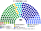
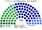
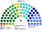
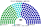
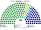
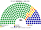
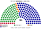
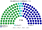

# 席次圖

> **這檔是什麼**：仿維基席次**圖庫**（長期示意；有則附大選重算／現行圖）。席次**數字表**與民調見 [`估計結果.md`](估計結果.md)；大選算法細節見本夾 `*大選重算*`／`*近期大選*` 檔。朝野互動見「預期政治生態」。

`0-基本/總體.md` 要求：給仿維基百科的議會席次圖（如：單一席次、複數席次圖；有政黨／派系議員的圓點顏色為所屬政黨／派系的代表色）。本夾兩個組成都有，所以三張：全院、單一、複數。

數字來自 [`15`](15-預期政治生態.md) 第 3 屆，由 [`生態模型.py`](生態模型.py) 算出。產生器：席次圖產生器。圖上、表下；黨席次一律用表（與 [`估計結果.md`](估計結果.md) 同形）。

## 推估第 3 屆

### 全院 180

### 單一席次 100

### 複數席次 80

| 政黨 | 單一 100 | 複數 80 | **全院** |
|---|--:|--:|--:|
| 中國國民黨 | 61 | 24 | **85** |
| 民主進步黨 | 38 | 28 | **66** |
| 台灣民眾黨 | 1 | 17 | **18** |
| 時代力量 | 0 | 6 | **6** |
| 綠黨與環境團體聯盟 | 0 | 3 | **3** |
| 台灣基進 | 0 | 2 | **2** |

過半 **91**、3/5 **108**。首長由全院選出：民眾黨（兩大黨議員都把它排第二），與國民黨組閣 103 席。

圖例依**派系**分色（國民黨／民進黨服務與政策為母黨色變體），不是整黨一色。單一席次：國民黨服務 49、政策 12；民進黨服務 30、政策 8。複數席次：民進黨政策 17、服務 11；國民黨政策 14、服務 10。

單一席次是全院多數的地基；**行政首長與行政權供給由全院 180 決定**（[`02`](02-行政首長.md)、[`03`](03-行政權預算與供給.md)）。國民黨第一偏好（34%）比民進黨（38%）少，單一卻多 23 席：見 [`15`](15-預期政治生態.md) §2.4。複數過半 **41**、3/5 **48**；基本法與修憲要在複數也過門檻（[`05`](05-法律與法規位階.md) §2.3）。民眾黨 18 席有 17 席在複數層。

## 顏色

兩大黨按派系分色。座位由左至右依政治光譜排列。

## 近期大選重算（[`17`](17-近期大選重算.md)）

### 2024-01 得票套本夾

| 政黨 | 單一 100 | 複數 80 | **全院** |
|---|--:|--:|--:|
| 國民黨 | 56 | 30 | **86** |
| 民進黨 | 35 | 31 | **66** |
| 民眾黨 | 9 | 19 | **28** |

### 2020-01 得票套本夾

| 政黨 | 單一 100 | 複數 80 | **全院** |
|---|--:|--:|--:|
| 民進黨 | 76 | 30 | **106** |
| 國民黨 | 24 | 29 | **53** |
| 民眾黨 | 0 | 10 | **10** |
| 時代力量 | 0 | 7 | **7** |
| 親民黨 | 0 | 3 | **3** |
| 台灣基進 | 0 | 1 | **1** |

### 2016-01 得票套本夾（中位第三＝親民黨）

| 政黨 | 單一 100 | 複數 80 | **全院** |
|---|--:|--:|--:|
| 民進黨 | 85 | 39 | **124** |
| 國民黨 | 15 | 24 | **39** |
| 時代力量 | 0 | 7 | **7** |
| 親民黨 | 0 | 6 | **6** |
| 新黨 | 0 | 4 | **4** |

### 2012-01 得票套本夾（中位第三＝親民黨）

| 政黨 | 單一 100 | 複數 80 | **全院** |
|---|--:|--:|--:|
| 國民黨 | 62 | 37 | **99** |
| 民進黨 | 38 | 30 | **68** |
| 台聯 | 0 | 8 | **8** |
| 親民黨 | 0 | 5 | **5** |

### 現行制度 2024-01 實際結果

