# 估計結果

> **這檔是什麼**：民意套本夾選制的席次**表**（含組閣聯盟／多數派政府）——§1 近期大選、§2 民調、§3 長期。圖庫見 [`席次圖.md`](席次圖.md)；算法見 [`17-近期大選重算.md`](17-近期大選重算.md)（[`近期大選重算.py`](近期大選重算.py)）。朝野互動見 [`15`](15-預期政治生態.md)。

選制：**國民院 150＝單一 120（top-3 孔多賽）＋複數 30（全國聖拉古、無門檻）**；**參議院 75＝6 區比例**。首長、供給、普通法律 ≥76（國民院）；參議院擱置否決；基本法國民院 ≥90 且參議院 ≥50。

## 1 近期大選

| 選舉 | 實際立法院 | **本夾國民院 150** | **本夾參議院 75** | 首長、組閣與規則 |
|---|---|---|---|---|
| 2024 政黨票 | 國民黨 52、民進黨 51、民眾黨 8、無黨籍 2（113） | **國民黨 77、民進黨 55、民眾黨 17、時代力量 1**（單一 國民黨 66、民進黨 44、民眾黨 10；複數 國民黨 11、民進黨 11、民眾黨 7、時代力量 1） | 民進黨 29、國民黨 28、民眾黨 18 | **國民黨**；國民黨＝77；參議院 28；普通法律參議院擱置、國民院 ≥76 重新表決；基本法不可 |
| 2024 總統票 | 國民黨 52、民進黨 51、民眾黨 8、無黨籍 2（113） | **國民黨 70、民進黨 49、民眾黨 30、時代力量 1**（單一 國民黨 59、民進黨 38、民眾黨 23；複數 國民黨 11、民進黨 11、民眾黨 7、時代力量 1） | 民進黨 29、國民黨 28、民眾黨 18 | **民眾黨**；民眾黨＋國民黨＝100；參議院 46；普通法律兩院皆過；基本法不可 |
| 2020 政黨票 | 民進黨 61、國民黨 38、民眾黨 5、時代力量 3、台灣基進 1、無黨籍 5 | **民進黨 106、國民黨 35、民眾黨 4、時代力量 2 …**（單一 民進黨 95、國民黨 25；複數 民進黨 11、國民黨 10、民眾黨 4、時代力量 2 …） | 民進黨 29、國民黨 26、民眾黨 10、時代力量 6、台灣基進 2 … | **民進黨**；民進黨＝106；參議院 29；普通法律參議院擱置、國民院 ≥76 重新表決；基本法不可 |
| 2016 政黨票 | 民進黨 68、國民黨 35、時代力量 5、親民黨 3、無盟 1、無黨籍 1 | **民進黨 118、國民黨 24、時代力量 2、親民黨 2 …**（單一 民進黨 104、國民黨 16；複數 民進黨 14、國民黨 8、時代力量 2、親民黨 2 …） | 民進黨 36、國民黨 22、時代力量 6、親民黨 6、新黨 5 | **民進黨**；民進黨＝118；參議院 36；普通法律參議院擱置、國民院 ≥76 重新表決；基本法不可 |
| 2016 總統票 | 民進黨 68、國民黨 35、時代力量 5、親民黨 3、無盟 1、無黨籍 1 | **民進黨 125、國民黨 17、時代力量 2、親民黨 2 …**（單一 民進黨 111、國民黨 9；複數 民進黨 14、國民黨 8、時代力量 2、親民黨 2 …） | 民進黨 36、國民黨 22、時代力量 6、親民黨 6、新黨 5 | **民進黨**；民進黨＝125；參議院 36；普通法律參議院擱置、國民院 ≥76 重新表決；基本法不可 |
| 2012 政黨票 | 國民黨 64、民進黨 40、台聯 3、親民黨 3、無盟 2、無黨籍 1 | **國民黨 87、民進黨 57、台聯 3、親民黨 2 …**（單一 國民黨 73、民進黨 47；複數 國民黨 14、民進黨 10、台聯 3、親民黨 2 …） | 國民黨 35、民進黨 28、台聯 7、親民黨 5 | **國民黨**；國民黨＝87；參議院 35；普通法律參議院擱置、國民院 ≥76 重新表決；基本法不可 |
| 2012 總統票 | 國民黨 64、民進黨 40、台聯 3、親民黨 3、無盟 2、無黨籍 1 | **國民黨 90、民進黨 54、台聯 3、親民黨 2 …**（單一 國民黨 76、民進黨 44；複數 國民黨 14、民進黨 10、台聯 3、親民黨 2 …） | 國民黨 35、民進黨 28、台聯 7、親民黨 5 | **國民黨**；國民黨＝90；參議院 35；普通法律參議院擱置、國民院 ≥76 重新表決；基本法不可 |

### 2024-01（政黨票）

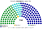

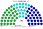

| 政黨 | 國民院單一 120 | 國民院複數 30 | **國民院 150** | **參議院 75** |
|---|--:|--:|--:|--:|
| 國民黨 | 66 | 11 | **77** | **28** |
| 民進黨 | 44 | 11 | **55** | **29** |
| 民眾黨 | 10 | 7 | **17** | **18** |
| 時代力量 | 0 | 1 | **1** | **0** |
| **合計** | **120** | **30** | **150** | **75** |

**組閣聯盟／多數派政府**：首長 **國民黨**；**國民黨＝77**（參議院 28）。普通法律：參議院擱置、國民院 ≥76 重新表決。基本法：不可。兩黨組合（國民院／參議院）：民進黨＋國民黨 132／57（可）；民進黨＋民眾黨 72／47（不可）；國民黨＋民眾黨 94／46（不可）。

### 2020-01（政黨票）

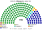

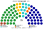

| 政黨 | 國民院單一 120 | 國民院複數 30 | **國民院 150** | **參議院 75** |
|---|--:|--:|--:|--:|
| 民進黨 | 95 | 11 | **106** | **29** |
| 國民黨 | 25 | 10 | **35** | **26** |
| 民眾黨 | 0 | 4 | **4** | **10** |
| 時代力量 | 0 | 2 | **2** | **6** |
| 台灣基進 | 0 | 1 | **1** | **2** |
| 親民黨 | 0 | 1 | **1** | **2** |
| 綠黨 | 0 | 1 | **1** | **0** |
| **合計** | **120** | **30** | **150** | **75** |

**組閣聯盟／多數派政府**：首長 **民進黨**；**民進黨＝106**（參議院 29）。普通法律：參議院擱置、國民院 ≥76 重新表決。基本法：不可。兩黨組合（國民院／參議院）：民進黨＋國民黨 141／55（可）；民進黨＋民眾黨 110／39（不可）；民進黨＋親民黨 107／31（不可）；國民黨＋民眾黨 39／36（不可）；國民黨＋親民黨 36／28（不可）；民眾黨＋親民黨 5／12（不可）。

### 2016-01（政黨票）

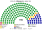

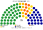

| 政黨 | 國民院單一 120 | 國民院複數 30 | **國民院 150** | **參議院 75** |
|---|--:|--:|--:|--:|
| 民進黨 | 104 | 14 | **118** | **36** |
| 國民黨 | 16 | 8 | **24** | **22** |
| 時代力量 | 0 | 2 | **2** | **6** |
| 親民黨 | 0 | 2 | **2** | **6** |
| 新黨 | 0 | 1 | **1** | **5** |
| 綠黨社會民主黨聯盟 | 0 | 1 | **1** | **0** |
| 信心希望聯盟 | 0 | 1 | **1** | **0** |
| 台聯 | 0 | 1 | **1** | **0** |
| **合計** | **120** | **30** | **150** | **75** |

**組閣聯盟／多數派政府**：首長 **民進黨**；**民進黨＝118**（參議院 36）。普通法律：參議院擱置、國民院 ≥76 重新表決。基本法：不可。兩黨組合（國民院／參議院）：民進黨＋國民黨 142／58（可）；民進黨＋親民黨 120／42（不可）；國民黨＋親民黨 26／28（不可）。

### 2012-01（政黨票）

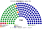

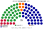

| 政黨 | 國民院單一 120 | 國民院複數 30 | **國民院 150** | **參議院 75** |
|---|--:|--:|--:|--:|
| 國民黨 | 73 | 14 | **87** | **35** |
| 民進黨 | 47 | 10 | **57** | **28** |
| 台聯 | 0 | 3 | **3** | **7** |
| 親民黨 | 0 | 2 | **2** | **5** |
| 綠黨 | 0 | 1 | **1** | **0** |
| **合計** | **120** | **30** | **150** | **75** |

**組閣聯盟／多數派政府**：首長 **國民黨**；**國民黨＝87**（參議院 35）。普通法律：參議院擱置、國民院 ≥76 重新表決。基本法：不可。兩黨組合（國民院／參議院）：民進黨＋國民黨 144／63（可）；民進黨＋親民黨 59／33（不可）；國民黨＋親民黨 89／40（不可）。

## 2 民調

2024 村里地理，三黨按民調比例縮放（[`近期大選重算.py`](近期大選重算.py) `POLLS_2026`）。

| 民調 | 國民院 150 | 單一 120 | 參議院 75 | 首長 | 組閣 |
|---|---|---|---|---|---|
| 美麗島電子報（2026-09-29..10-02，喜好度） | 民進黨 98、國民黨 28、民眾黨 24 | 民進黨 84、國民黨 19、民眾黨 17 | 民進黨 36、國民黨 21、民眾黨 18 | **民進黨** | 民進黨＝98 |
| 戴立安／畢肯（2026-10-20..22，好感度） | 民進黨 78、民眾黨 49、國民黨 23 | 民進黨 64、民眾黨 41、國民黨 15 | 民進黨 36、國民黨 20、民眾黨 19 | **民進黨** | 民進黨＝78 |

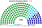

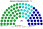

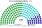

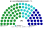

## 3 長期運行假設下（推估第 3 屆）

2024 地理；民進黨、國民黨各讓出 1/8 第一偏好給民眾黨（`python 近期大選重算.py --projection`）。派系拆分是**假設**（沿用舊夾第 3 屆比例）：單一席次 77% 地方服務派、比例名單（國民院複數與參議院）41%。

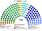

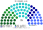

| 政黨 | 國民院單一 120 | 國民院複數 30 | **國民院 150** | **參議院 75** |
|---|--:|--:|--:|--:|
| 民眾黨 | 75 | 10 | **85** | **26** |
| 國民黨 | 32 | 10 | **42** | **25** |
| 民進黨 | 13 | 10 | **23** | **24** |
| **合計** | **120** | **30** | **150** | **75** |

| 派系 | 國民院單一 | 國民院複數 | 參議院 |
|---|--:|--:|--:|
| 民進黨・地方服務派 | 10 | 4 | 10 |
| 民進黨・國會政策派 | 3 | 6 | 14 |
| 國民黨・地方服務派 | 25 | 4 | 10 |
| 國民黨・國會政策派 | 7 | 6 | 15 |
| 台灣民眾黨 | 75 | 10 | 26 |

首長 **民眾黨**，單獨 85；參議院 26（不過半，普通法律走擱置否決後的重新表決）。基本法：民進黨＋國民黨 65／49（不可）；民進黨＋民眾黨 108／50（可）；國民黨＋民眾黨 127／51（可）。
