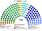
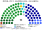
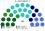
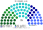

# 席次圖

> **這檔是什麼**：仿維基席次**圖庫**（長期示意；有則附大選重算／現行圖）。席次**數字表**與民調見 [`估計結果.md`](估計結果.md)；大選算法細節見本夾 `*大選重算*`／`*近期大選*` 檔。朝野互動見「預期政治生態」。

數字來自 [`15`](15-預期政治生態.md) 第 3 屆（國民院 150，非一院 180 縮放抄表）。產生器：席次圖產生器。座位由左至右依政治光譜排列。

## 國民院（推估第 3 屆）

### 全院 150

### 單一席次 90

### 複數席次 60

| 政黨 | 單一 90 | 複數 60 | **全院** |
|---|--:|--:|--:|
| 民進黨 | 44 | 17 | **61** |
| 國民黨 | 36 | 16 | **52** |
| 民眾黨 | 5 | 11 | **16** |
| 時代力量 | 1 | 6 | **7** |
| 基進 | 1 | 4 | **5** |
| 無黨籍／地方 | 3 | 2 | **5** |
| 綠黨與環境團體聯盟 | 0 | 4 | **4** |

過半 **76**、3/5 **90**。兩大黨相加 **113**。首長與供給由國民院單一表決（[`02`](02-行政首長.md)、[`03`](03-行政權預算與供給.md)）：民進黨 44＋民眾黨 5＝49。綠黨聯盟 4 席全在複數。

## 參議院 75

| 政黨 | **全院** |
|---|--:|
| 民進黨 | **20** |
| 國民黨 | **19** |
| 民眾黨 | **15** |
| 時代力量 | **8** |
| 基進 | **5** |
| 綠黨與環境團體聯盟 | **5** |
| 無黨籍／地方 | **3** |

過半 **38**、3/5 **45**。參議院民選、不掌行政；普通法律要它同意，並共決基本法與修憲（[`01b`](01b-參議院組成與選制.md)、[`05`](05-法律與法規位階.md)）。

## 顏色

兩大黨按派系分色（母黨色變體）；無黨籍／地方用灰。
