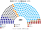
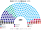

# 近期大選套新制

> **這檔是什麼**：近期大選得票**怎麼**套進本夾選制（方法、假設、對照）。席次一覽與圖見 [`估計結果.md`](估計結果.md) §1、[`席次圖.md`](席次圖.md)。

拿 2025-10、2021-10 兩次眾議院選舉，以及 2023 年總統、2026 年參議院選舉，用**當時實際的民意**套本夾的規則，再推到 2026-10。數字由 [`生態模型.py`](生態模型.py) 算出；推演是推測，標為推測。

## 1 方法

### 1.1 資料

| 項目 | 來源 |
|---|---|
| 2025-10 眾議院 | volby.cz 開放資料**逐投票區**（14,816 個，含海外；[`資料/ps-2025.csv`](資料/ps-2025.csv)）：ANO 34.51、SPOLU 23.36、STAN 11.23、Piráti 8.97、SPD 7.78、AUTO 6.77、Stačilo! 4.31 |
| 2021-10 眾議院 | 同上，14,883 個投票區（[`資料/ps-2021.csv`](資料/ps-2021.csv)）：SPOLU 27.79、ANO 27.12、PirSTAN 15.62、SPD 9.56、Přísaha 4.68、ČSSD 4.65、KSČM 3.60 |
| 人口 | 2026-01-01 各州人口（分配各州單一選區數）|
| 市鎮座標 | Wikidata（捷克市鎮代碼 P7606 的 P625）；布拉格等市轄區用所屬城市座標，區內依市轄區碼、投票區號排序 |
| 2023 總統 | 現實：SPOLU 支持的無黨籍候選人決選 58.3% | 主版（2021 名單票）：**ANO**（對 SPOLU 53.3%、對 PirSTAN 52.3%） |
| 兩兩對決民調 | 2022-12 至 2023-01 的 ANO 的候選人 對 無黨籍候選人乙、SPOLU 支持的無黨籍候選人 對 無黨籍候選人乙 各 7 筆 |

### 1.2 驗證

逐投票區加總與官方全國結果一致（ANO 34.52%、SPOLU 23.36%；2021 SPOLU 27.79%、ANO 27.13%）。只有 1 個市鎮（561533）在 Wikidata 找不到座標而略去，約 0.02% 的票。

### 1.3 校準

| 對決 | 實際或民調 | 模型 |
|---|---|---|
| SPOLU 支持的無黨籍候選人 對 ANO 的候選人 | 實際決選 58.3% | 58.9% |
| 無黨籍候選人乙 對 ANO 的候選人 | 民調 57–64% | 59.3% |
| SPOLU 支持的無黨籍候選人 對 無黨籍候選人乙 | 民調 2023-01：50–56% | 53.0% |

選民類型沿用羅馬尼亞夾校準出的「重地緣型占一半」；SPOLU 支持的無黨籍候選人、無黨籍候選人乙 的位置以民調網格搜尋決定。

## 2 眾議院

### 2.1 2025-10

| 政黨 | 得票 | 現實 200 | **新制：單一 110** | **新制：複數 90** | **新制：200** |
|---|--:|--:|--:|--:|--:|
| ANO | 34.51 | 80 | 79 | 31 | **110** |
| SPOLU | 23.36 | 52 | 17 | 21 | **38** |
| STAN | 11.23 | 22 | 13 | 11 | **24** |
| Piráti | 8.97 | 18 | 1 | 9 | **10** |
| SPD | 7.78 | 15 | 0 | 8 | **8** |
| AUTO | 6.77 | 13 | 0 | 8 | **8** |
| Stačilo! | 4.31 | 0 | 0 | 2 | **2** |
| 陣營 | 得票 | 現實 | 新制 |
|---|--:|--:|--:|
| ANO | 34.5% | 80（40%） | 110（55%） |
| 親西方反對黨（SPOLU、STAN、Piráti） | 43.6% | 92（46%） | 72（36%） |
| 主權派（SPD、AUTO、Stačilo!） | 18.9% | 28（14%） | 18（9%） |

| 組閣 | 現實 | 新制 |
|---|---|---|
| 總理 | Babiš，2025-12-09 任命（選後 66 天） | Babiš（ANO 的人選），眾議院集會後 30 日內選出 |
| 執政聯盟 | ANO＋SPD＋AUTO（108） | **ANO 單獨**（110），或為穩定拉 STAN（134） |
| 信任 | 2026-01-15 信任投票 108 比 91 | 不需要：選出即有信任 |

### 2.2 2021-10

| 政黨 | 得票 | 現實 200 | **新制：單一 110** | **新制：複數 90** | **新制：200** |
|---|--:|--:|--:|--:|--:|
| ANO | 27.12 | 72 | 79 | 27 | **106** |
| PirSTAN | 15.62 | 37 | 31 | 13 | **44** |
| SPOLU | 27.79 | 71 | 0 | 27 | **27** |
| SPD | 9.56 | 20 | 0 | 8 | **8** |
| ČSSD | 4.65 | 0 | 0 | 7 | **7** |
| Přísaha | 4.68 | 0 | 0 | 7 | **7** |
| KSČM | 3.60 | 0 | 0 | 1 | **1** |
**現實**：SPOLU＋PirSTAN 108 席，Fiala 組閣。**新制**：ANO 106 席，**Babiš 續任**。

★ 為什麼會反過來：見 [`12`](12-預期政治生態.md) §5.2。現行制度讓約 43% 的得票拿到 108 席，因為約兩成的選票（多半偏向 ANO 一側的小黨）因門檻落空；新制讓孔多賽贏家拿到過半，而 2021 年的孔多賽贏家是 ANO。

★ SPOLU 在單一選區 0 席：它在 ANO 與 PirSTAN 之間，兩邊的選民都把它排第二，但很少排第一。

## 3 總統 2023

民意層＝國會名單票（政黨層級），不用現實總統第一輪（受棄保、退選影響）、不用個別候選人；參選方層＝每個參選方可推人，相鄰政黨在新制誘因下可共同提名；前 3 名、6 格排序、孔多賽。（方法：[`選舉結果計算方式`](../../../notes/算法/選舉結果計算方式.md)）

| | **主版：2021-10 眾議院名單票** | 現實 |
|---|---|---|
| 前三 | SPOLU 27.8%、ANO 27.1%、PirSTAN 15.6% | SPOLU 支持的無黨籍候選人、ANO、無黨籍 |
| 勝者 | **ANO**：對 SPOLU 53.3%、對 PirSTAN 52.3% | SPOLU 支持的無黨籍候選人（58.3%） |
| 敏感度 | 全部重地緣：ANO；全部重社經：**PirSTAN** | — |

★ 2023 年的現實勝者是無黨籍、靠跨黨背書；以政黨為單位時沒有這個人選，三個參選方都在 50–53% 的刀口上，ANO 小勝。選民更重社經時是 PirSTAN。

## 4 參議院 2026-10

| | 現實 | **新制（推測）** |
|---|---|---|
| 投票日 | 第一輪與市鎮選舉同日（10-09/10），**決選單獨舉行**（10-16/17） | 第一輪 A 日，**決選與市鎮議會同日**（B 日） |
| 結果 | ANO 0／27，執政黨史上第一次一席未得 | **ANO 會拿下一部分**：模型以 2025 年民意全院改選是 ANO 63／81；2026 年 ANO 的民調（Median 5–6 月約 34–35%）和 2025 年接近 |

★ 這是本夾最明顯的取捨（[`12`](12-預期政治生態.md) §5.3）：**提高決選投票率，代價是參議院不再是反對黨的據點**。

## 5 走向：2025-10 到 2026-10

**推測。** 每個時點用當時的民意。

| 時點 | 現實 | **新制** |
|---|---|---|
| 2025-10 至 12 | Pavel 要求 Babiš 先處理 Agrofert；12-04 Babiš 宣布交付信託；12-09 任命 | 眾議院集會後 30 日內選出 Babiš。利益衝突由**審計院**依組織法認定：Babiš 同樣得在就任前交付信託，**但這是規則，不是總統的條件** |
| 2025-12 | ANO＋SPD＋AUTO 組閣 | ANO 單獨 110 席；SPD、AUTO 不是必要夥伴 |
| 2026-01 | Pavel 拒絕任命 Turek（Motorists） | Turek 大概不會被提名（ANO 不需要 Motorists）；即使被提名，總統 7 日內必須公布，爭議回到眾議院 |
| 2026-01-15 | 信任投票 108 比 91 | 不需要 |
| 2026-02 | 兩次不信任案，都失敗 | 反對黨要提**建設性更新**並具名繼任者，合計 90 席不夠 101，**不會提** |
| 2026-07 | 政府把總統排除在北約峰會代表團外，總統提權限訴訟 | **代表團由政府決定**，寫在憲法裡，沒有訴訟 |
| 2026 | 政府計畫取消收視費、改由預算撥款 | 公共媒體財源是組織法事項，ANO 的複數 31 席**改不了**，要拉 SPOLU 和 STAN |
| 2026-10 | 參議院 ANO 0／27 | ANO 拿下部分席次（§4） |

## 6 對照

| 指標（2025-10 到 2026-10） | 現實 | 新制 |
|---|---|---|
| 選後到總理就任 | 66 天 | ≤30 天（集會後） |
| 執政聯盟是否需要主權派 | 是（SPD、AUTO） | **否** |
| 總統與政府的公開衝突 | 利益衝突、Turek、北約峰會三次 | 規則化，無裁量空間 |
| 不信任案 | 2 次（失敗） | 0 次 |
| 參議院決選投票率 | 低（單獨舉行） | 高（與市鎮議會同日） |

## 7 限制與出處

- **偏好位置是假設**：ANO 是否真的在地緣軸中間，決定了大半結果。
- **參議院用全院同時改選模擬**；現實是每次改選 1/3，選區也不同。
- **策略行為沒有建模**：政黨會因新制改變提名、結盟和訊息。
- **2026 年沒有完整的全國民調**：只看到 Median 2026-05、06 的部分數字。
- **不論轉型可行性**。

| 數字 | 出處 |
|---|---|
| 2025、2021 逐投票區得票 | volby.cz 開放資料（PS2025data20251005、PS2021_data_20211010；pst4p＋psrkl＋pscoco） |
| 各州人口 | Wikipedia Regions of the Czech Republic（引捷克統計局 2026-01-01） |
| 2023 總統、民調 | Wikipedia 2023 Czech presidential election；Opinion polling for the 2023 Czech presidential election |
| 2025–26 政治事件 | Expats.cz、Radio Prague、Euronews、Reuters、CIVICUS、TVP World |
| 2026 參議院 | Wikipedia 2026 Czech Senate election；Expats.cz |
| OECD 對檢察獨立的意見 | OECD 2023-11 新聞稿 |
