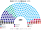
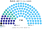
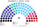
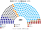
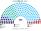
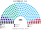
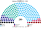
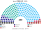
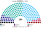

# 估計結果

> 近期大選與民調的民意套進本夾後的席次、首長、組閣與朝野互動。圖庫見 [`席次圖.md`](席次圖.md)。

選制摘要：眾議院 **200＝單一 110（top-3 孔多賽）＋複數 90（聖拉古、無法定門檻）**。詳 [`01`](01-國會與選制.md)。

## 計算方式

| 層 | 做法 |
|---|---|
| 民意層 | volby.cz 逐投票區眾議院名單票（2025 年 14,816 個、2021 年 14,883 個）。現行是比例名單，棄保失真小 |
| 參選方層 | 每黨都可推人；地方性政黨只在本地參選；相鄰政黨在合起來能進前 3、且雙方都偏好合併後勝者時共同提名（席次圖產生器）；SPOLU、PirSTAN 等現行聯盟視為一個參選方 |
| 眾議院單一 110 | 依州人口配額，州內依市鎮座標的 Hilbert 曲線排序、按有效票連續切；前 3 名、全體選民完整排序兩兩對決，循環用 Ranked Pairs。選民排序由各黨在地緣、文化兩軸的位置推得 |
| 眾議院複數 90 | 各州聖拉古、無法定門檻 |
| 參議院 81 | 假設以同一次眾議院民意全部改選；81 區 top-3 孔多賽 |
| 首長、組閣 | 眾議院 200 記名排名，孔多賽；組閣由首長往外依政策距離加黨到 ≥101 |
| 民調 | 全國投票意向，以 2025 投票區地理縮放；ODS、TOP09、KDU 併入 SPOLU |

程式：[`生態模型.py`](生態模型.py)、[`民調推估.py`](民調推估.py)；細節見 [`14`](14-近期大選重算.md)、共同算法 [`選舉結果計算方式`](../../../notes/算法/選舉結果計算方式.md)。

## 1 近期大選

用 volby.cz **逐投票區**（約 14,800 個）得票套本夾。細節見 [`14-近期大選重算.md`](14-近期大選重算.md)。

| | 現實 200 | **本夾眾議院 200** |
|---|---|---|
| 2025-10 | ANO 80、SPOLU 52、STAN 22、Piráti 18 … | **ANO 110**、SPOLU 38、STAN 24、Piráti 10、SPD 8、AUTO 8、Stačilo! 2 |
| 2021-10 | SPOLU＋PirSTAN 執政 | **ANO 106**、PirSTAN 44、SPOLU 27 …（Babiš 續任） |

### 2025-10 眾議院單一／複數

| 政黨 | 單一 110 | 複數 90 | **眾議院** |
|---|--:|--:|--:|
| ANO | 79 | 31 | **110** |
| SPOLU | 17 | 21 | **38** |
| STAN | 13 | 11 | **24** |
| Piráti | 1 | 9 | **10** |
| SPD | 0 | 8 | **8** |
| AUTO | 0 | 8 | **8** |
| Stačilo! | 0 | 2 | **2** |

**組閣聯盟／多數派政府**：首長 **ANO**；ANO **110**≥過半 101；參院示意 ANO 63／81。

**預期政治生態**：ANO 單獨執政，不必找 SPD、汽車黨等夥伴。SPOLU 38、STAN 24 領導反對；參議院若同一天改選也是 ANO 多數，參議院不再是反對黨的據點，制衡改靠組織法的兩種多數：ANO 複數只有 31，不到 54，改不了選制、法院、公共媒體。

### 2021-10 眾議院單一／複數

| 政黨 | 單一 110 | 複數 90 | **眾議院** |
|---|--:|--:|--:|
| ANO | 79 | 27 | **106** |
| PirSTAN | 31 | 13 | **44** |
| SPOLU | 0 | 27 | **27** |
| SPD | 0 | 8 | **8** |
| ČSSD | 0 | 7 | **7** |
| Přísaha | 0 | 7 | **7** |
| KSČM | 0 | 1 | **1** |

**組閣聯盟／多數派政府**：首長 **ANO** 續任；ANO **106**≥101。

**預期政治生態**：現實中 SPOLU 與 PirSTAN 兩個聯盟合組政府、ANO 在野；本夾結果相反，ANO 單獨過半。SPOLU、PirSTAN 合計 71 席，換不掉 ANO；兩個中右聯盟的選民在單一席次互相排第二，但輸給 ANO 的地方優勢。

## 2 民調

方法：民調得票率當全國第一偏好，以 2025-10 **逐投票區**地理縮放（[`民調推估.py`](民調推估.py)、[`資料/polls.csv`](資料/polls.csv)）——**單一 110** top-3 孔多賽、**複數 90** 聖拉古（不是全國比例拆單一）。民調把 SPOLU 拆成 ODS／TOP／KDU 者，模型合併為 **SPOLU**；其餘小黨併入「其他」。

### STEM（2026-10-01..06，n＝1332）

得票推估（ODS＋TOP09＋KDU→SPOLU）

首長 **ANO**。

| 政黨 | 得票推估% | 單一 110 | 複數 90 | 眾議院 200 |
|---|--:|--:|--:|--:|
| ANO | 31.3% | 78 | 32 | **110** |
| STAN | 16.6% | 32 | 18 | **50** |
| SPOLU | 17.5% | 0 | 18 | **18** |
| Piráti | 7.2% | 0 | 9 | **9** |
| SPD | 7.5% | 0 | 8 | **8** |
| AUTO | 4.6% | 0 | 4 | **4** |
| Stačilo | 3.3% | 0 | 1 | **1** |
| 其他 | 8.4% | 0 | 0 | **0** |
### NMS（2026-10-01..05，n＝1034）

得票推估（ODS＋TOP09＋KDU→SPOLU）

首長 **ANO**。

| 政黨 | 得票推估% | 單一 110 | 複數 90 | 眾議院 200 |
|---|--:|--:|--:|--:|
| ANO | 28.8% | 70 | 27 | **97** |
| STAN | 18.8% | 40 | 19 | **59** |
| SPOLU | 18.7% | 0 | 19 | **19** |
| SPD | 8% | 0 | 8 | **8** |
| Piráti | 6.3% | 0 | 8 | **8** |
| AUTO | 5.7% | 0 | 8 | **8** |
| Stačilo | 3% | 0 | 1 | **1** |
| 其他 | 8.4% | 0 | 0 | **0** |
### Median（2026-09-01..30，n＝1018）

得票推估（ODS＋TOP09＋KDU→SPOLU）

首長 **ANO**。

| 政黨 | 得票推估% | 單一 110 | 複數 90 | 眾議院 200 |
|---|--:|--:|--:|--:|
| ANO | 29.5% | 71 | 28 | **99** |
| STAN | 17% | 39 | 18 | **57** |
| SPOLU | 19% | 0 | 20 | **20** |
| Piráti | 7.5% | 0 | 9 | **9** |
| SPD | 9% | 0 | 8 | **8** |
| AUTO | 5% | 0 | 7 | **7** |
| 其他 | 6% | 0 | 0 | **0** |
| Stačilo | 2% | 0 | 0 | **0** |
### Ipsos（2026-09-08..12，n＝1084）

得票推估（ODS＋TOP09＋KDU→SPOLU）

首長 **ANO**。

| 政黨 | 得票推估% | 單一 110 | 複數 90 | 眾議院 200 |
|---|--:|--:|--:|--:|
| ANO | 31.4% | 70 | 31 | **101** |
| STAN | 16.6% | 40 | 17 | **57** |
| SPOLU | 20.4% | 0 | 20 | **20** |
| Piráti | 7.9% | 0 | 9 | **9** |
| SPD | 7.1% | 0 | 8 | **8** |
| AUTO | 4.5% | 0 | 4 | **4** |
| Stačilo | 3.4% | 0 | 1 | **1** |
| 其他 | 5.9% | 0 | 0 | **0** |
### Kantar（2026-08-03..21，n＝991）

得票推估（ODS＋TOP09＋KDU→SPOLU）

首長 **STAN**。

| 政黨 | 得票推估% | 單一 110 | 複數 90 | 眾議院 200 |
|---|--:|--:|--:|--:|
| STAN | 17% | 61 | 17 | **78** |
| ANO | 30.5% | 49 | 28 | **77** |
| SPOLU | 21% | 0 | 21 | **21** |
| Piráti | 8.5% | 0 | 9 | **9** |
| SPD | 6.5% | 0 | 8 | **8** |
| AUTO | 5% | 0 | 7 | **7** |
| 其他 | 2.5% | 0 | 0 | **0** |
| Stačilo | 0% | 0 | 0 | **0** |

### 民調的預期政治生態

- **STEM、Ipsos**：ANO 單獨 101–110 席，格局同 2025 大選。
- **NMS、Median**：ANO 97–99 席，差 2–4 席，要拉一個小黨（SPD 或汽車黨），小黨的要價空間大。
- **Kantar**：**STAN 當首長**（78 席，對 ANO 108:92），ANO 77 席幾乎同票卻在野：SPOLU、海盜黨的議員都把 STAN 排在 ANO 前面。STAN 的單一席次多來自地方首長型的候選人，政府會偏向地方分權議題；ANO 是勢均力敵的反對黨，隨時可以拉攏任何一個中間小黨挑戰首長。
- 五份民調下 SPOLU 都只有 18–21 席、單一 0 席：中右的票被 STAN 吸走。

## 3 長期運行假設下

生態以 **2025-10 得票套新制** 為眾議院示意（[`12-預期政治生態.md`](12-預期政治生態.md) §3）。

| 政黨 | 單一 110 | 複數 90 | **眾議院 200** |
|---|--:|--:|--:|
| ANO | 79 | 31 | **110** |
| SPOLU | 17 | 21 | **38** |
| STAN | 13 | 11 | **24** |
| Piráti | 1 | 9 | **10** |
| SPD | 0 | 8 | **8** |
| AUTO | 0 | 8 | **8** |
| Stačilo! | 0 | 2 | **2** |

**預期政治生態**：同 2025 大選；誘因與候選人行為見 [`12-預期政治生態.md`](12-預期政治生態.md)。
